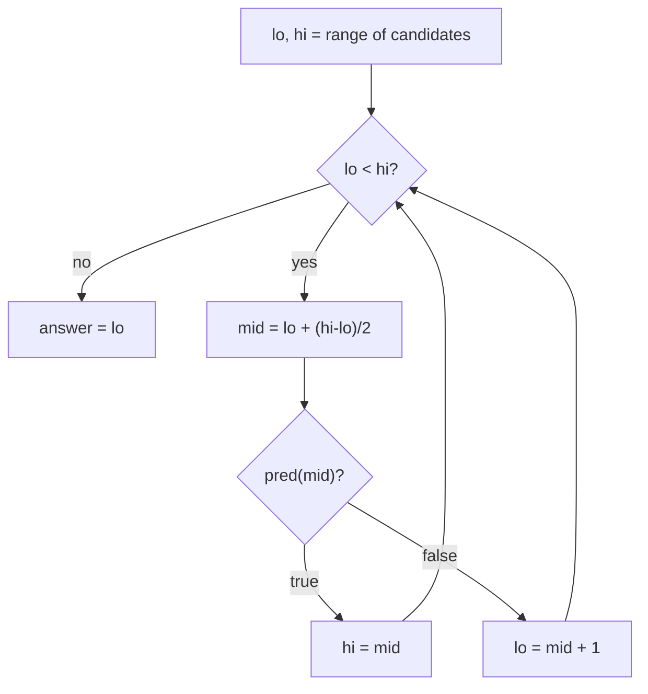

# 07 — Binary Search

Binary search is not really about sorted arrays. It works whenever you can ask a
yes/no question whose answers look like `false false false true true true`
and you want the boundary. A sorted array is just the most common source of
such a question.

## What you'll learn

- One loop template (half-open `[lo, hi)`) that gives lower bound, upper bound,
  insert position, and first/last occurrence without off-by-one guessing.
- How the standard library does it: `sort.Search`, `slices.BinarySearch`,
  `slices.BinarySearchFunc`.
- Searching *structures* that are not plainly sorted: rotated arrays, 2D
  matrices, two arrays at once.
- **Binary search on the answer**: guess a value, check feasibility, halve.

## Recognize the pattern

- Input is sorted (or sorted in pieces, e.g. rotated) and the target is O(log n).
- "Find the first/last/minimum/maximum X such that ..."
- "Minimum speed / capacity / time / largest minimum distance so that it's
  still possible to ...": the answer space is a range of integers and
  feasibility is monotone. That's binary search on the answer.
- n is huge (10^9 values, 10^18 bounds) but checking one candidate is cheap.

## The idea

Keep an interval that **always contains the answer** and shrink it by half.
With the half-open convention the answer is in `[lo, hi]` (inclusive of `hi`
because "not found" = `len(xs)`), the loop runs while `lo < hi`, and at exit
`lo == hi` is the answer.

Lower bound of `6` in `[1, 3, 5, 6, 6, 8]`:

```
idx:   0  1  2  3  4  5
val:   1  3  5  6  6  8      pred(i) = val[i] >= 6
pred:  F  F  F  T  T  T      we want the first T

lo=0 hi=6  mid=3  T -> hi=3     (mid might be the answer: keep it)
lo=0 hi=3  mid=1  F -> lo=2     (mid is definitely not: skip it)
lo=2 hi=3  mid=2  F -> lo=3
lo=3 hi=3  stop -> answer 3
```



Every problem in this module is a choice of **(range, predicate)**:

| Problem | Range | Predicate |
|---|---|---|
| Insert position | `[0, n]` | `nums[i] >= target` |
| Last position | `[0, n]` | `nums[i] > target`, then `-1` |
| Min in rotated | `[0, n-1]` | `nums[i] <= nums[n-1]` |
| Koko | `[1, max]` | `hours(k) <= h` |
| Median of two | `[0, m]` | partition `i` is not too small |

## Go template

```go
// First index in [lo, hi) where pred is true; hi if none.
func firstTrue(lo, hi int, pred func(int) bool) int {
	for lo < hi {
		mid := lo + (hi-lo)/2
		if pred(mid) {
			hi = mid
		} else {
			lo = mid + 1
		}
	}
	return lo
}

// Standard library equivalents:
i := sort.Search(len(xs), func(i int) bool { return xs[i] >= target })
i, found := slices.BinarySearch(xs, target)
```

See [binarysearch.go](binarysearch.go) for generic `LowerBound`, `UpperBound`
and `FirstTrue`.

## Complexity

| Use | Time | Space |
|---|---|---|
| Search a sorted array | O(log n) | O(1) |
| Binary search on the answer over range R, check costs C | O(C · log R) | O(1) + check |
| Median of two sorted arrays | O(log min(m, n)) | O(1) |

## Common pitfalls

- **Mixing conventions.** Closed `[lo, hi]` uses `lo <= hi` and `hi = mid - 1`;
  half-open `[lo, hi)` uses `lo < hi` and `hi = mid`. Mixing them gives infinite
  loops or skipped elements. Pick one (this course uses half-open for bounds).
- **Infinite loop with `lo = mid`.** With `mid = lo + (hi-lo)/2` (rounds down),
  the update must be `lo = mid + 1`. If you need `lo = mid`, round up:
  `mid = lo + (hi-lo+1)/2`.
- **Overflow.** `(lo + hi) / 2` can overflow on large bounds; `lo + (hi-lo)/2`
  cannot. Go's `int` is 64-bit on most platforms, but the habit matters, and
  it bites with `int32`.
- **Non-monotone predicate.** Binary search silently returns garbage if pred
  goes `F T F T`. Say *why* it's monotone before coding.
- **Rotated arrays with duplicates.** `nums[lo] == nums[mid] == nums[hi]` tells you
  nothing, so you must shrink by one (worst case O(n)). The versions here assume
  distinct values.
- **Go: `sort.Search` returns `n` when not found**, so always bounds-check
  before indexing: `if i < len(xs) && xs[i] == target`.
- **Go: ceiling division.** `(p + k - 1) / k` for positive ints; avoid
  `math.Ceil(float64(p)/float64(k))` and its float rounding.

## Problems

| # | Problem | Difficulty | Key idea |
|---|---|---|---|
| 01 | [Binary Search](p01_binary_search.go) | Easy | Closed-interval exact match, or lower bound + check |
| 02 | [Search Insert Position](p02_search_insert.go) | Easy | It's the lower bound |
| 03 | [First and Last Position](p03_first_last_position.go) | Medium | Lower bound and upper bound − 1 |
| 04 | [Search a 2D Matrix](p04_search_2d_matrix.go) | Medium | Flat index k → (k/n, k%n) |
| 05 | [Find Minimum in Rotated Sorted Array](p05_find_min_rotated.go) | Medium | Compare mid with the right end |
| 06 | [Search in Rotated Sorted Array](p06_search_rotated.go) | Medium | One half is always sorted; check if target is inside it |
| 07 | [Koko Eating Bananas](p07_koko_bananas.go) | Medium | Binary search on the answer (speed) |
| 08 | [Median of Two Sorted Arrays](p08_median_two_sorted.go) | Hard | Binary search the partition of the shorter array |

## Practice tip

Hide the solution and re-derive each problem as a **(range, predicate)** pair
before writing any loop. Then run only that problem's tests:

```sh
go test ./course/07-binary-search/ -run TestSearchRotated -v
```

Each randomized test checks your version against a linear brute force, which
is a good way to find off-by-one bugs.

## Next

[08 — Linked Lists](../08-linked-lists/)
