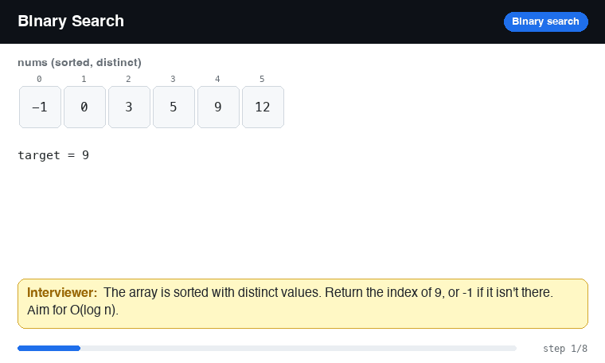

# Walkthrough: Binary Search

**Module:** [07 · Binary Search](../README.md) · **Difficulty:** Easy · **Solution:** [`p01_binary_search.go`](../p01_binary_search.go)



## The problem in plain words

You get a sorted list of distinct numbers and a target. Return the position of the target, or -1 if it isn't there. Do it in O(log n), not by checking every cell.

```
nums = [-1, 0, 3, 5, 9, 12], target = 9  →  4
nums = [-1, 0, 3, 5, 9, 12], target = 2  →  -1
```

## Mock interview

**Interviewer:** The array is sorted ascending with distinct values. Return the index of the target, or -1. Aim for O(log n).

**Candidate:** Quick checks: indices are 0-based, values are distinct, and an empty array should return -1?

**Interviewer:** Yes to all three.

**Candidate:** With `[-1, 0, 3, 5, 9, 12]` and target 9 the answer is 4. With target 2 it's -1, because 2 falls between 0 and 3. Edge cases: an empty array, a one-element array, and targets smaller or bigger than everything.

**Candidate:** The simple solution scans left to right. That's O(n) time and O(1) space, and it ignores the sorting.

**Interviewer:** How does the sorting help?

**Candidate:** If I look at the middle value and it's smaller than the target, everything to its left is smaller too. So one comparison throws away half the array. I keep a closed interval `[lo, hi]` of indices that could still hold the target. At each step I compare `nums[mid]` with the target: equal means return `mid`, smaller means `lo = mid + 1`, bigger means `hi = mid - 1`.

**Interviewer:** Why `mid + 1` and `mid - 1`, not `mid`?

**Candidate:** Because I already checked `mid` and it isn't the target. With a closed interval, keeping `mid` could leave `lo == hi == mid` forever. Skipping it makes the interval strictly smaller every time.

**Candidate:** In code: `lo, hi := 0, len(nums)-1`, loop `for lo <= hi`, compute `mid := lo + (hi-lo)/2`, and `switch` on the comparison. After the loop, return -1.

**Candidate:** On the example: `[0, 5]`, mid 2 holds 3, too small, so `lo = 3`. `[3, 5]`, mid 4 holds 9, found, return 4. For target 2: mid 2 holds 3, too big, `hi = 1`. mid 0 holds -1, too small, `lo = 1`. mid 1 holds 0, too small, `lo = 2`. Now `lo > hi`, so I return -1.

**Interviewer:** Complexity?

**Candidate:** The interval halves each step, so at most about log₂ n + 1 steps. **O(log n) time, O(1) space.**

## What the animation shows

| Step | What happens |
|---|---|
| 1 | Interviewer states the problem: find 9 in `[-1, 0, 3, 5, 9, 12]` |
| 2 | Brute force: a linear scan is O(n) |
| 3 | Start with the closed interval `lo = 0, hi = 5` |
| 4 | `mid = 2`, `nums[2] = 3 < 9` → `lo = 3` |
| 5 | Indices 0..2 are discarded; 3 candidates left |
| 6 | `mid = 4`, `nums[4] = 9` → return 4 |
| 7 | Interviewer asks about target 2 |
| 8 | Trace for 2: `hi = 1`, `lo = 1`, `lo = 2`; `lo > hi` → return -1. O(log n) time, O(1) space |

## Detailed explanation

The loop keeps one invariant: *if the target is in the array, its index lies in `[lo, hi]`.* At the start that range is the whole array. When `nums[mid] < target`, every index `≤ mid` holds a value `≤ nums[mid]`, so none of them can be the target, and `lo = mid + 1` keeps the invariant. The case `nums[mid] > target` mirrors this.

Every step either returns or shrinks the range by at least one (in practice by half). So the loop ends. If it ends because `lo > hi`, the range is empty, and by the invariant the target isn't there.

`mid := lo + (hi-lo)/2` avoids the overflow that `(lo+hi)/2` can hit with very large indices.

The file also has `SearchLowerBound`, which uses the module's half-open `LowerBound` helper and then checks whether the found index holds the target. Both are correct. The closed version stops early on a hit; the lower-bound version always runs the full log n steps but reuses one template.

Edge cases: an empty slice gives `hi = -1`, so the loop never runs and the answer is -1. A one-element slice runs once.

## Complexity

| Approach | Time | Space |
|---|---|---|
| Linear scan (not in the repo) | O(n) | O(1) |
| Closed-interval binary search (`Search`) | O(log n) | O(1) |
| Lower bound + check (`SearchLowerBound`) | O(log n) | O(1) |

## Common mistakes

- Mixing conventions: `lo <= hi` with `hi = mid` loops forever. A closed interval needs `hi = mid - 1`.
- Writing `(lo + hi) / 2`, which can overflow on huge ranges.
- Starting with `hi = len(nums)` in the closed version, which reads past the end.
- With the lower-bound version, forgetting `i < len(nums)` before reading `nums[i]`.

## Try it yourself

```sh
go test ./course/07-binary-search/ -run '^TestSearch$' -v
```
