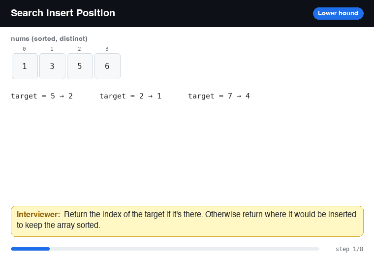

# Walkthrough: Search Insert Position

**Module:** [07 · Binary Search](../README.md) · **Difficulty:** Easy · **Solution:** [`p02_search_insert.go`](../p02_search_insert.go)



## The problem in plain words

You get a sorted list of distinct numbers and a target. If the target is in the list, return its position. If not, return the position where it would go so the list stays sorted.

```
nums = [1, 3, 5, 6], target = 5  →  2
nums = [1, 3, 5, 6], target = 2  →  1
nums = [1, 3, 5, 6], target = 7  →  4
```

## Mock interview

**Interviewer:** Return the index of the target if it's present, otherwise the index where it would be inserted. O(log n), please.

**Candidate:** If the target is bigger than everything, the answer is `len(nums)`, right? And an empty array returns 0?

**Interviewer:** Yes.

**Candidate:** Checking the examples: 5 is at index 2. 2 would go between 1 and 3, so index 1. 7 goes at the end, index 4.

**Candidate:** The brute force scans for the first value that is at least the target and returns its index, or `len(nums)` if none. That's O(n).

**Interviewer:** And faster?

**Candidate:** "First index where `nums[i] >= target`" answers both cases at once. If the target is there, that's its index. If not, that's where it goes. The question `nums[i] >= target` is false, false, ..., then true, true, because the array is sorted. So I binary-search for the first true. That's the lower bound.

**Candidate:** I use a half-open range `[lo, hi)` with `hi = len(nums)`, since `len(nums)` is a valid answer. If `nums[mid] < target`, mid is too small and so is everything left of it: `lo = mid + 1`. Otherwise mid might be the answer, so I keep it: `hi = mid`. When `lo == hi`, that's the answer.

**Interviewer:** Why does `hi = mid` not loop forever?

**Candidate:** `mid` rounds down, so `mid < hi` whenever `lo < hi`. Setting `hi = mid` always shrinks the range. And `lo = mid + 1` always grows `lo`.

**Candidate:** Testing target 5: `[0, 4)`, mid 2 holds 5, which is `>= 5`, so `hi = 2`. `[0, 2)`, mid 1 holds 3, `< 5`, so `lo = 2`. Now `lo == hi == 2`, so I return 2. For target 2 the same loop gives `hi = 2`, `hi = 1`, `lo = 1`, and returns 1.

**Interviewer:** Complexity?

**Candidate:** **O(log n) time, O(1) space.**

## What the animation shows

| Step | What happens |
|---|---|
| 1 | Interviewer states the problem and the three examples |
| 2 | Brute force: scan for the first `nums[i] >= target`, O(n) |
| 3 | Predicate is F…T; search `[0, 4)` with `hi = len(nums)` |
| 4 | Target 5: `mid = 2`, `5 >= 5` → `hi = 2` |
| 5 | `mid = 1`, `3 < 5` → `lo = 2` |
| 6 | `lo == hi == 2` → found at 2 |
| 7 | Interviewer asks about target 2 |
| 8 | Trace for 2: `hi = 2`, `hi = 1`, `lo = 1` → return 1; target 7 → 4. O(log n), O(1) |

## Detailed explanation

The loop keeps this invariant: *the answer lies in `[lo, hi]`* (inclusive of `hi`, because `hi = len(nums)` means "insert at the end"). Everything left of `lo` is known to be `< target`. Everything at or right of `hi` is known to be `>= target`.

- `nums[mid] < target`: mid and everything before it are too small, so `lo = mid + 1`.
- `nums[mid] >= target`: mid could be the first such index, so `hi = mid`, not `mid - 1`.

When `lo == hi`, everything before `lo` is `< target` and everything from `lo` on is `>= target`. That's exactly the insert position, and if the target exists, it's sitting at `lo`.

No special cases are needed. An empty slice returns 0 without running the loop. A target bigger than everything pushes `lo` up to `len(nums)`.

## Complexity

| Approach | Time | Space |
|---|---|---|
| Linear scan (not in the repo) | O(n) | O(1) |
| Lower bound (`SearchInsert`) | O(log n) | O(1) |

## Common mistakes

- Starting with `hi = len(nums) - 1`, which makes "append at the end" impossible to return.
- Writing `hi = mid - 1` in the half-open template. That can skip the answer.
- Using `lo <= hi` with `hi = mid`, which loops forever once `lo == hi`.
- Returning -1 when the target is missing. This problem wants the insert position.

## Try it yourself

```sh
go test ./course/07-binary-search/ -run TestSearchInsert -v
```
