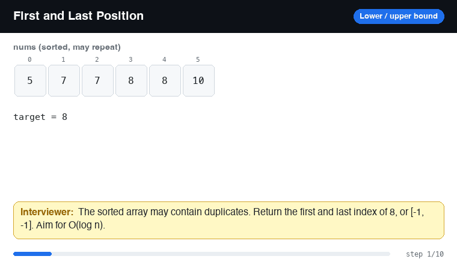

# Walkthrough: First and Last Position

**Module:** [07 · Binary Search](../README.md) · **Difficulty:** Medium · **Solution:** [`p03_first_last_position.go`](../p03_first_last_position.go)



## The problem in plain words

You get a sorted list that may contain repeats, and a target. Return the first and last position of the target, or `[-1, -1]` if it isn't there.

```
nums = [5, 7, 7, 8, 8, 10], target = 8  →  [3, 4]
nums = [5, 7, 7, 8, 8, 10], target = 6  →  [-1, -1]
```

## Mock interview

**Interviewer:** The array is sorted and may have duplicates. Return the first and last index of the target, or `[-1, -1]`. Aim for O(log n).

**Candidate:** Is an empty array possible? And the result is a pair, first then last?

**Interviewer:** Empty is possible, and yes, `[first, last]`.

**Candidate:** For target 8 the copies are at 3 and 4, so `[3, 4]`. For 6 there are none, so `[-1, -1]`. If every element is 8, the answer is `[0, n-1]`.

**Candidate:** A linear scan finds both in O(n). A common middle ground is "binary-search any 8, then walk left and right". But if the whole array is 8s, that walk is O(n) again.

**Interviewer:** So what do you do?

**Candidate:** Two boundary searches. The first index is the lower bound: the first `i` with `nums[i] >= target`. The upper bound is the first `i` with `nums[i] > target`. The last copy is just before it, so `last = upperBound - 1`. Both are the same half-open loop with a different comparison.

**Interviewer:** How do you know the target is there at all?

**Candidate:** After the lower bound, I check `first < len(nums) && nums[first] == target`. If that fails, I return `[-1, -1]` and skip the second search.

**Candidate:** In code, `SearchRange` calls `LowerBound`, checks it, then calls `UpperBound` and subtracts one.

**Candidate:** Testing on `[5, 7, 7, 8, 8, 10]`. Lower bound: mid 3 holds 8, `>= 8`, `hi = 3`. mid 1 holds 7, `lo = 2`. mid 2 holds 7, `lo = 3`. So first is 3, and `nums[3]` is 8. Upper bound: mid 3 holds 8, `<= 8`, so `lo = 4`. mid 5 holds 10, `hi = 5`. mid 4 holds 8, `lo = 5`. Upper bound is 5, so last is 4. Answer `[3, 4]`.

**Interviewer:** Complexity?

**Candidate:** Two binary searches: **O(log n) time, O(1) space**, no matter how many copies there are.

## What the animation shows

| Step | Search | Range | `mid` | Decision |
|---|---|---|---|---|
| 1 | | | | Interviewer states the problem |
| 2 | | | | Brute force and "find then walk" are both O(n) |
| 3 | lower | `[0,6)` | 3 (8) | `8 >= 8` → `hi = 3` |
| 4 | lower | `[0,3)` | 1 (7) | `7 < 8` → `lo = 2` |
| 5 | lower | `[2,3)` | 2 (7) | `7 < 8` → `lo = 3` |
| 6 | lower | | | `first = 3`, and `nums[3] == 8` |
| 7 | upper | `[0,6)` | 3 (8) | `8 <= 8` → `lo = 4` |
| 8 | upper | `[4,6)` | 5 (10) | `10 > 8` → `hi = 5` |
| 9 | upper | `[4,5)` | 4 (8) | `8 <= 8` → `lo = 5` |
| 10 | | | | `upper = 5`, `last = 4`, answer `[3, 4]`; O(log n) |

## Detailed explanation

Both bounds are "first true" searches over a monotone predicate:

- Lower bound: `nums[i] >= target` is F…F T…T. The first T is the first copy (or the insert point if there's none).
- Upper bound: `nums[i] > target` is F…F T…T. The first T is one past the last copy.

The half-open loop keeps the answer in `[lo, hi]`. When the predicate is false at `mid`, `mid` can't be the first true, so `lo = mid + 1`. When it's true, `mid` might be, so `hi = mid`. They meet at the boundary.

The existence check matters. If the target is missing, the lower bound points at the next bigger value (or `len(nums)`), and blindly computing `upperBound - 1` would give `last < first`.

Edge cases: an empty slice makes `first == len(nums) == 0`, so the check returns `[-1, -1]`. A target bigger than all values gives `first == len(nums)`, caught by the same check.

## Complexity

| Approach | Time | Space |
|---|---|---|
| Linear scan (`SearchRangeBrute`) | O(n) | O(1) |
| Lower + upper bound (`SearchRange`) | O(log n) | O(1) |

## Common mistakes

- Finding one copy and walking outward, which is O(n) on long runs of duplicates.
- Reading `nums[first]` without checking `first < len(nums)`.
- Using `>=` for both searches, which returns the first copy twice.
- Forgetting the `- 1` on the upper bound.

## Try it yourself

```sh
go test ./course/07-binary-search/ -run TestSearchRange -v
```
