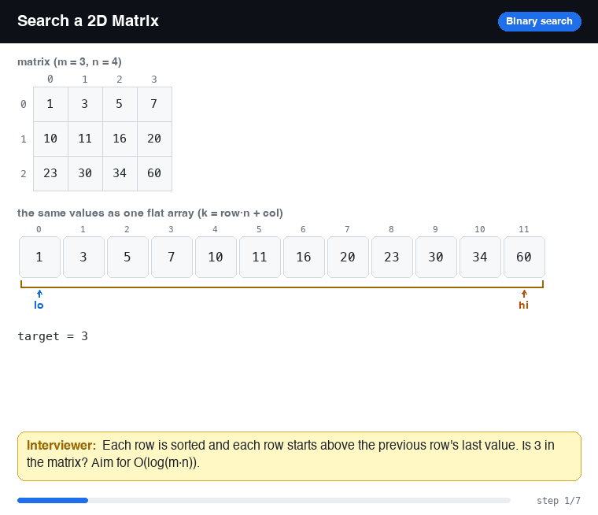

# Walkthrough: Search a 2D Matrix

**Module:** [07 · Binary Search](../README.md) · **Difficulty:** Medium · **Solution:** [`p04_search_2d_matrix.go`](../p04_search_2d_matrix.go)



## The problem in plain words

You get a grid where each row is sorted, and each row starts with a value bigger than the last value of the row above. Read row by row, the whole grid is one sorted list. Report whether the target is in it.

```
[[ 1,  3,  5,  7],
 [10, 11, 16, 20],
 [23, 30, 34, 60]]     target = 3 → true,  target = 13 → false
```

## Mock interview

**Interviewer:** Each row is sorted, and each row's first value is greater than the previous row's last value. Is the target in the matrix? Aim for O(log(m·n)).

**Candidate:** Can the matrix be empty, or have empty rows? And all rows have the same length?

**Interviewer:** It can be empty; rows have the same length.

**Candidate:** For target 3, it's in row 0, column 1, so true. For 13, it would sit between 11 and 16 but isn't there, so false.

**Candidate:** The brute force checks every cell: O(m·n). Searching each row with binary search is O(m log n), better but not the target.

**Interviewer:** What's the key observation?

**Candidate:** Read row by row, the matrix is one sorted list of `m·n` values. I don't have to build that list. A flat index `k` lives at row `k / n`, column `k % n`. So I run plain binary search over `k` in `[0, m·n - 1]` and look up each `mid` through that formula.

**Interviewer:** Why does that formula work?

**Candidate:** Each row has `n` values. The first `n` flat indices are row 0, the next `n` are row 1, and so on. Integer division gives the row, the remainder gives the position in the row.

**Candidate:** The code is the closed-interval search from problem 1, with `v := matrix[mid/n][mid%n]` instead of `nums[mid]`, and a guard for an empty matrix.

**Candidate:** On the example with target 3: `lo = 0, hi = 11`. mid 5 is (1, 1) = 11, too big, `hi = 4`. mid 2 is (0, 2) = 5, too big, `hi = 1`. mid 0 is (0, 0) = 1, too small, `lo = 1`. mid 1 is (0, 1) = 3. Found, return true.

**Interviewer:** Complexity?

**Candidate:** **O(log(m·n)) time, O(1) space.** No copy of the matrix.

## What the animation shows

| Step | `mid` | Cell | Value | Decision |
|---|---|---|---|---|
| 1 | | | | Interviewer states the problem |
| 2 | | | | Brute force: check every cell, O(m·n) |
| 3 | | | | Flat index k → (k / n, k % n); `lo = 0, hi = 11` |
| 4 | 5 | (1, 1) | 11 | `11 > 3` → `hi = 4` |
| 5 | 2 | (0, 2) | 5 | `5 > 3` → `hi = 1` |
| 6 | 0 | (0, 0) | 1 | `1 < 3` → `lo = 1` |
| 7 | 1 | (0, 1) | 3 | found → true; O(log(m·n)) time, O(1) space |

## Detailed explanation

The two sorting rules together mean the row-major order is fully sorted: within a row by the first rule, and across the row boundary by the second. So the "virtual" flat array `flat[k] = matrix[k/n][k%n]` is sorted, and binary search on it is correct for the same reason as in problem 1. The invariant is *if the target exists, its flat index is in `[lo, hi]`.*

The index mapping is the only new piece. It costs two integer operations per step, so the total stays O(log(m·n)).

Edge cases: `len(matrix) == 0` or `len(matrix[0]) == 0` returns false right away, so `n` is never zero in `mid % n`. A 1×n or m×1 matrix works without changes.

This trick needs the second rule. If rows were only sorted on their own and columns sorted too ("Search a 2D Matrix II"), the flat order wouldn't be sorted. That version uses a staircase walk from the top-right corner in O(m + n).

## Complexity

| Approach | Time | Space |
|---|---|---|
| Check every cell (`SearchMatrixBrute`) | O(m·n) | O(1) |
| Binary search on flat index (`SearchMatrix`) | O(log(m·n)) | O(1) |

## Common mistakes

- Using `k / m` or `k % m`. The divisor is the number of columns, `n`.
- Copying the matrix into a slice first, which costs O(m·n) and defeats the point.
- Skipping the empty-matrix guard, which panics on `matrix[0]`.
- Applying this to a matrix that is only sorted by rows and columns separately.

## Try it yourself

```sh
go test ./course/07-binary-search/ -run TestSearchMatrix -v
```
