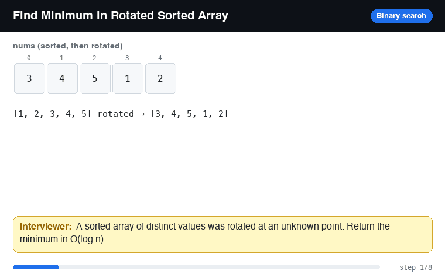

# Walkthrough: Find Minimum in Rotated Sorted Array

**Module:** [07 · Binary Search](../README.md) · **Difficulty:** Medium · **Solution:** [`p05_find_min_rotated.go`](../p05_find_min_rotated.go)



## The problem in plain words

A sorted list of distinct numbers was cut at some point and the front piece moved to the back. Find the smallest number in O(log n).

```
[3, 4, 5, 1, 2]    →  1
[11, 13, 15, 17]   →  11   (rotated by zero)
```

## Mock interview

**Interviewer:** An ascending array of distinct integers was rotated at an unknown pivot. Return the minimum in O(log n). It's non-empty.

**Candidate:** Values are distinct, and "rotated by zero", meaning still fully sorted, is allowed?

**Interviewer:** Yes to both.

**Candidate:** `[3, 4, 5, 1, 2]` has minimum 1, at the point where the order drops. `[11, 13, 15, 17]` has no drop, so the minimum is the first value. A single element is its own minimum.

**Candidate:** The brute force is a linear scan for the minimum: O(n) time, O(1) space.

**Interviewer:** The array isn't sorted. How can binary search work?

**Candidate:** I don't need sorted values. I need a yes/no question that flips once. The array is two runs: a big left run and a small right run. Every value in the right run is `<=` the last element, and every value in the left run is bigger than it. So "is `nums[i] <= nums[last]`?" reads F F F T T, and the minimum is the first T.

**Candidate:** In code I compare `nums[mid]` with `nums[hi]`. If `nums[mid] > nums[hi]`, mid is in the left run and the minimum is strictly to its right: `lo = mid + 1`. Otherwise mid is in the right run and may be the minimum itself: `hi = mid`. The loop runs while `lo < hi`, and the answer is `nums[lo]`.

**Interviewer:** Why `nums[hi]` and not `nums[lo]`?

**Candidate:** Take `[11, 13, 15, 17]`. Comparing with `nums[lo]`, mid 13 is bigger than 11, which looks exactly like "mid is in the left run", so I'd move right, away from the answer. Comparing with `nums[hi]` works in both cases: in an unrotated array every mid is `<= nums[hi]`, so `hi` slides down to 0.

**Candidate:** On `[3, 4, 5, 1, 2]`: mid 2 holds 5, bigger than `nums[4] = 2`, so `lo = 3`. Then mid 3 holds 1, not bigger than `nums[4] = 2`, so `hi = 3`. `lo == hi == 3`, and the answer is 1.

**Interviewer:** Complexity?

**Candidate:** **O(log n) time, O(1) space.**

## What the animation shows

| Step | What happens |
|---|---|
| 1 | Interviewer states the problem: `[3, 4, 5, 1, 2]` |
| 2 | Brute force: linear scan, O(n) |
| 3 | The predicate `nums[i] <= last` reads F F F T T; the minimum is the first T |
| 4 | `lo = 0, hi = 4, mid = 2`: `5 > 2` → `lo = 3` |
| 5 | `lo = 3, hi = 4, mid = 3`: `1 <= 2` → `hi = 3` |
| 6 | `lo == hi == 3` → minimum is 1 |
| 7 | Interviewer asks why compare with `nums[hi]`, using `[11, 13, 15, 17]` |
| 8 | Trace: `hi = 1`, then `hi = 0` → 11; comparing with `nums[lo]` would move the wrong way. O(log n), O(1) |

## Detailed explanation

Let `p` be the index of the minimum. Then `nums[p..n-1]` is the small run, all `<= nums[n-1]`, and `nums[0..p-1]` is the big run, all `> nums[n-1]`. (If `p = 0`, the big run is empty.) The predicate is monotone, so a first-true search finds `p`.

The loop compares with `nums[hi]` instead of the fixed `nums[n-1]`. That's still correct: the loop keeps the minimum inside `[lo, hi]`, and `nums[hi]` is always in the small run (it starts as the last element, and later `hi` only moves to a mid that was in the small run). So "is `nums[mid] > nums[hi]`?" answers "is mid in the big run?"

- Big run: the minimum is strictly after `mid`, so `lo = mid + 1`.
- Small run: the minimum is at `mid` or before it, so `hi = mid`.

Because `mid < hi` whenever `lo < hi`, both updates shrink the range, and the loop ends with `lo == hi == p`.

Duplicates break this: `nums[mid] == nums[hi]` doesn't tell you which run `mid` is in. The usual fix is `hi--`, with a worst case of O(n). This problem rules duplicates out.

## Complexity

| Approach | Time | Space |
|---|---|---|
| Linear scan (`FindMinBrute`) | O(n) | O(1) |
| Binary search vs. right end (`FindMin`) | O(log n) | O(1) |

## Common mistakes

- Comparing with `nums[lo]`, which fails on unrotated input.
- Writing `hi = mid - 1` in the small-run case, which can skip the minimum.
- Looping on `lo <= hi` with `hi = mid`, which never ends.
- Returning `lo` (the index) when the problem wants the value `nums[lo]`.

## Try it yourself

```sh
go test ./course/07-binary-search/ -run TestFindMin -v
```
