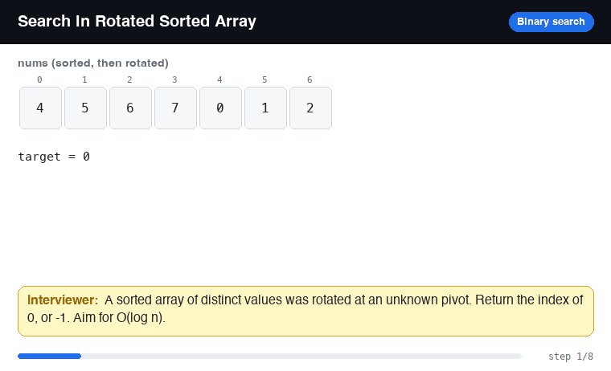

# Walkthrough: Search in Rotated Sorted Array

**Module:** [07 · Binary Search](../README.md) · **Difficulty:** Medium · **Solution:** [`p06_search_rotated.go`](../p06_search_rotated.go)



## The problem in plain words

A sorted list of distinct numbers was cut at some point and the front piece moved to the back. Find the position of a target, or return -1, in O(log n).

```
nums = [4, 5, 6, 7, 0, 1, 2], target = 0  →  4
nums = [4, 5, 6, 7, 0, 1, 2], target = 3  →  -1
```

## Mock interview

**Interviewer:** An ascending array of distinct values was rotated at an unknown pivot. Return the index of the target, or -1. O(log n).

**Candidate:** Distinct values, and it might not be rotated at all?

**Interviewer:** Right.

**Candidate:** 0 is at index 4. 3 isn't there, so -1. Edge cases: an empty array, one element, and an unrotated array.

**Candidate:** A linear scan is O(n). I could also find the rotation point with the previous problem and then binary-search one side. That's O(log n) but two passes.

**Interviewer:** Can you do it in one loop?

**Candidate:** Yes. If I cut a rotated array at `mid`, at least one of the halves `[lo, mid]` and `[mid, hi]` is fully sorted. The rotation point can only be in one of them. For the sorted half I can check "is the target inside?" just by comparing with its two ends. If yes, I search there. If no, it must be in the other half.

**Interviewer:** How do you tell which half is sorted?

**Candidate:** If `nums[lo] <= nums[mid]`, there's no drop between `lo` and `mid`, so the left half is sorted. Otherwise the drop is in the left half, which means the right half is sorted.

**Candidate:** The code is the closed-interval loop. First check `nums[mid] == target`. Then, if the left half is sorted and `nums[lo] <= target < nums[mid]`, set `hi = mid - 1`, else `lo = mid + 1`. If the right half is sorted and `nums[mid] < target <= nums[hi]`, set `lo = mid + 1`, else `hi = mid - 1`.

**Candidate:** On the example: `[0, 6]`, mid 3 holds 7. `4 <= 7`, so the left half `[4, 5, 6, 7]` is sorted. 0 isn't in `[4, 7)`, so `lo = 4`. `[4, 6]`, mid 5 holds 1. `0 <= 1`, so the left half `[0, 1]` is sorted, and 0 is in `[0, 1)`, so `hi = 4`. `[4, 4]`, mid 4 holds 0. Return 4.

**Interviewer:** Complexity?

**Candidate:** Each step halves the range. **O(log n) time, O(1) space.**

## What the animation shows

| Step | What happens |
|---|---|
| 1 | Interviewer states the problem: find 0 in `[4, 5, 6, 7, 0, 1, 2]` |
| 2 | Brute force O(n); pivot-then-search needs two passes |
| 3 | Key fact: cutting at mid leaves at least one sorted half |
| 4 | `mid = 3` (7): `nums[lo] = 4 <= 7`, so `[4, 5, 6, 7]` is sorted |
| 5 | Is `4 <= 0 < 7`? No → `lo = 4` |
| 6 | `mid = 5` (1): `nums[lo] = 0 <= 1`, so `[0, 1]` is sorted |
| 7 | Is `0 <= 0 < 1`? Yes → `hi = 4` |
| 8 | `mid = 4` holds 0 → return 4; O(log n) time, O(1) space |

## Detailed explanation

A rotated array has at most one "drop", where a value is followed by a smaller one. Any range `[lo, hi]` contains at most one drop, so splitting it at `mid` gives two parts, and at least one part has no drop. A part with no drop is sorted.

`nums[lo] <= nums[mid]` detects this for the left part. With distinct values, if the drop were inside `[lo, mid]`, then `nums[mid]` would be in the small run and `nums[lo]` in the big run, giving `nums[lo] > nums[mid]`. So `<=` means no drop on the left.

For a sorted part, membership is a range check on its ends. The strict comparisons (`target < nums[mid]` and `nums[mid] < target`) leave out `mid` itself, since it was already checked. If the target isn't in the sorted part, it can only be in the other part. Either way, the invariant *if the target exists, it's in `[lo, hi]`* holds, and the range shrinks every step.

When `lo == mid` (two elements left), `nums[lo] <= nums[mid]` is trivially true. That's why the comparison uses `<=`, not `<`.

## Complexity

| Approach | Time | Space |
|---|---|---|
| Linear scan (`SearchRotatedBrute`) | O(n) | O(1) |
| One-pass binary search (`SearchRotated`) | O(log n) | O(1) |

## Common mistakes

- Using `nums[lo] < nums[mid]` instead of `<=`, which breaks when `lo == mid`.
- Checking the target against the unsorted half's ends. Only the sorted half's range is meaningful.
- Getting the inclusive/exclusive ends wrong in the range checks.
- Assuming it works with duplicates. `[1, 1, 1, 3, 1]` needs extra handling.

## Try it yourself

```sh
go test ./course/07-binary-search/ -run TestSearchRotated -v
```
