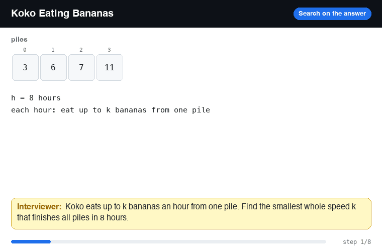

# Walkthrough: Koko Eating Bananas

**Module:** [07 · Binary Search](../README.md) · **Difficulty:** Medium · **Solution:** [`p07_koko_bananas.go`](../p07_koko_bananas.go)



## The problem in plain words

There are piles of bananas. Each hour Koko picks one pile and eats up to `k` bananas from it. If the pile has fewer, she finishes it and waits for the hour to end. Find the slowest whole speed `k` that lets her eat everything within `h` hours.

```
piles = [3, 6, 7, 11],      h = 8  →  4
piles = [30, 11, 23, 4, 20], h = 5  →  30
piles = [30, 11, 23, 4, 20], h = 6  →  23
```

## Mock interview

**Interviewer:** Find the smallest integer speed `k` so Koko finishes all piles within `h` hours. Assume there are at most `h` piles.

**Candidate:** She never splits an hour across two piles, right? So a pile of `p` takes `ceil(p / k)` hours.

**Interviewer:** Correct.

**Candidate:** At speed 4, the piles `[3, 6, 7, 11]` take 1 + 2 + 2 + 3 = 8 hours, which fits. At speed 3 they take 1 + 2 + 3 + 4 = 10, which doesn't. So the answer is 4. The answer is never above `max(piles)`, since at that speed each pile takes one hour, and there are at most `h` piles.

**Candidate:** The brute force tries `k = 1, 2, 3, ...` and returns the first one that fits. Each check is O(n), and there can be up to `max` speeds, so O(n · max). With piles of size 10⁹ that's far too slow.

**Interviewer:** How do you speed it up?

**Candidate:** Total hours only go down, or stay the same, as `k` grows. So "can she finish at speed `k`?" is false for small `k` and true from some point on. I want the first true. That's binary search, but over possible answers, not over the array. The range is `[1, max(piles)]`.

**Interviewer:** Why is that check monotone?

**Candidate:** For each pile, `ceil(p / k)` can't increase when `k` increases. A sum of non-increasing terms is non-increasing. So once the total is `<= h`, it stays `<= h` for every faster speed.

**Candidate:** In code, `hoursAt` sums `(p + k - 1) / k`, which is ceiling division without floats. `MinEatingSpeed` calls the module's `FirstTrue(1, max+1, ...)`. The `+1` is because `FirstTrue`'s `hi` is exclusive.

**Candidate:** On the example: range `[1, 12)`. mid 6 needs 6 hours, fits, `hi = 6`. mid 3 needs 10, too slow, `lo = 4`. mid 5 needs 8, fits, `hi = 5`. mid 4 needs 8, fits, `hi = 4`. `lo == hi == 4`.

**Interviewer:** Complexity?

**Candidate:** log(max) checks, each O(n). **O(n log max) time, O(1) space.**

## What the animation shows

| Step | `k` | Hours per pile | Total | Decision |
|---|---|---|---|---|
| 1 | | | | Interviewer states the problem |
| 2 | | | | Brute force: try every k, O(max · n) |
| 3 | | | | Feasibility is F…T over `[1, 11]`; search for the first T |
| 4 | 6 | 1, 1, 2, 2 | 6 | `6 <= 8` → `hi = 6` |
| 5 | 3 | 1, 2, 3, 4 | 10 | `10 > 8` → `lo = 4` |
| 6 | 5 | 1, 2, 2, 3 | 8 | `8 <= 8` → `hi = 5` |
| 7 | 4 | 1, 2, 2, 3 | 8 | `8 <= 8` → `hi = 4` |
| 8 | | | | `lo == hi == 4` → answer 4; O(n log max) time, O(1) space |

## Detailed explanation

This is **binary search on the answer**. The array of piles is never sorted or searched. What gets searched is the range of speeds, using a cheap yes/no check.

The check `hoursAt(piles, k) <= h` is monotone in `k` (see the interview). `FirstTrue` keeps the invariant *the smallest feasible speed lies in `[lo, hi]`*:

- Feasible at `mid`: the answer is `mid` or smaller, so `hi = mid`.
- Not feasible at `mid`: every slower speed is also infeasible, so `lo = mid + 1`.

The upper end `max(piles)` is always feasible because `len(piles) <= h`. So the search always finds an answer, and `FirstTrue` never returns its "none found" value.

`(p + k - 1) / k` computes `ceil(p / k)` for positive integers. Floating-point `math.Ceil` can round wrong for large values, and integer division alone would round down.

Edge case: `MinEatingSpeed` returns 1 for no piles, which avoids calling `slices.Max` on an empty slice.

## Complexity

| Approach | Time | Space |
|---|---|---|
| Try every speed (`MinEatingSpeedBrute`) | O(n · max) | O(1) |
| Binary search on speed (`MinEatingSpeed`) | O(n log max) | O(1) |

## Common mistakes

- Using `p / k` (rounds down), which undercounts hours.
- Starting the range at 0, which divides by zero.
- Passing `max(piles)` as an exclusive `hi`, which can never return `max` itself.
- Searching for "hours == h" instead of "hours <= h". Many speeds may hit `h` exactly, or none.

## Try it yourself

```sh
go test ./course/07-binary-search/ -run TestMinEatingSpeed -v
```
