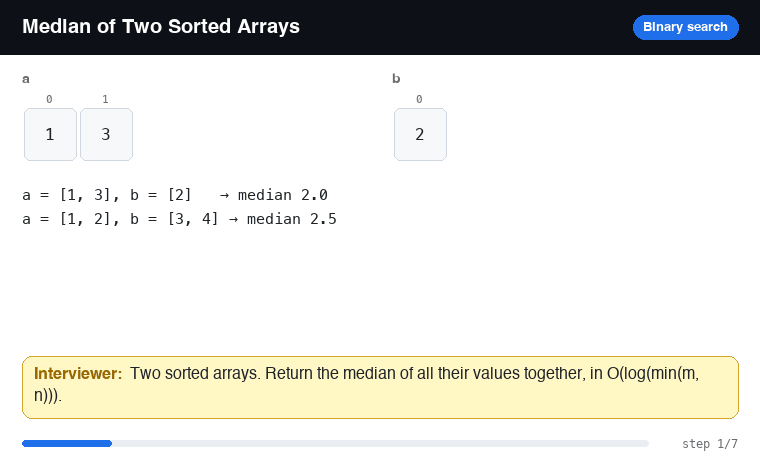

# Walkthrough: Median of Two Sorted Arrays

**Module:** [07 · Binary Search](../README.md) · **Difficulty:** Hard · **Solution:** [`p08_median_two_sorted.go`](../p08_median_two_sorted.go)



## The problem in plain words

You get two sorted lists. Find the median of all their numbers together. For an even total, the median is the average of the two middle numbers. Do it in O(log(min(m, n))), without merging the lists.

```
a = [1, 3], b = [2]     →  2.0
a = [1, 2], b = [3, 4]  →  2.5
```

## Mock interview

**Interviewer:** Two ascending arrays. Return the median of all values combined in O(log(min(m, n))). Return 0 if both are empty.

**Candidate:** Either array can be empty? And the result is a float, since an even total averages two values?

**Interviewer:** Yes and yes.

**Candidate:** `[1, 3]` and `[2]` merge to `[1, 2, 3]`, median 2. `[1, 2]` and `[3, 4]` merge to `[1, 2, 3, 4]`, median (2 + 3) / 2 = 2.5.

**Candidate:** The brute force merges the two arrays like merge sort and picks the middle. That's O(m + n) time and space.

**Interviewer:** You only need the middle. Can you avoid the merge?

**Candidate:** The median splits the merged order into a left half and a right half. Suppose the left half takes `i` values from `a` and `j` from `b`. The size of the left half is fixed: `half = (m + n + 1) / 2`. So `j = half - i`, and I only have to choose `i`. The split is correct when every left value is `<=` every right value. Because each array is sorted, that's just two checks: `a[i-1] <= b[j]` and `b[j-1] <= a[i]`.

**Interviewer:** And how do you find `i`?

**Candidate:** Binary search over `i` in `[0, m]`. If `a[i-1] > b[j]`, I took too many from `a`, so `hi = i - 1`. If `b[j-1] > a[i]`, I took too few, so `lo = i + 1`. Otherwise the cut is valid. For an odd total, the median is the largest left value. For an even total, it's the average of the largest left and smallest right values. I swap first so that `a` is the shorter array. That keeps `j` in range and gives the `log(min(m, n))` bound.

**Interviewer:** What if `i` is 0 or `m`, so `a[i-1]` doesn't exist?

**Candidate:** The helper `at` returns `math.MinInt` past the left edge and `math.MaxInt` past the right edge. An empty side then never fails a check and never wins a max or min.

**Candidate:** On `a = [1, 3]`, `b = [2]`: swap, so `a = [2]`, `b = [1, 3]`, `half = 2`. Try `i = 0, j = 2`: `b[1] = 3 > a[0] = 2`, too few from `a`, `lo = 1`. Try `i = 1, j = 1`: `a[0] = 2 <= b[1] = 3` and `b[0] = 1 <= a[1] = +∞`. Valid. The total is odd, so the median is `max(2, 1) = 2`.

**Interviewer:** Complexity?

**Candidate:** **O(log min(m, n)) time, O(1) space.**

## What the animation shows

| Step | What happens |
|---|---|
| 1 | Interviewer states the problem with both examples |
| 2 | Brute force: merge and pick the middle, O(m + n) |
| 3 | Swap so `a = [2]` is shorter; `half = 2`; `j = half − i`; the two validity checks |
| 4 | `i = 0, j = 2`: `b[j-1] = 3 > a[i] = 2` → too few from `a` → `lo = 1` |
| 5 | `i = 1, j = 1`: both checks pass; odd total → median = max(left) = 2 |
| 6 | Interviewer asks about an even total and empty sides |
| 7 | `a = [1, 2], b = [3, 4]`: `i = 1` fails, `i = 2, j = 0` is valid → (2 + 3) / 2 = 2.5; O(log min(m, n)) |

## Detailed explanation

A cut `(i, j)` with `i + j = half` puts `a[0..i-1]` and `b[0..j-1]` on the left. Since each array is sorted, the only places where a left value could exceed a right value are across the arrays: `a[i-1]` vs `b[j]`, and `b[j-1]` vs `a[i]`. If both checks pass, the left side holds exactly the `half` smallest values.

The checks are monotone in `i`:

- `a[i-1] > b[j]` means `i` is too big. Taking fewer from `a` lowers `a[i-1]` and raises `b[j]`.
- `b[j-1] > a[i]` means `i` is too small, by the mirror argument.

They can't both be true, and exactly one `i` passes both, so the search always finds it. That's why the Go code ends with a `panic("unreachable")`: it can only be reached if the inputs aren't sorted.

`half = (m + n + 1) / 2` gives the left side the extra element when the total is odd. Then the median is simply `max(aLeft, bLeft)`.

Searching the shorter array matters. With `i` in `[0, m]` and `m <= n`, `j = half - i` always lies in `[0, n]`.

## Complexity

| Approach | Time | Space |
|---|---|---|
| Merge and pick the middle (`FindMedianSortedArraysBrute`) | O(m + n) | O(m + n) |
| Binary search the partition (`FindMedianSortedArrays`) | O(log min(m, n)) | O(1) |

## Common mistakes

- Searching the longer array, so `j` can go negative or past `n`.
- Indexing `a[i-1]` or `b[j]` without handling the edges. Use sentinels like `at`.
- Using `(m + n) / 2` for `half` and then taking the wrong side for an odd total.
- Integer division when averaging: `(leftMax + rightMin) / 2` in `int` drops the `.5`.

## Try it yourself

```sh
go test ./course/07-binary-search/ -run TestFindMedianSortedArrays -v
```
