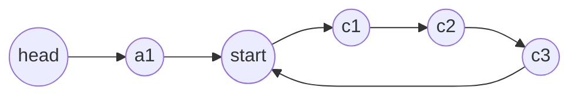

# 08 — Linked Lists

Linked-list problems rarely need clever algorithms. They test whether you can
rewire pointers without losing part of the list or dereferencing nil. A
handful of moves (dummy head, reverse, fast/slow pointers, splice) covers
nearly every question.

## What you'll learn

- The `ListNode` type and test helpers (`FromSlice`, `ToSlice`) in [linkedlists.go](linkedlists.go).
- The **dummy head** trick that removes "is this the first node?" special cases.
- Reversal, iterative and recursive, and reversing a sub-range in place.
- **Fast/slow pointers**: middle of a list, n-th from end, Floyd's cycle detection.
- Composing those moves into harder problems (reorder list, k-group reversal).

## Recognize the pattern

| Clue | Move |
|---|---|
| "the head might change" / building a new list | dummy head + tail pointer |
| "reverse", "palindrome list", "reorder" | three-pointer reversal |
| "middle", "n-th from end", "in one pass" | two pointers with a gap or speed difference |
| "cycle", "where does the loop start", "duplicate number in [1..n]" | Floyd's tortoise and hare |
| "O(1) extra space" with an extra pointer per node | store state inside the list (interleave) |
| "merge k lists" | heap (module 10) or pairwise merge |

## The idea

**Reversal** is the move you'll use most. Each step saves `next`, flips
one arrow, and slides the window forward:

```
 prev  cur  next
 nil   1 -> 2 -> 3 -> nil

 nil <- 1    2 -> 3 -> nil         cur.Next = prev
       prev  cur  next             prev, cur = cur, next

 nil <- 1 <- 2    3 -> nil
             prev cur

 nil <- 1 <- 2 <- 3                return prev
```

**Floyd's cycle detection**: slow moves 1, fast moves 2. If there's a cycle,
fast laps slow and they meet. Reset one pointer to the head and move both one
step at a time. They meet again exactly at the start of the cycle.



If the tail is `a` long and they first meet `b` into a cycle of length `c`:
`2(a+b) = a+b+kc`, so `a = kc − b`. Walking `a` steps from head and from the
meeting point lands both on `start`.

## Go template

```go
// Dummy head + tail: build or splice a list without first-node special cases.
dummy := &ListNode{}
tail := dummy
for /* ... */ {
	tail.Next = node
	tail = tail.Next
}
return dummy.Next

// Reverse in place.
var prev *ListNode
for cur := head; cur != nil; {
	next := cur.Next
	cur.Next = prev
	prev, cur = cur, next
}

// Middle (first middle for even length).
slow, fast := head, head
for fast.Next != nil && fast.Next.Next != nil {
	slow, fast = slow.Next, fast.Next.Next
}
```

## Complexity

| Operation | Time | Space |
|---|---|---|
| Traverse / reverse / find middle | O(n) | O(1) |
| Recursive reversal | O(n) | O(n) call stack |
| Insert/delete given the previous node | O(1) | O(1) |
| Access by index | O(n) | O(1) |

## Common pitfalls

- **Losing the rest of the list.** Save `cur.Next` *before* overwriting it.
- **nil dereference in the fast pointer loop.** Check `fast != nil && fast.Next != nil`
  (in that order; `&&` short-circuits) before `fast.Next.Next`.
- **Off-by-one on "n-th from end".** To delete a node you need the node
  *before* it; start both pointers at a dummy and give fast a gap of `n+1`.
- **Forgetting to cut.** After splitting a list (reorder list, merge sort),
  set the first half's tail `.Next = nil` or you'll build a cycle.
- **Go: parallel assignment helps.** `prev, cur = cur, next` evaluates the whole
  right side before assigning anything, so it's safe. Split it into two
  statements in the wrong order and you lose a pointer.
- **Go: map keys are pointers.** `map[*ListNode]bool` compares node identity,
  which is what cycle/copy problems need. Comparing `Val` would be wrong with
  duplicate values.
- **Go: recursion depth.** Recursive reversal of a 10^6-node list uses a deep
  goroutine stack. Go grows stacks dynamically so it won't crash like C, but
  it's still O(n) memory. Prefer iteration when asked for O(1) space.
- **Mutating test inputs.** Most solutions here relink nodes in place. Build a fresh
  list for every call you compare.

## Problems

| # | Problem | Difficulty | Key idea |
|---|---|---|---|
| 01 | [Reverse Linked List](p01_reverse_list.go) | Easy | prev/cur/next rewiring; recursive variant |
| 02 | [Merge Two Sorted Lists](p02_merge_two_sorted.go) | Easy | Dummy head + tail pointer |
| 03 | [Linked List Cycle I & II](p03_linked_list_cycle.go) | Medium | Floyd; reset to head to find the start |
| 04 | [Remove Nth Node From End](p04_remove_nth_from_end.go) | Medium | Gap of n+1 from a dummy head |
| 05 | [Reorder List](p05_reorder_list.go) | Medium | Middle + reverse second half + weave |
| 06 | [Add Two Numbers](p06_add_two_numbers.go) | Medium | Digit-by-digit with carry; loop while carry |
| 07 | [Copy List with Random Pointer](p07_copy_random_list.go) | Medium | Old→new map, or interleave clones for O(1) |
| 08 | [Reverse Nodes in k-Group](p08_reverse_k_group.go) | Hard | Check k nodes exist, reverse between anchors |

## Practice tip

Draw the boxes and arrows on paper for a 3-node list before you code, and
again for the empty and one-node lists. Then hide the solution, re-solve, and
run only that problem's tests:

```sh
go test ./course/08-linked-lists/ -run TestReverseKGroup -v
```

## Next

[09 — Trees](../09-trees/)
