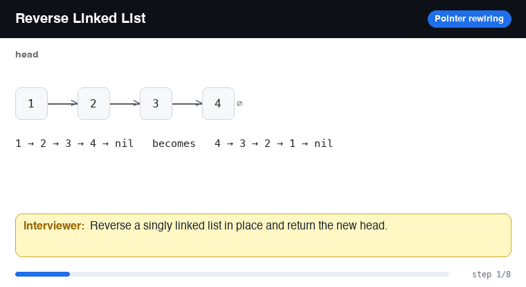

# Walkthrough: Reverse Linked List

**Module:** [08 · Linked Lists](../README.md) · **Difficulty:** Easy · **Solution:** [`p01_reverse_list.go`](../p01_reverse_list.go)



## The problem in plain words

Turn a singly linked list around so the last node becomes the first. Change the arrows; don't build a new list. Return the new head.

```
1 -> 2 -> 3 -> 4 -> nil   becomes   4 -> 3 -> 2 -> 1 -> nil
nil                       stays     nil
```

## Mock interview

**Interviewer:** Reverse a singly linked list in place and return the new head.

**Candidate:** In place means I relink the existing nodes, not allocate new ones? And an empty list returns nil?

**Interviewer:** Yes.

**Candidate:** For `1 -> 2 -> 3 -> 4`, the result is `4 -> 3 -> 2 -> 1`, and 1's `Next` becomes nil. Edge cases: empty list and a single node, which both come back unchanged.

**Candidate:** One simple approach copies the values into a slice and writes them back in reverse. That's O(n) extra space, and it moves values instead of relinking nodes. A recursive version relinks nodes but uses O(n) stack.

**Interviewer:** Can you do it with O(1) extra space?

**Candidate:** Yes, with three pointers. `prev` is the part already reversed, starting at nil. `cur` is the node I'm working on, starting at the head. For each node: save `next := cur.Next`, point `cur.Next` at `prev`, then slide `prev, cur = cur, next`. When `cur` is nil, `prev` is the new head.

**Interviewer:** Why save `next` first?

**Candidate:** Once I overwrite `cur.Next`, the only link to the rest of the list is gone. Saving it first is what keeps the rest reachable.

**Candidate:** On the example: `prev = nil, cur = 1`. Save 2, point 1 at nil, move to `prev = 1, cur = 2`. Save 3, point 2 at 1. Save 4, point 3 at 2. Save nil, point 4 at 3. Now `cur` is nil, so I return `prev`, which is 4.

**Interviewer:** Complexity?

**Candidate:** One pass, three pointers: **O(n) time, O(1) space.**

## What the animation shows

The animation draws a `nil` box at the left so `prev` has something to point at. Reversed arrows curve back over the nodes.

| Step | What happens |
|---|---|
| 1 | Interviewer states the problem: reverse `1 → 2 → 3 → 4` |
| 2 | Brute force: copying values or recursing costs O(n) extra space |
| 3 | `prev = nil`, `cur = head (1)` |
| 4 | Save `next = 2`; `1.Next = nil`; slide forward |
| 5 | Save `next = 3`; `2.Next = 1`; slide forward |
| 6 | Save `next = 4`; `3.Next = 2`; slide forward |
| 7 | Save `next = nil`; `4.Next = 3`; `cur` is nil, loop ends |
| 8 | Return `prev` (4): `4 → 3 → 2 → 1 → nil`; O(n) time, O(1) space |

## Detailed explanation

The loop keeps two lists apart: `prev` heads the reversed part (the nodes already visited, in reverse order), and `cur` heads the part not yet visited, in the original order. Each step moves one node from the front of the second list to the front of the first. When the second list is empty, the first one is the whole list reversed.

Go's parallel assignment `prev, cur = cur, next` evaluates the right side before assigning, so it's safe on one line.

Edge cases fall out of the loop. With `head == nil`, the loop never runs and `prev` (nil) is returned. With one node, one step points it at nil and returns it.

`ReverseListRecursive` reverses `head.Next` first, then sets `head.Next.Next = head` (the old next node is now the tail of the reversed part) and `head.Next = nil`. It's correct but uses one stack frame per node.

## Complexity

| Approach | Time | Space |
|---|---|---|
| Iterative three pointers (`ReverseList`) | O(n) | O(1) |
| Recursive (`ReverseListRecursive`) | O(n) | O(n) call stack |

## Common mistakes

- Overwriting `cur.Next` before saving it, which loses the rest of the list.
- Returning `head` or `cur` at the end. The new head is `prev`.
- In the recursive version, forgetting `head.Next = nil`, which leaves a two-node cycle at the tail.
- Splitting `prev, cur = cur, next` into two lines in the wrong order.

## Try it yourself

```sh
go test ./course/08-linked-lists/ -run TestReverseList -v
```
