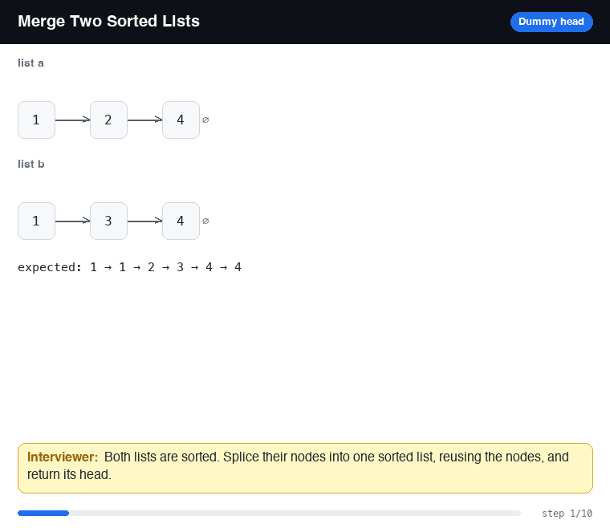

# Walkthrough: Merge Two Sorted Lists

**Module:** [08 · Linked Lists](../README.md) · **Difficulty:** Easy · **Solution:** [`p02_merge_two_sorted.go`](../p02_merge_two_sorted.go)



## The problem in plain words

You get two linked lists, each sorted from small to large. Join their nodes into one sorted list. Reuse the existing nodes instead of creating new ones.

```
1->2->4  +  1->3->4   ->  1->1->2->3->4->4
nil      +  0         ->  0
```

## Mock interview

**Interviewer:** Splice two sorted lists into one sorted list, reusing the nodes, and return its head.

**Candidate:** Either list may be empty? And with equal values, does the order matter?

**Interviewer:** Either may be empty. Order between equal values doesn't matter, but stable is nice.

**Candidate:** For `1->2->4` and `1->3->4`, the result is `1->1->2->3->4->4`. If one list is nil, the answer is the other list.

**Candidate:** A brute force collects all values, sorts them, and builds a new list: O((m+n) log(m+n)) time, O(m+n) space, and new nodes. It ignores that both lists are already sorted.

**Interviewer:** What's better?

**Candidate:** The smallest remaining value is always at the front of one of the two lists. So I compare the two fronts, take the smaller node, and repeat, like the merge step of merge sort. To build the result I use a dummy node and a `tail` pointer. The dummy means I never ask "is this the first node?". I just hang each node on `tail.Next` and move `tail`.

**Interviewer:** What happens when one list runs out?

**Candidate:** The rest of the other list is already sorted and every value in it is at least the last one I took. So I attach it in one step with `tail.Next = a` or `tail.Next = b`. No loop needed.

**Candidate:** The loop is `for a != nil && b != nil`. If `a.Val <= b.Val`, I take `a`, otherwise `b`. Using `<=` keeps equal values in their original order. At the end I return `dummy.Next`.

**Candidate:** On the example: 1 vs 1, take a's 1. 2 vs 1, take b's 1. 2 vs 3, take 2. 4 vs 3, take 3. 4 vs 4, take a's 4. `a` is now nil, so I attach b's remaining 4.

**Interviewer:** Complexity?

**Candidate:** Each node is spliced once. **O(m + n) time, O(1) extra space.**

## What the animation shows

Blue nodes in the merged list came from `a`, orange ones from `b`.

| Step | `a` | `b` | Decision |
|---|---|---|---|
| 1 | | | Interviewer states the problem |
| 2 | | | Brute force: collect, sort, rebuild |
| 3 | 1 | 1 | Set up `dummy` and `tail` |
| 4 | 1 | 1 | `1 <= 1` → take from `a` (stable on ties) |
| 5 | 2 | 1 | `2 > 1` → take from `b` |
| 6 | 2 | 3 | `2 <= 3` → take from `a` |
| 7 | 4 | 3 | `4 > 3` → take from `b` |
| 8 | 4 | 4 | `4 <= 4` → take from `a` |
| 9 | nil | 4 | attach the rest of `b` |
| 10 | | | Return `dummy.Next`: `1 → 1 → 2 → 3 → 4 → 4`; O(m + n) time, O(1) space |

## Detailed explanation

Invariant: *the merged list from `dummy.Next` to `tail` holds the smallest nodes seen so far, in sorted order, and every node still in `a` or `b` is at least `tail.Val`.* Taking the smaller front keeps it true, because the smaller front is the smallest of all remaining nodes (each list's front is its own minimum).

When one list is empty, the other is sorted and every value in it is `>= tail.Val`, so attaching it keeps the whole result sorted.

The dummy node removes two special cases: choosing which list gives the head, and handling an empty result. `dummy.Next` is nil if both inputs are nil.

The statement `tail.Next, a = a, a.Next` uses Go's parallel assignment, so `a.Next` is read before anything changes.

## Complexity

| Approach | Time | Space |
|---|---|---|
| Collect, sort, rebuild (not in the repo) | O((m+n) log(m+n)) | O(m + n) |
| Dummy head + tail (`MergeTwoLists`) | O(m + n) | O(1) |

## Common mistakes

- Forgetting to attach the leftover list, which drops its nodes.
- Returning `dummy` instead of `dummy.Next`.
- Forgetting `tail = tail.Next`, so every node overwrites the same link.
- Using `<` instead of `<=`, which still sorts but isn't stable.

## Try it yourself

```sh
go test ./course/08-linked-lists/ -run TestMergeTwoLists -v
```
