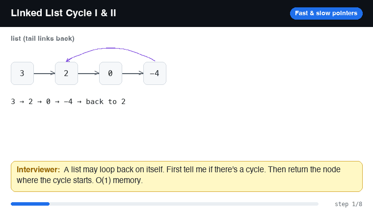

# Walkthrough: Linked List Cycle I & II

**Module:** [08 · Linked Lists](../README.md) · **Difficulty:** Medium · **Solution:** [`p03_linked_list_cycle.go`](../p03_linked_list_cycle.go)



## The problem in plain words

A linked list might loop back on itself: some node's `Next` points to an earlier node. Part 1: say whether there's a loop. Part 2: return the node where the loop starts. Use only O(1) extra memory.

```
3 -> 2 -> 0 -> -4
     ^          |
     +----------+      has a cycle; it starts at the node with value 2
```

## Mock interview

**Interviewer:** Tell me if the list has a cycle. Then return the first node of the cycle, or nil. O(1) memory.

**Candidate:** "First node of the cycle" means the node where the tail reconnects? And values can repeat, so I should compare node pointers, not values?

**Interviewer:** Right on both.

**Candidate:** In the example, `-4` points back to `2`, so there's a cycle and it starts at `2`. A list ending in nil has no cycle. An empty list and a single node without a self-loop have none either.

**Candidate:** The easy way stores every node pointer in a set. The first node I see twice is the cycle start. That's O(n) time and O(n) space.

**Interviewer:** And with O(1) space?

**Candidate:** Floyd's tortoise and hare. `slow` moves one node per step and `fast` moves two. Without a cycle, `fast` reaches nil. With one, both end up going round the loop, and `fast` gains one node per step on `slow`, so it can't jump over it. They must meet.

**Interviewer:** That tells you there's a cycle. How do you find where it starts?

**Candidate:** Say the part before the cycle has length `a`, they meet `b` steps into the cycle, and the cycle has length `c`. Fast walked twice as far as slow: `2(a + b) = a + b + kc`, so `a = kc − b`. That means walking `a` steps from the meeting point lands on the start too. So I put `p` at the head and move `p` and `slow` one step at a time. They meet exactly at the start.

**Candidate:** In code, `DetectCycle` loops `for fast != nil && fast.Next != nil`, moves both, and when `slow == fast` it runs the second loop `for p != slow`.

**Candidate:** On the example: after step 1, `slow = 2`, `fast = 0`. After step 2, `slow = 0`, `fast = 2` (it went `-4` then back to `2`). After step 3, both are on `-4`. They met. Now `p = 3` and `slow = -4`. One step later both are on `2`. The cycle starts at `2`.

**Interviewer:** Complexity?

**Candidate:** `slow` enters the cycle within `a` steps and is caught within one more lap, and phase 2 takes `a` steps. **O(n) time, O(1) space.**

## What the animation shows

| Step | What happens |
|---|---|
| 1 | Interviewer states the problem: `3 → 2 → 0 → -4 → back to 2` |
| 2 | Brute force: a hash set of visited nodes, O(n) space |
| 3 | `slow` and `fast` start at the head |
| 4 | Step 1: `slow = 2`, `fast = 0` |
| 5 | Step 2: `slow = 0`, `fast = 2` (followed the back link) |
| 6 | Step 3: both on `-4` → cycle exists |
| 7 | Phase 2: `a = kc − b`; `p` starts at head, `slow` stays at the meeting point |
| 8 | After one step both are on `2` → the cycle starts at 2; O(n) time, O(1) space |

## Detailed explanation

**Why they meet.** Once both pointers are in the cycle, look at the gap from `fast` forward to `slow`. Each step `slow` adds one to the gap and `fast` removes two, so the gap shrinks by exactly one. It reaches zero, so they land on the same node. They can't skip past each other.

**Why phase 2 finds the start.** When they meet, `slow` has taken `a + b` steps and `fast` `2(a + b)`. The extra `a + b` is a whole number of laps: `a + b = kc`. So `a = kc − b`. A pointer at the meeting point is `b` steps into the cycle. After `a` more steps it is `b + a = kc` steps in, which is the start. A pointer from the head reaches the start after `a` steps too. Both arrive together.

The loop condition `fast != nil && fast.Next != nil` must check `fast` first; `&&` short-circuits, so `fast.Next` is never read on nil.

`HasCycle` is phase 1 alone and returns true on a meeting. `HasCycleSet` is the hash-set version. Its map is keyed by `*ListNode`, so it compares node identity, which is what's needed when values repeat.

## Complexity

| Approach | Time | Space |
|---|---|---|
| Hash set of nodes (`HasCycleSet`) | O(n) | O(n) |
| Floyd, detect only (`HasCycle`) | O(n) | O(1) |
| Floyd, find the start (`DetectCycle`) | O(n) | O(1) |

## Common mistakes

- Checking `fast.Next != nil` before `fast != nil`, which panics on nil.
- Comparing `slow.Val == fast.Val` instead of the pointers.
- In phase 2, restarting `slow` at the head as well, or moving `p` two steps at a time.
- Comparing before moving in the first loop. Both start at the head, so they'd "meet" immediately.

## Try it yourself

```sh
go test ./course/08-linked-lists/ -run TestCycle -v
```
