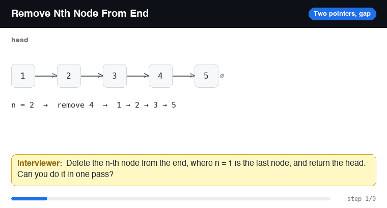

# Walkthrough: Remove Nth Node From End

**Module:** [08 · Linked Lists](../README.md) · **Difficulty:** Medium · **Solution:** [`p04_remove_nth_from_end.go`](../p04_remove_nth_from_end.go)



## The problem in plain words

Delete the n-th node counting from the end of a linked list (n = 1 is the last node) and return the head. Try to walk the list only once.

```
1->2->3->4->5, n=2  ->  1->2->3->5
1, n=1              ->  nil
```

## Mock interview

**Interviewer:** Remove the n-th node from the end and return the head. Assume `1 <= n <= length`. Can you do it in one pass?

**Candidate:** So n is always valid, and if n equals the length I'm deleting the head?

**Interviewer:** Yes.

**Candidate:** For `1->2->3->4->5` and n = 2, the second from the end is 4, so the result is `1->2->3->5`. For a single node with n = 1, the result is nil.

**Candidate:** The straightforward way takes two passes: count the length L, then walk to the node at position L − n from a dummy head and unlink the one after it. That's O(L) time and O(1) space, but it reads the list twice.

**Interviewer:** And in one pass?

**Candidate:** Two pointers with a fixed gap. To unlink a node I need the node *before* it. Both pointers start at a dummy in front of the head. I move `fast` n + 1 steps ahead. Then I move both one step at a time until `fast` is nil. At that point `slow` is n + 1 nodes from the end, which is exactly the node before the target. Then `slow.Next = slow.Next.Next`.

**Interviewer:** Why the dummy?

**Candidate:** If n equals the length, the node to delete is the head, and the node before it doesn't exist. The dummy is that node. I return `dummy.Next`, which is right in both cases.

**Candidate:** On the example: both at the dummy. `fast` moves 3 steps to node 3. Then both move: `slow = 1, fast = 4`; `slow = 2, fast = 5`; `slow = 3, fast = nil`. Stop. `slow` is on 3, so I set `3.Next = 5`, which drops 4.

**Interviewer:** Complexity?

**Candidate:** One pass, **O(L) time, O(1) space.** It's the same big-O as two passes, but each node is read once.

## What the animation shows

| Step | `slow` | `fast` | What happens |
|---|---|---|---|
| 1 | | | Interviewer states the problem |
| 2 | | | Two-pass approach: count L, walk L − n |
| 3 | D | D | Both start at the dummy |
| 4 | D | 3 | `fast` moves n + 1 = 3 steps ahead |
| 5 | 1 | 4 | Both move one step |
| 6 | 2 | 5 | Both move one step |
| 7 | 3 | nil | `fast` is nil, stop; `slow` is just before the target |
| 8 | 3 | | `slow.Next = slow.Next.Next` skips 4 |
| 9 | | | Return `dummy.Next`: `1 → 2 → 3 → 5`; O(L) time, O(1) space |

## Detailed explanation

Number the nodes so the dummy is position 0 and the real nodes are 1 to L; nil is position L + 1. After the first loop, `fast` is at position n + 1 and `slow` at 0, a gap of n + 1. The second loop keeps the gap and stops when `fast` reaches L + 1. Then `slow` is at L + 1 − (n + 1) = L − n. The target, n-th from the end, is at position L − n + 1, which is `slow.Next`.

The gap is n + 1, not n, because I want to land *before* the target. With a gap of n, `slow` would land on the target itself and I'd have no way to unlink it in a singly linked list.

The first loop is `for i := 0; i <= n; i++`, which runs n + 1 times. Since `n <= L`, `fast` never steps past nil in that loop.

`RemoveNthFromEndTwoPass` does the same unlink but finds the position by counting with `Len(head)` first.

## Complexity

| Approach | Time | Space |
|---|---|---|
| Count then walk (`RemoveNthFromEndTwoPass`) | O(L), two passes | O(1) |
| Gap of n + 1 (`RemoveNthFromEnd`) | O(L), one pass | O(1) |

## Common mistakes

- A gap of n instead of n + 1, which stops on the target instead of before it.
- Starting at `head` instead of a dummy, which breaks when the head must be deleted.
- Returning `head` instead of `dummy.Next`; if the head was deleted, `head` is stale.
- Off-by-one in the first loop: `i < n` gives a gap of n.

## Try it yourself

```sh
go test ./course/08-linked-lists/ -run TestRemoveNthFromEnd -v
```
