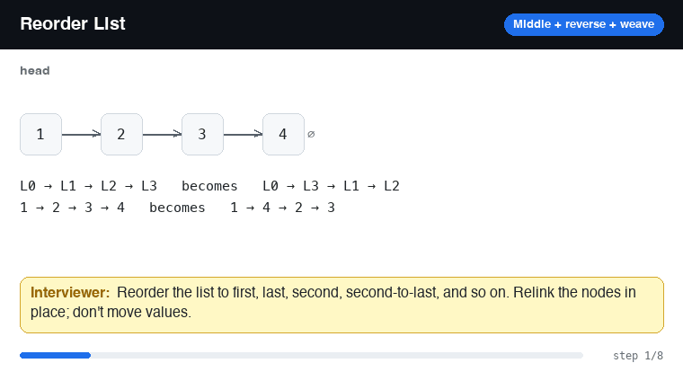

# Walkthrough: Reorder List

**Module:** [08 · Linked Lists](../README.md) · **Difficulty:** Medium · **Solution:** [`p05_reorder_list.go`](../p05_reorder_list.go)



## The problem in plain words

Rearrange a linked list into first, last, second, second-to-last, and so on. Relink the nodes in place; don't swap values.

```
1->2->3->4     ->  1->4->2->3
1->2->3->4->5  ->  1->5->2->4->3
```

## Mock interview

**Interviewer:** Rearrange `L0 -> L1 -> ... -> Ln` into `L0 -> Ln -> L1 -> Ln-1 -> ...` in place. Values must not move.

**Candidate:** No return value, I just relink? And empty or one-node lists stay as they are?

**Interviewer:** Correct.

**Candidate:** `1->2->3->4` becomes `1->4->2->3`. With five nodes, the middle node 3 ends up last: `1->5->2->4->3`.

**Candidate:** The simple way puts every node pointer in a slice and relinks with two indices, `i` from the front and `j` from the back. That's O(n) time but O(n) extra space.

**Interviewer:** Can you do it in O(1) space?

**Candidate:** I need to walk the back half from the end, and a singly linked list can't go backward. So I reverse the back half. The plan is three moves I already know. One: find the middle with slow/fast pointers. Two: reverse the second half and cut it off. Three: weave the two halves, taking one node from each in turn.

**Interviewer:** Where exactly does the first half end?

**Candidate:** I run `for fast.Next != nil && fast.Next.Next != nil`. That stops `slow` at the end of the first half, and for odd lengths the first half gets the extra node. Then `second := ReverseList(slow.Next)` and `slow.Next = nil`. The cut matters: without it, the first half still points into the second, and the weave makes a cycle.

**Candidate:** The weave saves both next pointers, sets `first.Next = second` and `second.Next = fNext`, then advances both. It stops when `second` is nil. Since the first half is never shorter, the first half's last node is already in place.

**Candidate:** On `1->2->3->4`: slow stops at 2. Reverse `3->4` into `4->3` and cut after 2. Weave: 1 points to 4, 4 points to 2. Then 2 points to 3, 3 points to nil. Result `1->4->2->3`.

**Interviewer:** Complexity?

**Candidate:** Three linear passes and a few pointers: **O(n) time, O(1) extra space.**

## What the animation shows

Nodes stay in their original positions; arrows show the current `Next` links.

| Step | What happens |
|---|---|
| 1 | Interviewer states the problem: `1 → 2 → 3 → 4` becomes `1 → 4 → 2 → 3` |
| 2 | Brute force: slice of node pointers, O(n) extra space |
| 3 | Step 1: `slow` and `fast` start at the head |
| 4 | `fast.Next.Next` is nil → stop; `slow = 2` ends the first half |
| 5 | Step 2: reverse `3 → 4` into `4 → 3`, cut after 2 |
| 6 | Step 3: `1.Next = 4`, `4.Next = 2` |
| 7 | `2.Next = 3`, `3.Next = nil`; `second` is nil, stop |
| 8 | Result `1 → 4 → 2 → 3`; O(n) time, O(1) extra space |

## Detailed explanation

The target order alternates between the front of the list moving forward and the back moving backward. After step 2, the "back moving backward" sequence is just the reversed second half read forward. So the problem becomes merging two lists by alternating, which is easy.

Sizes: the slow/fast loop leaves the first half with `ceil(n/2)` nodes and the second with `floor(n/2)`. The weave inserts each second-half node after a first-half node. When the second half runs out, any remaining first-half node (the middle, for odd n) is already last, and its `Next` is nil because of the cut.

Each weave step must save `first.Next` and `second.Next` before changing them, for the same reason as in reversal.

`ReorderListBrute` does the same relinking by index in a slice, and ends with `nodes[i].Next = nil` so the middle node becomes the tail.

## Complexity

| Approach | Time | Space |
|---|---|---|
| Slice of nodes (`ReorderListBrute`) | O(n) | O(n) |
| Middle + reverse + weave (`ReorderList`) | O(n) | O(1) |

## Common mistakes

- Forgetting `slow.Next = nil`, which leaves a cycle after the weave.
- Reversing from `slow` instead of `slow.Next`. The middle node ends up in both halves and the weave dereferences nil.
- Not saving both next pointers before relinking in the weave.
- Swapping values instead of relinking nodes.

## Try it yourself

```sh
go test ./course/08-linked-lists/ -run TestReorderList -v
```
