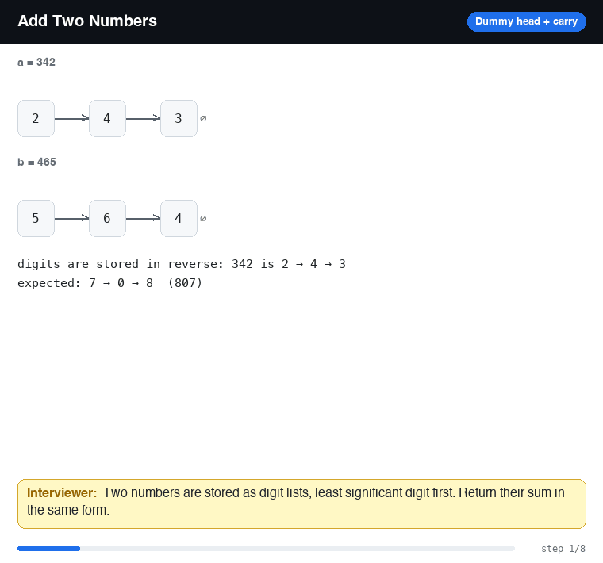

# Walkthrough: Add Two Numbers

**Module:** [08 · Linked Lists](../README.md) · **Difficulty:** Medium · **Solution:** [`p06_add_two_numbers.go`](../p06_add_two_numbers.go)



## The problem in plain words

Two numbers are stored as linked lists of digits, with the ones digit first (so 342 is `2 -> 4 -> 3`). Add them and return the sum in the same form.

```
2->4->3 + 5->6->4  ->  7->0->8   (342 + 465 = 807)
9->9    + 1        ->  0->0->1   (99 + 1 = 100)
```

## Mock interview

**Interviewer:** Two non-negative integers are stored as digit lists, least significant digit first. Return their sum as a list in the same form.

**Candidate:** No leading zeros, except the number 0 itself? And the lists can have different lengths?

**Interviewer:** Yes to both.

**Candidate:** 342 + 465 = 807, which is `7->0->8`. 99 + 1 = 100, which is `0->0->1`: the result can be one digit longer than both inputs.

**Candidate:** One idea is to convert both lists to integers, add, and convert back. That breaks as soon as a number has more than about 19 digits, because `int64` overflows. The lists can be any length.

**Interviewer:** So what do you do?

**Candidate:** Add digit by digit, like on paper. The digits already come ones first, which is the order I add in. At each position, `sum = carry + a.Val + b.Val`, where a missing digit counts as 0. I append `sum % 10` to the result and keep `carry = sum / 10`. I build the result with a dummy head and a tail pointer.

**Interviewer:** When does the loop stop?

**Candidate:** When both lists are done *and* the carry is 0. The condition is `a != nil || b != nil || carry > 0`. The `carry > 0` part is what adds the final 1 in 99 + 1.

**Candidate:** On the first example: 0 + 2 + 5 = 7, digit 7, carry 0. 0 + 4 + 6 = 10, digit 0, carry 1. 1 + 3 + 4 = 8, digit 8, carry 0. Result `7->0->8`.

**Candidate:** For 99 + 1: 0 + 9 + 1 = 10, digit 0, carry 1. 1 + 9 = 10, digit 0, carry 1. Both lists are done but the carry is 1, so one more round: digit 1. Result `0->0->1`.

**Interviewer:** Complexity?

**Candidate:** One pass over the longer list, plus maybe one digit. **O(max(m, n)) time**, and O(max(m, n)) space for the output list.

## What the animation shows

| Step | What happens |
|---|---|
| 1 | Interviewer states the problem: 342 + 465 as `2→4→3` and `5→6→4` |
| 2 | Converting to int overflows past ~19 digits |
| 3 | Set up `carry = 0` and a dummy head; loop while `a`, `b` or `carry` remain |
| 4 | `0 + 2 + 5 = 7` → digit 7, carry 0 |
| 5 | `0 + 4 + 6 = 10` → digit 0, carry 1 |
| 6 | `1 + 3 + 4 = 8` → digit 8, carry 0; result `7 → 0 → 8` |
| 7 | Interviewer asks about 99 + 1 |
| 8 | `10 → 0, carry 1`; `10 → 0, carry 1`; final carry adds 1 → `0 → 0 → 1`; O(max(m, n)) |

## Detailed explanation

This is grade-school addition. Each column's sum is at most 9 + 9 + 1 = 19, so the carry is always 0 or 1, and `sum % 10` and `sum / 10` split it correctly.

Invariant: *after k rounds, the result list holds the lowest k digits of the true sum, and `carry` is what spills into column k.* Each round adds one column, so the invariant holds. The loop ends only when there are no digits left and no carry, so every digit of the sum has been written.

Different lengths need no special code: the `if a != nil` and `if b != nil` checks simply skip a finished list. The dummy head avoids a special case for the first digit.

Unlike most problems in this module, the solution allocates new nodes. That's required: the sum may be longer than either input.

## Complexity

| Approach | Time | Space |
|---|---|---|
| Convert to int and back (not in the repo; overflows) | O(m + n) | O(m + n) |
| Digit by digit with carry (`AddTwoNumbers`) | O(max(m, n)) | O(max(m, n)) output |

## Common mistakes

- Looping only `while a != nil && b != nil`, which drops the longer list's tail.
- Forgetting `|| carry > 0`, which loses the final digit in 99 + 1.
- Converting to `int`, which overflows on long inputs.
- Reversing the inputs first. The digits are already in the right order to add.

## Try it yourself

```sh
go test ./course/08-linked-lists/ -run TestAddTwoNumbers -v
```
