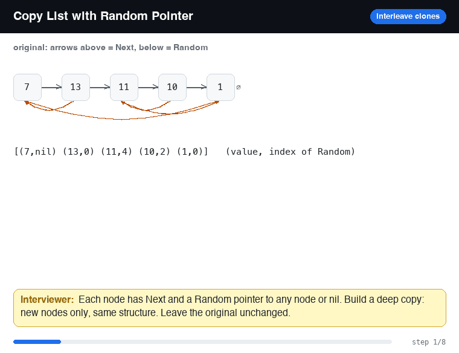

# Walkthrough: Copy List with Random Pointer

**Module:** [08 · Linked Lists](../README.md) · **Difficulty:** Medium · **Solution:** [`p07_copy_random_list.go`](../p07_copy_random_list.go)



## The problem in plain words

Each node has a `Next` pointer and a `Random` pointer that can point to any node in the list, or be nil. Make a deep copy: brand-new nodes whose `Next` and `Random` pointers match the original's shape but point only at new nodes. Leave the original unchanged.

```
[(7,nil) (13,0) (11,4) (10,2) (1,0)]   (value, index of Random)
->  an identical, fully separate list
```

## Mock interview

**Interviewer:** Deep-copy a list where every node also has a Random pointer. The copy must use only new nodes, and the original must be unchanged afterwards.

**Candidate:** Random can point forward, backward, to itself, or be nil? And an empty list returns nil?

**Interviewer:** Yes.

**Candidate:** In the example, 13's Random is node 0 (the 7), 11's is node 4 (the 1), and so on. In the copy, 13′'s Random must point at 7′, not at the original 7.

**Candidate:** Copying `Next` alone is easy. The hard part is Random: when I copy 11, its Random target, 1, may not have a copy yet. The standard fix is a map from each old node to its new node. Pass 1 creates every clone. Pass 2 sets `clone[n].Next = clone[n.Next]` and `clone[n].Random = clone[n.Random]`. That's O(n) time and O(n) extra space for the map.

**Interviewer:** Can you avoid the map?

**Candidate:** Yes, by storing the map inside the list. Step 1: insert each clone right after its original, so the list becomes `7 -> 7' -> 13 -> 13' -> ...`. Now `X.Next` *is* X's clone. Step 2: for each original X with a Random, set `X'.Random = X.Random.Next`, because `X.Random.Next` is the clone of X's Random target. Step 3: split the two lists apart and restore the original `Next` pointers.

**Interviewer:** Why does step 2 need step 1 to be finished first?

**Candidate:** `X.Random` can point anywhere, including ahead. Its clone has to exist already, so every clone must be inserted before I set any Random.

**Candidate:** On the example: after step 1 the list is `7, 7', 13, 13', 11, 11', 10, 10', 1, 1'`. In step 2, 11's Random is 1, and `1.Next` is 1′, so `11'.Random = 1'`. 7's Random is nil, so 7′ keeps nil. In step 3, each original skips over its clone, and each clone skips over the next original. I return the old `head.Next`, which is 7′.

**Interviewer:** Complexity?

**Candidate:** Three linear passes. **O(n) time, O(1) extra space** besides the copy itself.

## What the animation shows

Arrows above the boxes are `Next`. Arrows below are `Random`: orange for originals, green for clones. Clones are drawn with a prime (7′) and a purple fill.

| Step | What happens |
|---|---|
| 1 | Interviewer states the problem with the original list and its Random pointers |
| 2 | Brute force: old→new map in two passes, O(n) extra space |
| 3 | Step 1 begins: 7′ is inserted between 7 and 13 |
| 4 | Step 1 done: every original is followed by its clone |
| 5 | Step 2 example: `11.Random = 1`, so `11'.Random = 1.Next = 1'` |
| 6 | Step 2 done: every clone's Random points at a clone; 7′ keeps nil |
| 7 | Step 3: unweave into the restored original and the copy |
| 8 | The copy matches the original's shape; O(n) time, O(1) extra space |

## Detailed explanation

After step 1, the list alternates original, clone, original, clone. For every original `X`, `X.Next` is `X'`. That is the old→new map, stored without extra memory.

Step 2 walks the originals only (`n = n.Next.Next`). For each, `n.Random.Next` is the clone of `n.Random`, so `n.Next.Random = n.Random.Next` sets the clone's Random correctly. If `n.Random` is nil, the clone's Random stays nil.

Step 3 walks the originals again. For original `n` and its clone `c = n.Next`:

- `n.Next = c.Next` restores the original link (to the next original, or nil).
- `c.Next = c.Next.Next` links the clone to the next clone, if there is one.

After step 3 the original list is exactly as it started, which the problem requires.

`CopyRandomListMap` is the map version. Its map starts with `nil: nil`, so `clone[n.Next]` and `clone[n.Random]` handle nil without an `if`.

## Complexity

| Approach | Time | Space |
|---|---|---|
| Old→new map (`CopyRandomListMap`) | O(n) | O(n) map |
| Interleave clones (`CopyRandomListInterleave`) | O(n) | O(1) extra (besides the output) |

## Common mistakes

- Setting Random during step 1, before the clone of the Random target exists.
- Setting `X'.Random = X.Random`, which points the copy into the original list.
- Forgetting to restore the original `Next` pointers in step 3.
- Dereferencing `c.Next.Next` on the last clone without checking `c.Next != nil`.

## Try it yourself

```sh
go test ./course/08-linked-lists/ -run TestCopyRandomList -v
```
