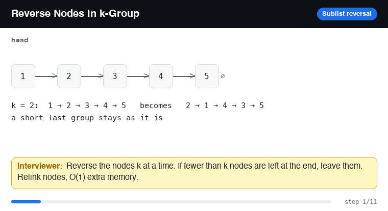

# Walkthrough: Reverse Nodes in k-Group

**Module:** [08 · Linked Lists](../README.md) · **Difficulty:** Hard · **Solution:** [`p08_reverse_k_group.go`](../p08_reverse_k_group.go)



## The problem in plain words

Reverse a linked list k nodes at a time. If fewer than k nodes are left at the end, leave them as they are. Relink the nodes (don't swap values) and use O(1) extra memory.

```
1->2->3->4->5, k=2  ->  2->1->4->3->5
1->2->3->4->5, k=3  ->  3->2->1->4->5
```

## Mock interview

**Interviewer:** Reverse the nodes in groups of k and return the new head. A short last group stays in order. Relink nodes, O(1) memory. `k >= 1`.

**Candidate:** With k = 1 nothing changes, and if k is larger than the list, nothing changes either?

**Interviewer:** Right.

**Candidate:** For `1->2->3->4->5` with k = 2, the groups are `[1,2]`, `[3,4]` and the leftover `[5]`. Reversing the full groups gives `2->1->4->3->5`.

**Candidate:** A brute force copies the values into a slice, reverses each full chunk of k, and builds a new list. That's O(n) time but O(n) space, and it moves values instead of relinking nodes.

**Interviewer:** How do you do it in place?

**Candidate:** It's the plain reversal from problem 1, applied to one group at a time between two fixed anchors. I keep `groupPrev`, the node just before the current group, starting at a dummy. For each group:

1. Walk k nodes from `groupPrev` to find `kth`. If I hit nil first, the group is short, so I return `dummy.Next`.
2. Remember `groupNext = kth.Next`, where the rest of the list starts.
3. Reverse the group with the prev/cur loop, but start `prev` at `groupNext` instead of nil. Then the group's old first node ends up pointing straight at `groupNext`.
4. Set `groupPrev.Next = kth`, the group's new head. The old first node is now the group's tail, so it becomes `groupPrev` for the next group.

**Interviewer:** Why start `prev` at `groupNext`?

**Candidate:** In a full-list reversal, the old head ends up pointing at `prev`'s starting value, nil. Here I want the reversed group to stay connected to the rest of the list. Starting `prev` at `groupNext` does that with no extra step.

**Candidate:** On the example with k = 2: `groupPrev` is the dummy. kth = 2, groupNext = 3. Reverse: 1 points to 3, 2 points to 1. Then dummy points to 2, and `groupPrev` becomes 1. Next group: kth = 4, groupNext = 5. Reverse: 3 points to 5, 4 points to 3. 1 points to 4, `groupPrev` becomes 3. Walking 2 from 3 reaches nil, so I stop. The list is `2->1->4->3->5`.

**Interviewer:** Complexity?

**Candidate:** Each node is walked once by the check and once by the reversal. **O(n) time, O(1) extra space.**

## What the animation shows

Nodes stay in their original positions; arrows show the current `Next` links, and "list now" spells out the order. Green nodes belong to finished groups.

| Step | What happens |
|---|---|
| 1 | Interviewer states the problem: k = 2 on `1 → 2 → 3 → 4 → 5` |
| 2 | Brute force: reverse value chunks in a slice, O(n) space |
| 3 | `groupPrev = dummy` |
| 4 | Group 1: `kth = 2`, `groupNext = 3` |
| 5 | Reverse with `prev = groupNext`: `1.Next = 3`, `2.Next = 1` |
| 6 | `dummy.Next = 2`; `groupPrev = 1`; list `2 → 1 → 3 → 4 → 5` |
| 7 | Group 2: `kth = 4`, `groupNext = 5` |
| 8 | Reverse: `3.Next = 5`, `4.Next = 3` |
| 9 | `1.Next = 4`; `groupPrev = 3`; list `2 → 1 → 4 → 3 → 5` |
| 10 | Walking 2 nodes from 3 reaches nil → short group, stop |
| 11 | Return `dummy.Next`: `2 → 1 → 4 → 3 → 5`; O(n) time, O(1) space |

## Detailed explanation

Invariant at the top of each round: *`dummy.Next` through `groupPrev` is the finished part, already reversed group by group, and `groupPrev.Next` is the first node of the untouched rest.*

One round:

- The walk to `kth` checks that k nodes exist without changing anything. If they don't, the untouched rest stays in order, which is what the problem asks for.
- The reversal runs while `cur != groupNext`, so it touches exactly the k nodes of the group. Starting with `prev = groupNext` means the first node processed (the old first node) gets `Next = groupNext`, so the group stays linked to the rest.
- `first := groupPrev.Next` is read *before* `groupPrev.Next` is changed. Then `groupPrev.Next = kth` attaches the reversed group, and `groupPrev = first` moves the anchor to the group's new tail.

The dummy gives the first group a node before it, like every other group, so the head change needs no special case.

## Complexity

| Approach | Time | Space |
|---|---|---|
| Reverse value chunks and rebuild (`ReverseKGroupBrute`) | O(n) | O(n) |
| In-place group reversal (`ReverseKGroup`) | O(n) | O(1) |

## Common mistakes

- Reversing before checking that k nodes exist, which wrongly reverses the short last group.
- Starting `prev` at nil, which disconnects the group from the rest of the list.
- Reading `groupPrev.Next` after reassigning it, so `groupPrev` moves to the wrong node.
- Forgetting to advance `groupPrev`, which reverses the same group forever.

## Try it yourself

```sh
go test ./course/08-linked-lists/ -run TestReverseKGroup -v
```
