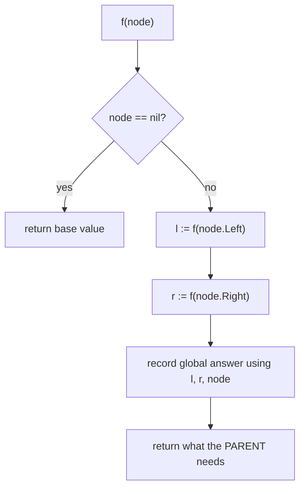

# 09 — Trees

Almost every binary-tree problem is the same recursive function with a
different "combine" step: *ask the left subtree, ask the right subtree, combine
the answers at this node.* Once you see trees that way, the remaining work
is choosing **what to return** and **what to pass down**.

## What you'll learn

- `TreeNode`, plus `FromLevelOrder` / `ToLevelOrder` helpers that use the familiar
  `[3,9,20,null,null,15,7]` notation (`Null` marks a missing child), in [trees.go](trees.go).
- All four traversals, recursive and iterative: pre/in/post-order with an
  explicit stack, and level order with a queue.
- Bottom-up recursion ("return one thing, record another"): diameter, max path sum.
- Top-down recursion (pass constraints down): validate BST.
- BST properties: ordered descent (LCA) and sorted inorder.
- Rebuilding and serializing trees.

## Recognize the pattern

| Clue | Approach |
|---|---|
| depth, height, size, sum of a subtree | post-order: compute from children, return up |
| "longest path between any two nodes", "max path sum" | post-order; return the best one-sided branch, record the best path that turns at this node |
| "valid BST", "all nodes within range", "path from root with constraint" | pre-order: pass bounds/state down |
| "level", "row", "right side view", "zigzag", "minimum depth" | BFS with `size := len(queue)` per level |
| sorted order in a BST, "k-th smallest" | inorder traversal |
| "ancestor", "distance between nodes" | post-order search returning found nodes |
| rebuild / encode a tree | preorder + null markers, or preorder + inorder |

## The idea

```
                  1            pre  (root, L, R): 1 2 4 5 3 6
                 / \           in   (L, root, R): 4 2 5 1 3 6
                2   3          post (L, R, root): 4 5 2 6 3 1
               / \   \         level           : [1] [2 3] [4 5 6]
              4   5   6
```

**Bottom-up template.** Diameter, walked on the tree above. Each call returns
its height, and the best path that turns at a node is `left + right`:

```
node 4: l=0 r=0 -> best=max(0,0)=0 ; returns 1
node 5: l=0 r=0 -> best=0          ; returns 1
node 2: l=1 r=1 -> best=2          ; returns 2
node 6:                            ; returns 1
node 3: l=0 r=1 -> best=2          ; returns 2
node 1: l=2 r=2 -> best=4          ; returns 3      diameter = 4 (4-2-1-3-6)
```



**Top-down template.** Validate BST passes an allowed interval `(lo, hi)`;
going left sets `hi = node.Val`, going right sets `lo = node.Val`.

## Go template

```go
// Bottom-up: return what the parent needs, record the global answer.
func solve(root *TreeNode) int {
	best := 0
	var dfs func(*TreeNode) int
	dfs = func(n *TreeNode) int {
		if n == nil {
			return 0
		}
		l, r := dfs(n.Left), dfs(n.Right)
		best = max(best, l+r) // answer that "turns" at n
		return 1 + max(l, r)  // value for the parent
	}
	dfs(root)
	return best
}

// BFS by level.
queue := []*TreeNode{root}
for len(queue) > 0 {
	size := len(queue)
	for _, n := range queue[:size] {
		// process n; append children
	}
	queue = queue[size:]
}
```

## Complexity

| Operation | Time | Space |
|---|---|---|
| Any full traversal | O(n) | O(h) recursion/stack, O(w) queue for BFS |
| BST search / insert / LCA | O(h) | O(1) iterative |
| h for a balanced tree / a degenerate (linked-list) tree | O(log n) / O(n) | |

Always say "O(h), which is O(n) worst case" for recursion space.

## Common pitfalls

- **Validating a BST with only parent/child checks.** A grandchild can break
  the rule (`[5,4,6,null,null,3,7]`). Pass bounds down.
- **Sentinels for bounds.** Using `math.MinInt` as "no lower bound" fails when a
  node holds `math.MinInt`. Use `*int` (nil = unbounded) or the inorder check.
- **Edges vs nodes.** Diameter counts edges, depth counts nodes. Be explicit.
- **Negative values in path sums.** Clamp branch gains with `max(gain, 0)`, but the
  path must still contain at least one node, so initialise `best` to `math.MinInt`, not 0.
- **Go: recursive closures need a declared variable first.** `var dfs func(*TreeNode) int`
  then `dfs = func...`; `dfs := func...` can't call itself.
- **Go: closures capturing a counter** (preorder cursor in BuildTree / Deserialize)
  must capture a variable, not a copy passed by value.
- **Go: queue as a slice.** `queue = queue[1:]` is fine for interviews, but the
  backing array is only freed when the whole slice is. Use `queue[size:]` once per level.
- **Go: `for _, n := range queue[:size]` while appending to `queue`.** Safe,
  because the range expression is evaluated once, and you only read the first
  `size` items.

## Problems

| # | Problem | Difficulty | Key idea |
|---|---|---|---|
| 01 | [Maximum Depth](p01_max_depth.go) | Easy | 1 + max(left, right); BFS counts levels |
| 02 | [Invert Binary Tree](p02_invert_tree.go) | Easy | Swap children at every node |
| 03 | [Diameter of Binary Tree](p03_diameter.go) | Easy | Return height, record left + right |
| 04 | [Validate BST](p04_validate_bst.go) | Medium | Pass (lo, hi) bounds down; or strictly increasing inorder |
| 05 | [Lowest Common Ancestor (BST + general)](p05_lowest_common_ancestor.go) | Medium | BST: split point. General: both sides non-nil |
| 06 | [Right Side View](p06_right_side_view.go) | Medium | Last node per BFS level; or right-first DFS |
| 07 | [Construct from Preorder + Inorder](p07_build_tree.go) | Medium | Root from preorder splits inorder; index map |
| 08 | [Serialize and Deserialize](p08_serialize.go) | Hard | Preorder with `#` null markers |
| 09 | [Maximum Path Sum](p09_max_path_sum.go) | Hard | Return best one-sided gain, record the turning path |

The traversals themselves, with tests, are in [trees.go](trees.go), and
`Equal` is LeetCode's *Same Tree*.

## Practice tip

For each problem, decide two things before coding: *what does my recursive
function return?* and *what, if anything, is recorded globally?* Then hide the
solution, re-solve, and run its tests:

```sh
go test ./course/09-trees/ -run TestMaxPathSum -v
```

## Next

[10 — Heaps](../10-heaps/)
