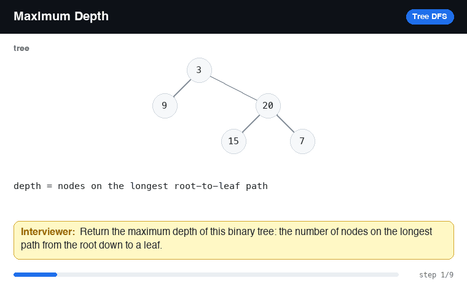

# Walkthrough: Maximum Depth

**Module:** [09 · Trees](../README.md) · **Difficulty:** Easy · **Solution:** [`p01_max_depth.go`](../p01_max_depth.go)



## The problem in plain words

You get a binary tree. Count the nodes on the longest path from the root down to a leaf. An empty tree has depth 0.

```
    3
   / \
  9   20          [3,9,20,null,null,15,7]  →  3
     /  \
    15   7
```

## Mock interview

**Interviewer:** Return the maximum depth of a binary tree: the number of nodes on the longest root-to-leaf path.

**Candidate:** Do we count nodes or edges? And what is the depth of an empty tree?

**Interviewer:** Nodes. An empty tree has depth 0, and a single node has depth 1.

**Candidate:** For `[3,9,20,null,null,15,7]` the longest path is 3 → 20 → 15 (or 3 → 20 → 7), so the answer is 3. For `[1,null,2]` it's 2. Edge cases are the empty tree and a tree that is one long chain.

**Candidate:** A clumsy approach is to list every root-to-leaf path and measure each one. That copies paths around and costs O(n·h) time and extra memory.

**Interviewer:** Can you do better?

**Candidate:** The depth of a node only depends on its children. If I know the depth of the left subtree and of the right subtree, the depth here is `1 + max(left, right)`. A nil child has depth 0. So one post-order recursion answers it.

**Interviewer:** Why is it safe to trust the recursive calls?

**Candidate:** Each call works on a strictly smaller tree, and the base case (nil returns 0) is correct. By induction every call returns the true depth of its subtree, including the call on the root.

**Candidate:** In code: `if root == nil { return 0 }`, then `return 1 + max(MaxDepth(root.Left), MaxDepth(root.Right))`. There's also `MaxDepthBFS`, which counts levels with a queue and avoids deep recursion.

**Candidate:** Testing on the example: 9 is a leaf and returns 1. 15 and 7 are leaves and return 1. 20 returns 1 + max(1, 1) = 2. The root returns 1 + max(1, 2) = 3.

**Interviewer:** Complexity?

**Candidate:** Each node is visited once, so **O(n) time**. The recursion stack is as deep as the tree, **O(h) space**, which is O(n) for a skewed tree and O(log n) for a balanced one.

## What the animation shows

| Step | What happens |
|---|---|
| 1 | Interviewer states the problem on `[3,9,20,null,null,15,7]` |
| 2 | Brute force: measure every root-to-leaf path |
| 3 | At the root: ask left and right before answering |
| 4 | Leaf 9 returns 1 + max(0, 0) = 1 |
| 5 | Leaf 15 returns 1 |
| 6 | Leaf 7 returns 1 |
| 7 | Node 20 returns 1 + max(1, 1) = 2 |
| 8 | Root 3 returns 1 + max(1, 2) = 3 |
| 9 | Answer 3, O(n) time, O(h) space |

## Detailed explanation

This is the basic shape of almost every tree problem: *ask the left subtree, ask the right subtree, combine at this node.* Here the combine step is `1 + max(l, r)`.

The calls finish in post-order: a node can only return after both children have returned. That's why the animation fills in leaves first and the root last.

Edge cases:

- **Empty tree:** the nil check returns 0 straight away.
- **Skewed tree** (every node has only one child): the recursion goes n levels deep. In Go the stack grows on demand, so it won't crash for normal inputs, but `MaxDepthBFS` uses no recursion at all if that matters.

The BFS version increments `depth` once per level. It takes `size := len(queue)` at the start of each level, so it knows where that level ends.

## Complexity

| Approach | Time | Space |
|---|---|---|
| Recursive DFS (`MaxDepth`) | O(n) | O(h) |
| Level-order BFS (`MaxDepthBFS`) | O(n) | O(w), w = widest level |

## Common mistakes

- Counting edges instead of nodes (that gives depth − 1).
- Returning 1 for a nil node, which adds an extra level everywhere.
- In the BFS, forgetting to snapshot `size` before appending children, which mixes two levels together.

## Try it yourself

```sh
go test ./course/09-trees/ -run TestMaxDepth -v
```
