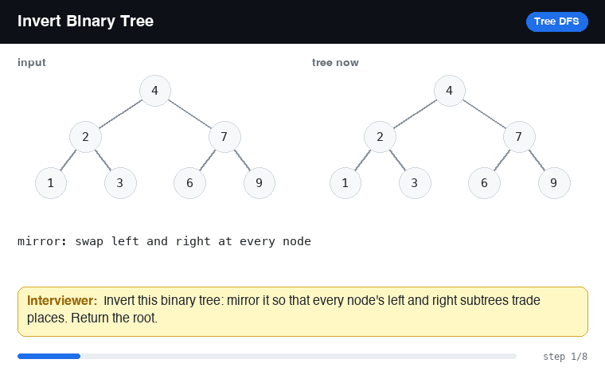

# Walkthrough: Invert Binary Tree

**Module:** [09 · Trees](../README.md) · **Difficulty:** Easy · **Solution:** [`p02_invert_tree.go`](../p02_invert_tree.go)



## The problem in plain words

Turn a binary tree into its mirror image: at every node, the left and right subtrees swap places. Return the root.

```
    4                 4
   / \               / \
  2   7     ->      7   2
 / \ / \           / \ / \
1  3 6  9         9  6 3  1
```

## Mock interview

**Interviewer:** Invert a binary tree: mirror it so every node's left and right subtrees trade places. Return the root.

**Candidate:** Should I change the tree in place or build a new one? And what about an empty tree?

**Interviewer:** In place is fine. An empty tree returns `nil`.

**Candidate:** For `[4,2,7,1,3,6,9]` the result is `[4,7,2,9,6,3,1]`. A leaf stays the same, since swapping two nils does nothing.

**Candidate:** One naive way is to read each level into a list, reverse it, and build a new tree. That's O(n), but it needs a second tree and careful handling of null slots.

**Interviewer:** Is there something simpler?

**Candidate:** Mirroring a tree means mirroring both subtrees and then swapping them. That's a local operation at every node. The recursive version is one line: `root.Left, root.Right = InvertTree(root.Right), InvertTree(root.Left)`.

**Interviewer:** In what order does that line run?

**Candidate:** Go evaluates everything on the right-hand side first, left to right, so it inverts the right subtree, then the left subtree, and only then assigns both. Because the assignment waits until both calls return, I never read a child pointer I've already overwritten.

**Candidate:** Testing on the example: at 4, I recurse into 7 first. 9 and 6 are leaves and return themselves. Then 7 swaps, so its children become 9, 6. Then 2's subtree: 3 and 1 return, 2 swaps to 3, 1. Finally 4 swaps its children to 7, 2. The level order is `[4,7,2,9,6,3,1]`.

**Interviewer:** Complexity?

**Candidate:** Each node is swapped once: **O(n) time**. The recursion uses **O(h) space**. `InvertTreeBFS` does the same swaps with a queue, using O(w) space for the widest level.

## What the animation shows

| Step | What happens |
|---|---|
| 1 | Interviewer states the problem on `[4,2,7,1,3,6,9]` |
| 2 | Naive idea: reverse each level and rebuild |
| 3 | At 4: both recursive calls run before the assignment, right subtree first |
| 4 | Leaf 9 swaps nil with nil and returns itself (the other leaves do the same) |
| 5 | 7 swaps: its children become 9, 6 |
| 6 | 2 swaps: its children become 3, 1 |
| 7 | Root 4 swaps: its children become 7, 2 |
| 8 | Result `[4,7,2,9,6,3,1]`, O(n) time, O(h) space |

## Detailed explanation

Claim: `InvertTree(n)` returns the mirror of the subtree at `n`. For nil it returns nil, which is correct. For a real node, the mirror has the mirrored right subtree on the left and the mirrored left subtree on the right. That is exactly what the tuple assignment builds.

Any traversal works, as long as every node gets swapped once. Pre-order (swap, then recurse), post-order (recurse, then swap) and BFS all give the same result. The one trap is overwriting a child pointer before you have read it. The tuple assignment avoids that (see Common mistakes).

Edge cases: an empty tree returns nil, and a single node returns itself.

## Complexity

| Approach | Time | Space |
|---|---|---|
| Recursive (`InvertTree`) | O(n) | O(h) |
| BFS (`InvertTreeBFS`) | O(n) | O(w) |

## Common mistakes

- Writing `root.Left = InvertTree(root.Right)` and then `root.Right = InvertTree(root.Left)` on two lines. The second line reads the already-changed `root.Left`. Use a tuple assignment or a temp variable.
- Forgetting to return the root.
- Swapping values instead of subtrees. Mirroring changes the shape, not just labels.

## Try it yourself

```sh
go test ./course/09-trees/ -run TestInvertTree -v
```
