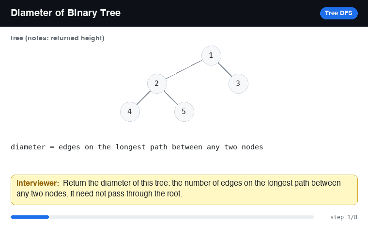

# Walkthrough: Diameter of Binary Tree

**Module:** [09 · Trees](../README.md) · **Difficulty:** Easy · **Solution:** [`p03_diameter.go`](../p03_diameter.go)



## The problem in plain words

Find the longest path between any two nodes, measured in edges. The path does not have to go through the root.

```
      1
     / \
    2   3        [1,2,3,4,5]  →  3   (4-2-1-3 or 5-2-1-3)
   / \
  4   5
```

## Mock interview

**Interviewer:** Return the diameter of a binary tree: the number of edges on the longest path between any two nodes.

**Candidate:** Edges, not nodes? And can the path skip the root?

**Interviewer:** Edges. And yes, the path can be anywhere in the tree.

**Candidate:** For `[1,2,3,4,5]` the longest path is 4-2-1-3, which has 3 edges. For `[1,2]` it's 1. A single node or an empty tree gives 0.

**Candidate:** Every path has one highest node where it turns. At that node, the longest path turning there is the left height plus the right height. The brute force (`DiameterBrute`) tries every node as the turning point and calls `height` each time. Heights get recomputed over and over, so it's O(n²) on a skewed tree.

**Interviewer:** How do you avoid recomputing heights?

**Candidate:** I compute the height bottom-up in one pass, and at each node I also record `l + r` in a variable `best`. The helper *returns* the height, because that's what the parent needs. It *records* the path length, because that's the actual answer. Return one thing, record another.

**Interviewer:** Why can't the helper just return the diameter?

**Candidate:** A parent can only extend a path that goes straight down. A path that already turns inside a child can't be extended upward. So the parent needs the height, and the turning path has to be kept on the side.

**Candidate:** In code: a closure `h(n)` returns 0 for nil, otherwise computes `l, r := h(n.Left), h(n.Right)`, sets `best = max(best, l+r)`, and returns `1 + max(l, r)`.

**Candidate:** Testing on the example: 4 and 5 return 1 with best 0. Node 2 sees 1 + 1 = 2, so best = 2, and returns 2. Leaf 3 returns 1. The root sees 2 + 1 = 3, so best = 3. The answer is 3.

**Interviewer:** Complexity?

**Candidate:** One pass, so **O(n) time**, and **O(h) space** for the recursion.

## What the animation shows

| Step | Node | l | r | best | returns |
|---|---|---|---|---|---|
| 1 | Interviewer states the problem | | | | |
| 2 | Brute force: recompute heights per node | | | | |
| 3 | 4 | 0 | 0 | 0 | 1 |
| 4 | 5 | 0 | 0 | 0 | 1 |
| 5 | 2 | 1 | 1 | 2 | 2 |
| 6 | 3 | 0 | 0 | 2 | 1 |
| 7 | 1 | 2 | 1 | 3 | 3 |
| 8 | Answer 3 (4-2-1-3), O(n) time, O(h) space | | | | |

## Detailed explanation

Take any longest path. It has exactly one node closest to the root, the place where it turns. From there it goes down into the left subtree as far as it can, and down into the right subtree as far as it can. The left part has `height(left)` edges and the right part has `height(right)` edges, where height counts nodes. So the diameter is the maximum of `l + r` over all nodes. The helper visits every node, so it checks every possible turning point.

The height counts nodes, and a nil child has height 0. That makes `l + r` the number of edges in the path that turns at `n`. A leaf gives 0 + 0 = 0 edges, which is correct.

Edge cases: an empty tree returns 0 because `best` starts at 0. A chain of n nodes gives n − 1.

## Complexity

| Approach | Time | Space |
|---|---|---|
| Brute force (`DiameterBrute`) | O(n²) worst case | O(h) |
| One pass (`Diameter`) | O(n) | O(h) |

## Common mistakes

- Returning `l + r` instead of the height, which breaks every parent's calculation.
- Only checking the path through the root. The longest path can sit entirely inside one subtree.
- Mixing up nodes and edges: `l + r + 1` counts nodes.

## Try it yourself

```sh
go test ./course/09-trees/ -run TestDiameter -v
```
