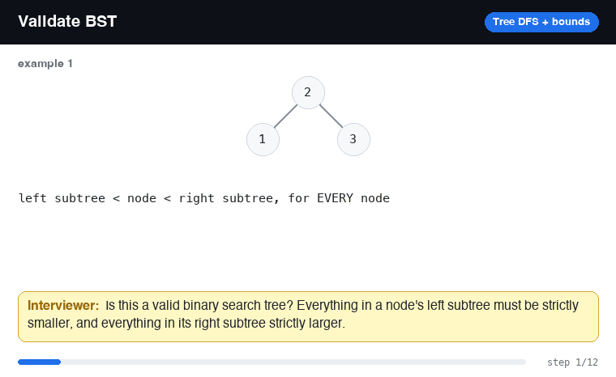

# Walkthrough: Validate BST

**Module:** [09 · Trees](../README.md) · **Difficulty:** Medium · **Solution:** [`p04_validate_bst.go`](../p04_validate_bst.go)



## The problem in plain words

Check whether a binary tree is a valid binary search tree. For every node, everything in its left subtree must be strictly smaller, and everything in its right subtree strictly larger. Duplicates make it invalid.

```
[2,1,3]               →  true
[5,4,6,null,null,3,7] →  false   (3 is in 5's right subtree but 3 < 5)
```

## Mock interview

**Interviewer:** Decide whether a binary tree is a valid BST. Left subtree values must be strictly smaller than the node, right subtree values strictly larger.

**Candidate:** Is an empty tree valid? And are duplicates allowed?

**Interviewer:** An empty tree is valid. Duplicates are not.

**Candidate:** `[2,1,3]` is valid. `[5,4,6,null,null,3,7]` is the tricky one: each parent-child pair looks fine (4 < 5, 6 > 5, 3 < 6, 7 > 6), but 3 sits in 5's right subtree, so it should be larger than 5. That tree is invalid.

**Candidate:** The brute force (`IsValidBSTBrute`) compares each node with every value in its left and right subtrees. That's O(n²) on a skewed tree. Checking only parent and child is O(n), but wrong, as the second example shows.

**Interviewer:** How do you get O(n) and still be correct?

**Candidate:** Each node inherits a range from its ancestors. The root may hold any value. When I go left from a node with value v, everything below must be less than v, so the upper bound becomes v. When I go right, the lower bound becomes v. A node is valid if it sits strictly inside its range and both children are valid with their tighter ranges.

**Interviewer:** Why does checking a node against just two numbers cover all its ancestors?

**Candidate:** The range is the tightest combination of every ancestor's rule. Going left from 5 and then right from 2, say, gives the range (2, 5). Any ancestor further up gives a looser limit that's already implied. So two numbers carry everything I need.

**Candidate:** In code, the bounds are `*int`, so `nil` means "no bound". That avoids a sentinel like `math.MinInt`, which a real node could hold. `valid(n, lo, hi)` returns true for nil, false if `n.Val <= *lo` or `n.Val >= *hi`, and otherwise recurses with `valid(n.Left, lo, &n.Val) && valid(n.Right, &n.Val, hi)`.

**Candidate:** Testing on `[2,1,3]`: 2 in (-∞, ∞) is fine, 1 in (-∞, 2) is fine, 3 in (2, ∞) is fine, so it returns true. On `[5,4,6,null,null,3,7]`: 5, 4 and 6 pass, then 3 must lie in (5, 6). It doesn't, so it returns false.

**Interviewer:** Complexity?

**Candidate:** Each node is checked once against two numbers: **O(n) time** and **O(h) space** for the recursion. The other approach, `IsValidBSTInorder`, checks that an in-order walk is strictly increasing. It's also O(n).

## What the animation shows

| Step | What happens |
|---|---|
| 1 | Interviewer states the rule on `[2,1,3]` |
| 2 | Brute force is O(n²); parent/child checks alone are wrong |
| 3 | Check 2 in (-∞, ∞): ok |
| 4 | Check 1 in (-∞, 2): ok |
| 5 | Check 3 in (2, ∞): ok |
| 6 | `[2,1,3]` → true |
| 7 | Interviewer shows `[5,4,6,null,null,3,7]`, where every parent/child pair looks fine |
| 8 | Check 5 in (-∞, ∞): ok |
| 9 | Check 4 in (-∞, 5): ok |
| 10 | Check 6 in (5, ∞): ok |
| 11 | Check 3 in (5, 6): fails, return false |
| 12 | Results and complexity: O(n) time, O(h) space |

## Detailed explanation

**Invariant:** when `valid(n, lo, hi)` is called, every ancestor's rule about `n` is captured by `lo < n.Val < hi`. At the root there are no rules, so both bounds are nil. Going left from node `p` adds the rule "less than p.Val". Since every earlier upper bound is at least p.Val (or p wouldn't have passed), `p.Val` is the tightest upper bound. The same holds for going right.

So `valid` returns true only if every node satisfies all of its ancestors' rules, which is the definition of a BST.

The `&&` short-circuits: as soon as one node fails, the rest of the tree is skipped.

The in-order version uses a different fact: a tree is a BST exactly when its in-order sequence is strictly increasing. `IsValidBSTInorder` walks the tree with an explicit stack and compares each value with the previous one.

Edge cases:

- Empty tree: valid.
- Values equal to `math.MinInt` or `math.MaxInt`: handled, because "no bound" is `nil`, not a sentinel.
- Duplicates: `<=` and `>=` make them fail.

## Complexity

| Approach | Time | Space |
|---|---|---|
| Brute force (`IsValidBSTBrute`) | O(n²) worst case | O(n) |
| Bounds passed down (`IsValidBST`) | O(n) | O(h) |
| In-order walk (`IsValidBSTInorder`) | O(n) | O(h) |

## Common mistakes

- Only comparing a node with its direct children. The second example passes that test but isn't a BST.
- Using `math.MinInt` / `math.MaxInt` as "no bound". A node holding that value then fails wrongly.
- Using `<` and `>` instead of `<=` and `>=`, which lets duplicates through.

## Try it yourself

```sh
go test ./course/09-trees/ -run TestIsValidBST -v
```
