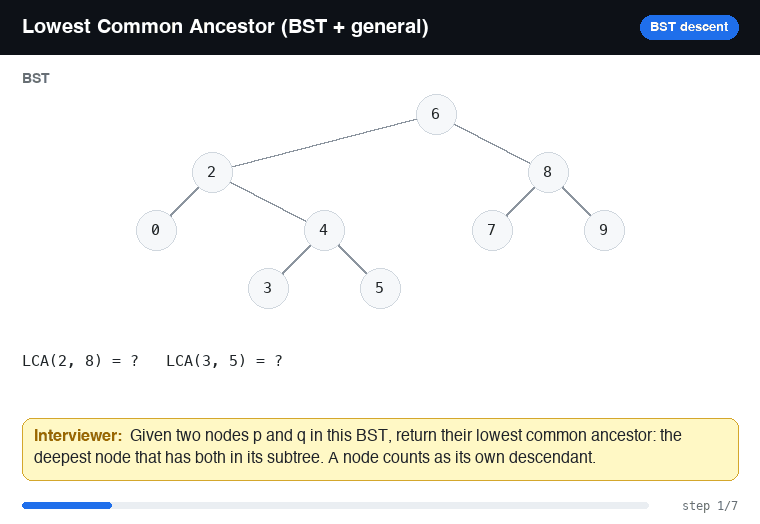

# Walkthrough: Lowest Common Ancestor (BST + general)

**Module:** [09 · Trees](../README.md) · **Difficulty:** Medium · **Solution:** [`p05_lowest_common_ancestor.go`](../p05_lowest_common_ancestor.go)



## The problem in plain words

Given two nodes p and q in a tree, find the deepest node that has both of them below it. A node counts as being below itself, so if p is an ancestor of q, the answer is p.

```
        6
      /   \
     2     8           LCA(2, 8) = 6
    / \   / \          LCA(2, 4) = 2
   0   4 7   9         LCA(3, 5) = 4
      / \
     3   5
```

## Mock interview

**Interviewer:** Given a BST and two nodes p and q that are both in it, return their lowest common ancestor.

**Candidate:** Are both nodes guaranteed to be in the tree? And can a node be its own ancestor?

**Interviewer:** Both are in the tree, and yes, a node counts as its own ancestor.

**Candidate:** On this tree, LCA(2, 8) is 6, because 2 and 8 are on different sides of the root. LCA(2, 4) is 2, because 4 is under 2. LCA(3, 5) is 4.

**Candidate:** A general approach ignores the BST order. It searches the whole tree, or it stores the root-to-p and root-to-q paths and finds where they part. That's O(n) time.

**Interviewer:** How does the BST property help?

**Candidate:** At any node, the values tell me where p and q are. If both are smaller than the node, both are in the left subtree, and so is their LCA. If both are larger, it's on the right. Otherwise they split here: one is on each side, or one of them is this node. The split node is the LCA.

**Interviewer:** Why is the split node the *lowest* common ancestor?

**Candidate:** It's a common ancestor because both values fall in its range. And it's the lowest one, because if I step to either child, one of p or q is no longer below me.

**Candidate:** In code, `LowestCommonAncestorBST` is a loop with a `switch`: go left if both values are smaller, go right if both are larger, otherwise return the node. For a general tree, `LowestCommonAncestor` does a post-order search. Each call returns p or q if it finds one below. The first node that gets a non-nil answer from both sides is the LCA.

**Candidate:** Testing LCA(3, 5): at 6 both are smaller, so go left. At 2 both are larger, so go right. At 4, 3 is smaller and 5 is larger, so they split. The answer is 4. For LCA(2, 8), the split happens at the root, 6.

**Interviewer:** Complexity?

**Candidate:** The BST walk follows one path: **O(h) time and O(1) space**. The general version visits every node: **O(n) time, O(h) space**.

## What the animation shows

p and q are drawn in purple.

| Step | Query | Node | Decision |
|---|---|---|---|
| 1 | Interviewer states the problem | | |
| 2 | General approach costs O(n) | | |
| 3 | LCA(3, 5) | 6 | both smaller → go left |
| 4 | LCA(3, 5) | 2 | both larger → go right |
| 5 | LCA(3, 5) | 4 | split → answer 4 |
| 6 | LCA(2, 8) | 6 | split at the root → answer 6 |
| 7 | Answers and complexity for both versions | | |

## Detailed explanation

**BST version.** While both p and q are on the same side of the current node, the LCA must be on that side too, because the other subtree contains neither of them. The walk stops at the first node `n` where `min(p, q) <= n.Val <= max(p, q)`. Both are in `n`'s subtree, and they are in different parts of it (or one of them is `n`). No child of `n` contains both, so `n` is the lowest.

**General version.** `LowestCommonAncestor(root, p, q)` returns:

- `root` itself if it is nil, p or q;
- `root` if both the left and the right call returned something (p is on one side, q on the other);
- otherwise whichever side returned something.

The non-nil value that bubbles up is either the LCA or the one node found so far. If p is an ancestor of q, the search returns p as soon as it reaches it, without looking below. That's correct, because a node is its own ancestor. The general version compares pointers, so duplicate values are fine.

Edge cases: p == q returns that node. If p is the root, the answer is the root.

## Complexity

| Approach | Time | Space |
|---|---|---|
| BST walk (`LowestCommonAncestorBST`) | O(h) | O(1) |
| General tree (`LowestCommonAncestor`) | O(n) | O(h) |

## Common mistakes

- Using strict comparisons in the "split" test, so the walk passes p when p is an ancestor of q.
- Using the BST walk on a tree that isn't a BST.
- In the general version, comparing values instead of node pointers when values can repeat.

## Try it yourself

```sh
go test ./course/09-trees/ -run TestLowestCommonAncestor -v
```
