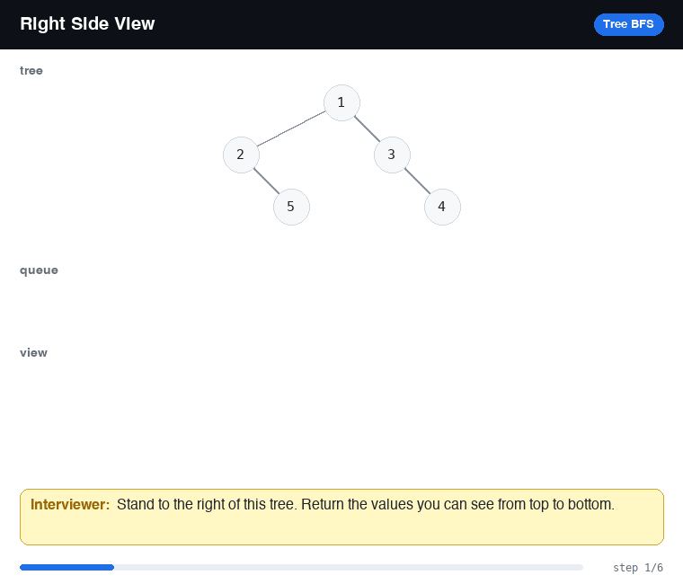

# Walkthrough: Right Side View

**Module:** [09 · Trees](../README.md) · **Difficulty:** Medium · **Solution:** [`p06_right_side_view.go`](../p06_right_side_view.go)



## The problem in plain words

Stand to the right of a binary tree and look at it. List the values you can see from top to bottom. That's the rightmost node on each level.

```
    1            <- 1
   / \
  2   3          <- 3        [1,2,3,null,5,null,4]  →  [1, 3, 4]
   \   \
    5   4        <- 4
```

## Mock interview

**Interviewer:** Imagine standing to the right of a binary tree. Return the values you can see, from top to bottom.

**Candidate:** So one value per level, the rightmost node on that level? Even if it's a left child?

**Interviewer:** Yes. If nothing is to its right on that level, you can see it.

**Candidate:** For `[1,2,3,null,5,null,4]` the answer is `[1, 3, 4]`. For `[1,2,3,4]` it's also `[1, 3, 4]`: 4 is a left child, but nothing hides it. An empty tree gives an empty list.

**Candidate:** Just following right children is wrong, as the second example shows. A slow but correct method searches the whole tree once per depth for the rightmost node. That's O(n·h).

**Interviewer:** What would you do instead?

**Candidate:** Level-order traversal. I process the tree one level at a time with a queue. At the start of each level, `size := len(queue)` tells me how many nodes are on it. The last of those, `queue[size-1]`, is the one visible from the right.

**Interviewer:** Could you do it with DFS?

**Candidate:** Yes. `RightSideViewDFS` visits the right child before the left and records the first node it reaches at each new depth. The first node seen at a depth is the rightmost one. It uses O(h) space instead of O(width).

**Candidate:** In code: start the queue with the root. For each level, append `queue[size-1].Val` to the view, enqueue the children of the first `size` nodes (left, then right), and drop those `size` nodes with `queue = queue[size:]`.

**Candidate:** Testing on the example: level 0 is `[1]`, so I see 1. Level 1 is `[2, 3]`, so I see 3. Level 2 is `[5, 4]`, so I see 4. The answer is `[1, 3, 4]`.

**Interviewer:** Complexity?

**Candidate:** Every node enters and leaves the queue once: **O(n) time**. The queue holds at most one level: **O(width) space**.

## What the animation shows

| Step | Level | Queue | Visible |
|---|---|---|---|
| 1 | Interviewer states the problem | | |
| 2 | Brute force: search per depth, O(n·h) | | |
| 3 | 0 | [1] | 1 |
| 4 | 1 | [2, 3] | 3 |
| 5 | 2 | [5, 4] | 4 |
| 6 | Answer `[1, 3, 4]`, O(n) time, O(width) space | | |

## Detailed explanation

BFS visits nodes level by level, and within a level from left to right, because children are enqueued left before right. So the last node of each level in the queue is the rightmost node at that depth, which is exactly the node visible from the right.

Taking `size` at the start of the level matters. While processing the level, the loop appends children to the same slice. Without the snapshot, you couldn't tell where one level ends and the next begins. Ranging over `queue[:size]` is safe while appending, because the range expression is evaluated once.

Edge cases:

- Empty tree: returns an empty (nil) slice.
- A left child on the deepest level, like 4 in `[1,2,3,4]`: it's the last node on its level, so it's included.

## Complexity

| Approach | Time | Space |
|---|---|---|
| BFS (`RightSideView`) | O(n) | O(width) |
| Right-first DFS (`RightSideViewDFS`) | O(n) | O(h) |

## Common mistakes

- Walking only right children, which misses left children that stick out deeper.
- Reading `len(queue)` inside the loop instead of a snapshot, so levels mix.
- In the DFS, visiting left before right, which records the leftmost node instead.

## Try it yourself

```sh
go test ./course/09-trees/ -run TestRightSideView -v
```
