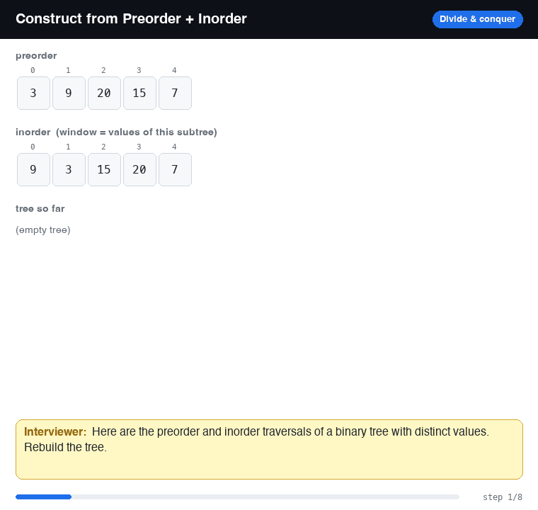

# Walkthrough: Construct from Preorder + Inorder

**Module:** [09 · Trees](../README.md) · **Difficulty:** Medium · **Solution:** [`p07_build_tree.go`](../p07_build_tree.go)



## The problem in plain words

You get two lists: the preorder and the inorder traversal of a binary tree with distinct values. Rebuild the tree.

```
preorder = [3,9,20,15,7]          3
inorder  = [9,3,15,20,7]         / \
                                9   20
                                   /  \
                                  15   7
```

## Mock interview

**Interviewer:** Given the preorder and inorder traversals of a binary tree with distinct values, rebuild the tree and return its root.

**Candidate:** Are all values distinct, and are both lists guaranteed to come from the same tree?

**Interviewer:** Yes to both.

**Candidate:** With preorder `[3,9,20,15,7]` and inorder `[9,3,15,20,7]`, the root is 3. In inorder, 9 is left of 3 and 15, 20, 7 are right of it. So 9 is the left subtree, and the rest is the right subtree. Empty lists give a nil tree.

**Candidate:** The direct method (`BuildTreeBrute`) takes `preorder[0]` as the root, scans inorder to find it, slices both lists and recurses. The scan and the slicing cost O(n) per node, so it's O(n²) on a skewed tree.

**Interviewer:** How do you speed it up?

**Candidate:** Two changes. First, a map from value to inorder index makes finding the root O(1). Second, instead of slicing preorder, I keep a shared cursor `next`. Preorder lists root, then the whole left subtree, then the whole right subtree. So if I always build the left subtree before the right, the next unused preorder value is always the root of the subtree I'm building.

**Interviewer:** Why must left come before right?

**Candidate:** Because that's the order preorder uses. If I built the right subtree first, the cursor would hand it values that belong to the left subtree.

**Candidate:** In code: `build(lo, hi)` builds the subtree whose values are `inorder[lo:hi]`. If `lo >= hi` it returns nil. Otherwise it takes `preorder[next]` as the root, increments `next`, looks up `mid := pos[root.Val]`, then sets `root.Left = build(lo, mid)` and `root.Right = build(mid+1, hi)`.

**Candidate:** Testing: `build(0,5)` takes 3, mid = 1. `build(0,1)` takes 9, a leaf. `build(2,5)` takes 20, mid = 3. `build(2,3)` takes 15, and `build(4,5)` takes 7. The tree is `[3,9,20,null,null,15,7]`.

**Interviewer:** Complexity?

**Candidate:** Each value becomes a node once with an O(1) lookup: **O(n) time**. The map is **O(n) space**, plus O(h) for the recursion.

## What the animation shows

| Step | Call | Root | mid | Window in inorder |
|---|---|---|---|---|
| 1 | Interviewer states the problem | | | |
| 2 | Brute force: scan and slice, O(n²) | | | |
| 3 | `build(0, 5)` | 3 | 1 | 9 3 15 20 7 |
| 4 | `build(0, 1)` | 9 | 0 | 9 |
| 5 | `build(2, 5)` | 20 | 3 | 15 20 7 |
| 6 | `build(2, 3)` | 15 | 2 | 15 |
| 7 | `build(4, 5)` | 7 | 4 | 7 |
| 8 | Tree `[3,9,20,null,null,15,7]`, O(n) time, O(n) space | | | |

## Detailed explanation

Two facts make this work:

1. In preorder, a subtree's root comes before everything else in that subtree.
2. In inorder, a node splits its subtree's values into left (before it) and right (after it).

`build(lo, hi)` keeps this invariant: *when it is called, `preorder[next]` is the root of the subtree made of `inorder[lo:hi]`.* It holds at the start, since `preorder[0]` is the root of the whole tree. After taking the root, the next `mid - lo` preorder values are the left subtree, which `build(lo, mid)` consumes. The cursor then points at the right subtree's root, ready for `build(mid+1, hi)`.

This needs distinct values. With duplicates, `pos` can't tell which copy is the root, and the tree may not be unique.

Edge cases: empty input returns nil. A skewed tree works, with recursion depth n.

## Complexity

| Approach | Time | Space |
|---|---|---|
| Scan and slice (`BuildTreeBrute`) | O(n²) worst case | O(n) |
| Index map + cursor (`BuildTree`) | O(n) | O(n) |

## Common mistakes

- Building the right subtree before the left, which hands preorder values to the wrong side.
- Passing the cursor by value into the recursion. It must be shared (a captured variable in Go).
- Off-by-one errors in the windows: the left part is `[lo, mid)` and the right part is `[mid+1, hi)`.

## Try it yourself

```sh
go test ./course/09-trees/ -run TestBuildTree -v
```
