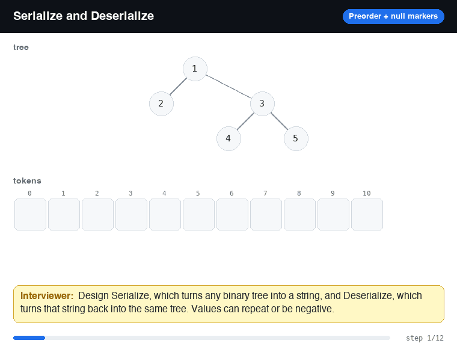

# Walkthrough: Serialize and Deserialize

**Module:** [09 · Trees](../README.md) · **Difficulty:** Hard · **Solution:** [`p08_serialize.go`](../p08_serialize.go)



## The problem in plain words

Write two functions. One turns any binary tree into a string. The other turns that string back into exactly the same tree. Values can repeat and can be negative. You choose the format.

```
    1
   / \          Serialize   → "1,2,#,#,3,4,#,#,5,#,#"
  2   3         Deserialize → the same tree
     / \
    4   5
```

## Mock interview

**Interviewer:** Design `Serialize` and `Deserialize` for a binary tree. Any format is fine, as long as the round trip gives back the same tree.

**Candidate:** Can values repeat or be negative? And what should `Deserialize` do with bad input?

**Interviewer:** Values can repeat and be negative. Return an error for malformed input.

**Candidate:** For the tree `[1,2,3,null,null,4,5]`, a preorder walk gives 1, 2, 3, 4, 5, but that alone fits many tree shapes. An empty tree must round-trip too.

**Candidate:** A first idea is to store two traversals, preorder and inorder, and rebuild like problem 07. But that needs distinct values, and this problem allows repeats.

**Interviewer:** So what do you store?

**Candidate:** Preorder, plus a `#` for every nil child. With the nil markers, the string says exactly where each subtree ends, so one traversal is enough. For this tree that's `1,2,#,#,3,4,#,#,5,#,#`.

**Interviewer:** Why is preorder with markers unambiguous?

**Candidate:** Reading it back, each token is either `#`, which means an empty subtree, or a value, which means a node followed by its full left subtree and then its full right subtree. There's only one way to parse that, so there's only one tree.

**Candidate:** In code: `Serialize` uses a closure `walk` that writes `#` for nil, otherwise writes the value and walks left then right, with commas between tokens. `Deserialize` splits on commas and uses a shared index `i`. `build()` reads the next token. For `#` it returns nil. For a value it makes a node, then builds the left child, then the right child. It returns an error on a bad number, on running out of tokens, or if tokens are left over at the end.

**Candidate:** Testing: the walk writes 1, then 2, then two `#` for 2's children, then 3, 4, `#`, `#`, 5, `#`, `#`. Reading back, "1" becomes the root, "2" its left child, the two `#` close 2's subtree, and "3" becomes 1's right child. 4 and 5 follow the same way.

**Interviewer:** Complexity?

**Candidate:** A tree with n nodes has n + 1 nil children, so there are 2n + 1 tokens. Both directions are **O(n) time and O(n) space**.

## What the animation shows

| Step | What happens |
|---|---|
| 1 | Interviewer states the problem on `[1,2,3,null,null,4,5]` |
| 2 | One plain traversal is ambiguous; two traversals break with duplicates |
| 3 | Serialize: visit 1, write "1" |
| 4 | Visit 2, write "2" |
| 5 | 2's nil children wrote `#`, `#`; visit 3, write "3" |
| 6 | Visit 4, write "4" |
| 7 | 4's nil children wrote `#`, `#`; visit 5, write "5" |
| 8 | Final string `1,2,#,#,3,4,#,#,5,#,#` |
| 9 | Deserialize: token 0 "1" becomes the root |
| 10 | Token 1 "2" becomes 1's left child; the next two `#` end its subtree |
| 11 | Token 4 "3" becomes 1's right child; 4 and 5 follow the same rule |
| 12 | Rebuilt tree matches; O(n) both ways |

## Detailed explanation

The format is a direct recording of the recursion. `walk(n)` writes one token for `n` and then calls itself on the left and right children. `build()` reads one token and then calls itself for the left and right children. Because both follow the same order, the reader consumes tokens in exactly the order the writer produced them.

Why one traversal is enough: without markers, preorder `1,2,3` could be a chain or a root with two children. With markers, `1,2,#,#,3,#,#` can only be a root with two leaf children, and `1,2,3,#,#,#,#` can only be a left chain.

Error handling in `Deserialize`:

- A non-numeric token returns the `strconv.Atoi` error, wrapped with its position.
- Running out of tokens mid-tree returns "unexpected end of input".
- Extra tokens after a complete tree return "trailing tokens".

Edge cases: the empty tree serializes to `"#"` and reads back as nil. Negative values work because `-` never appears in a `#` token.

## Complexity

| Function | Time | Space |
|---|---|---|
| `Serialize` | O(n) | O(n) output + O(h) stack |
| `Deserialize` | O(n) | O(n) tokens + O(h) stack |

## Common mistakes

- Leaving out the nil markers, which makes preorder ambiguous.
- Passing the token index by value in the recursion, so every call reads the same token.
- Not checking for leftover tokens, which silently accepts bad input.

## Try it yourself

```sh
go test ./course/09-trees/ -run TestSerialize -v
```
