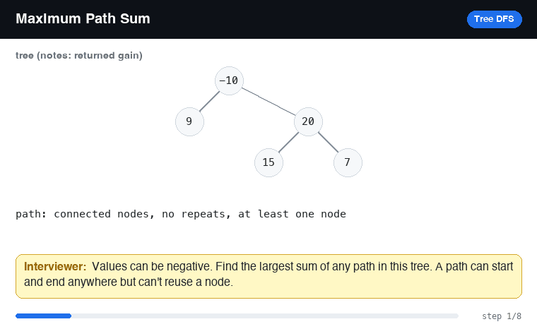

# Walkthrough: Maximum Path Sum

**Module:** [09 · Trees](../README.md) · **Difficulty:** Hard · **Solution:** [`p09_max_path_sum.go`](../p09_max_path_sum.go)



## The problem in plain words

A path is a chain of connected nodes with no node used twice. It can start and end anywhere and has at least one node. Values can be negative. Find the largest possible sum along a path.

```
   -10
   /  \
  9    20         [-10,9,20,null,null,15,7]  →  42   (15-20-7)
      /  \
     15   7
```

## Mock interview

**Interviewer:** Find the maximum path sum in a binary tree. A path can start and end at any nodes, can't repeat a node, and has at least one node. Values can be negative.

**Candidate:** Does the path have to go through the root? And is the tree ever empty?

**Interviewer:** No, it can be anywhere. The tree is never empty.

**Candidate:** For `[1,2,3]` the answer is 6, the path 2-1-3. For `[-10,9,20,null,null,15,7]` it's 42, the path 15-20-7, which skips the negative root. For `[-3]` it's -3, since the path must have at least one node.

**Candidate:** The brute force (`MaxPathSumBrute`) treats the tree as a graph and runs a DFS from every node, summing every simple path. That's O(n²).

**Interviewer:** Can you do it in one pass?

**Candidate:** Yes, with the same shape as Diameter. Every path has one highest node where it turns. At that node, the best path is the node's value plus the best downward chain into the left subtree plus the best downward chain into the right subtree. If a chain is negative, I leave it out, so I clamp it with `max(gain, 0)`.

**Candidate:** So the helper `gain(n)` *returns* the best downward chain starting at `n`, which is `n.Val + max(l, r)`, because a parent can only extend one side. And it *records* `n.Val + l + r` in `best`, the best path that turns at `n`.

**Interviewer:** Why does `best` start at `math.MinInt` and not 0?

**Candidate:** If every value is negative, the answer is negative, like -3. Starting at 0 would return 0, which isn't the sum of any path.

**Candidate:** Testing on the example: 9 returns 9, best = 9. 15 returns 15, best = 15. 7 returns 7. At 20, the turning path is 20 + 15 + 7 = 42, so best = 42, and it returns 20 + 15 = 35. At the root, -10 + 9 + 35 = 34, which doesn't beat 42. The answer is 42.

**Interviewer:** Complexity?

**Candidate:** One post-order pass: **O(n) time and O(h) space**.

## What the animation shows

| Step | Node | l | r | best | returns |
|---|---|---|---|---|---|
| 1 | Interviewer states the problem | | | | |
| 2 | Brute force: DFS from every node, O(n²) | | | | |
| 3 | 9 | 0 | 0 | 9 | 9 |
| 4 | 15 | 0 | 0 | 15 | 15 |
| 5 | 7 | 0 | 0 | 15 | 7 |
| 6 | 20 | 15 | 7 | 42 | 35 |
| 7 | -10 | 9 | 35 | 42 | 25 |
| 8 | Answer 42 (15-20-7), O(n) time, O(h) space | | | | |

## Detailed explanation

Take the best path. It has one node closest to the root, the turning node `t`. The path is `t` plus some downward chain into the left subtree plus some downward chain into the right subtree. Either chain can be empty. To make the sum as large as possible, each chain should be the best downward chain from that child, or nothing if that chain is negative. That is exactly `t.Val + l + r` with `l` and `r` clamped at 0. The helper computes this for every node, so it checks every possible turning node.

The return value is different from what's recorded. A parent that extends a path through `n` can only continue down one side of `n`. Otherwise the path would branch, which isn't allowed. So `gain` returns `n.Val + max(l, r)`.

The return value is not clamped, so a negative node still reports its true chain. The parent decides whether to use it with `max(gain, 0)`.

Edge cases:

- All negative values: `best` starts at `math.MinInt`, so the answer is the largest single value.
- A single node: the answer is its value.

## Complexity

| Approach | Time | Space |
|---|---|---|
| Brute force (`MaxPathSumBrute`) | O(n²) | O(n) |
| One pass (`MaxPathSum`) | O(n) | O(h) |

## Common mistakes

- Returning `n.Val + l + r` to the parent. That lets a path branch, which isn't a path.
- Starting `best` at 0, which fails on all-negative trees.
- Forgetting to clamp negative child gains, so a bad subtree drags the sum down.

## Try it yourself

```sh
go test ./course/09-trees/ -run TestMaxPathSum -v
```
