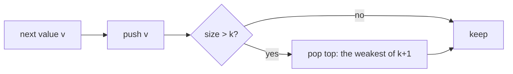

# 10 — Heaps & Priority Queues

A heap gives you the smallest (or largest) element in O(1) and lets you
insert or remove in O(log n). Use it when the question keeps asking "what's the best
item right now?" while the set of items changes, or when you only need the
top k of a large stream.

## What you'll learn

- How a binary heap is laid out in an array, and how `siftUp` / `siftDown` keep
  it valid ([heaps.go](heaps.go), `ArrayHeap`).
- Go's `container/heap` and a generic wrapper `Heap[T]` with `NewMin`, `NewMax`
  and a custom `less`, so you aren't rewriting five methods per problem.
- **Top-k**: size-k heap of the *opposite* polarity, and when quickselect is better.
- **k-way merge**: a heap of "current heads".
- **Greedy scheduling**: always take the most urgent or most frequent item.
- **Two heaps** for running medians.

## Recognize the pattern

| Clue | Heap shape |
|---|---|
| "k largest / k most frequent / k closest" | size-k heap; top = the *worst* of the kept k |
| "k-th largest" (one-off, array in memory) | quickselect O(n) expected, or size-k min-heap |
| "merge k sorted ..." / "smallest range covering k lists" | min-heap of one cursor per list |
| "repeatedly take the biggest/smallest, combine, put back" | simulate with a heap |
| "median of a stream", "sliding window median" | max-heap (low half) + min-heap (high half) |
| "schedule by earliest deadline / cheapest next step" | priority queue (also Dijkstra in module 13) |

## The idea

A binary heap is a complete binary tree stored level by level in a slice.
Every parent is `<=` its children (min-heap), so the minimum is at index 0.

```
index:   0  1  2  3  4  5          parent(i) = (i-1)/2
value:   1  3  2  7  4  5          children  = 2i+1, 2i+2

             1(0)
           /      \
        3(1)      2(2)
        /  \      /
     7(3) 4(4)  5(5)
```

- **Push** appends at the end and *sifts up*, swapping with the parent while
  it's smaller. O(log n).
- **Pop** takes the root, moves the last element to the root, and *sifts down*,
  swapping with the smaller child while it's bigger. O(log n).
- **Heapify** (build from n items) sifts down every internal node from the
  bottom up, which is O(n) total, not O(n log n).

**Top-k with the opposite heap.** To keep the k *largest*, use a *min*-heap of
size k: its top is the weakest member, so a new value only needs to beat that one.



## Go template

```go
// With the generic wrapper in heaps.go:
h := New(func(a, b Item) bool { return a.priority < b.priority }) // min by priority
h.Push(item)
top := h.Pop()

// Raw container/heap for an []int min-heap, the version you may have to type from memory:
type IntHeap []int
func (h IntHeap) Len() int           { return len(h) }
func (h IntHeap) Less(i, j int) bool { return h[i] < h[j] } // > for a max-heap
func (h IntHeap) Swap(i, j int)      { h[i], h[j] = h[j], h[i] }
func (h *IntHeap) Push(x any)        { *h = append(*h, x.(int)) }
func (h *IntHeap) Pop() any {
	old := *h
	x := old[len(old)-1]
	*h = old[:len(old)-1]
	return x
}

ih := &IntHeap{5, 2, 8}
heap.Init(ih)          // O(n)
heap.Push(ih, 1)       // call the PACKAGE function, not h.Push
smallest := heap.Pop(ih).(int)
```

## Complexity

| Operation | Time |
|---|---|
| Push / Pop | O(log n) |
| Peek | O(1) |
| Build from n items (`heap.Init`, `Heapify`) | O(n) |
| Top-k of n with a size-k heap | O(n log k) time, O(k) space |
| k-way merge of N total items | O(N log k) |
| Quickselect | O(n) expected, O(n²) worst |

## Common pitfalls

- **Calling `h.Push(x)` instead of `heap.Push(h, x)`.** The method only appends;
  the package function appends *and* sifts up. Same for `Pop`. This is the
  most common Go heap bug.
- **Pointer receivers.** `Push`/`Pop` must use pointer receivers (they change
  the slice length); `Len/Less/Swap` can use value receivers.
- **Wrong polarity for top-k.** k largest → min-heap; k smallest/closest → max-heap.
- **Tie-breaking.** "Top K Frequent Words" needs a total order (count, then word)
  and the *reverse* of it in the heap. Write a `better(a, b)` helper once and
  use `less = better(b, a)`.
- **Pushing nil into a heap of list nodes.** Filter out empty lists before
  merging, or `Less` will dereference nil.
- **`Peek` / `Pop` on an empty heap panics.** Check `Len()` first.
- **Floats for distances.** Compare squared distances as ints; no `math.Sqrt`.
- **Go: `container/heap` uses `any`.** Every Pop needs a type assertion. The
  generic wrapper hides that, but know the raw form for interviews.

## Problems

| # | Problem | Difficulty | Key idea |
|---|---|---|---|
| 01 | [Last Stone Weight](p01_last_stone_weight.go) | Easy | Max-heap simulation |
| 02 | [Kth Largest Element](p02_kth_largest.go) | Medium | Size-k min-heap; three-way quickselect |
| 03 | [K Closest Points to Origin](p03_k_closest_points.go) | Medium | Size-k max-heap on squared distance |
| 04 | [Top K Frequent Words](p04_top_k_frequent_words.go) | Medium | Count + size-k heap with reversed tie-break |
| 05 | [Task Scheduler](p05_task_scheduler.go) | Medium | Max-heap + cooldown queue; closed-form frame count |
| 06 | [Merge k Sorted Lists](p06_merge_k_sorted.go) | Hard | Min-heap of list heads; or pairwise merge |
| 07 | [Find Median from Data Stream](p07_median_finder.go) | Hard | Two heaps, sizes balanced within one |

## Practice tip

Type out the raw `container/heap` boilerplate from memory once per practice
session; it takes about a minute once it's familiar. Then hide a solution,
re-solve it, and run its tests:

```sh
go test ./course/10-heaps/ -run TestMedianFinder -v
```

## Next

[11 — Tries](../11-tries/)
