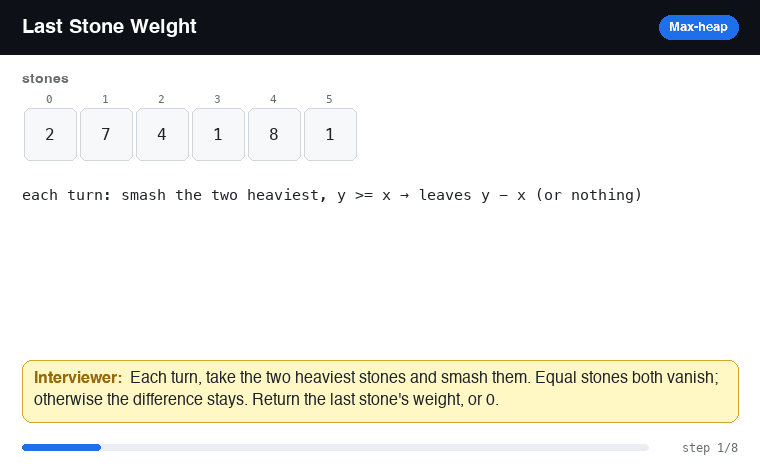

# Walkthrough: Last Stone Weight

**Module:** [10 · Heaps & Priority Queues](../README.md) · **Difficulty:** Easy · **Solution:** [`p01_last_stone_weight.go`](../p01_last_stone_weight.go)



## The problem in plain words

You have a pile of stones. Each turn, pick the two heaviest and smash them together. If they weigh the same, both disappear. Otherwise one stone remains, weighing the difference. When one stone or none is left, return its weight, or 0.

```
[2,7,4,1,8,1] → 1     (8,7 → 1;  4,2 → 2;  2,1 → 1;  1,1 → 0;  left: 1)
```

## Mock interview

**Interviewer:** Each turn, smash the two heaviest stones. Equal stones both vanish, otherwise the difference stays. Return the weight of the last stone, or 0 if none is left.

**Candidate:** Are the weights always positive? And should I change the input slice?

**Interviewer:** Always positive. Please don't change the input.

**Candidate:** For `[2,7,4,1,8,1]` the answer is 1. For `[3,3]` both vanish, so it's 0. A single stone returns its own weight.

**Candidate:** The brute force (`LastStoneWeightBrute`) sorts the stones every turn and takes the last two. There can be n turns, each with a sort, so it's O(n² log n).

**Interviewer:** What structure fits better?

**Candidate:** "Repeatedly take the largest and put something back" is what a max-heap does. Pop and push are both O(log n), and I can build the heap from the slice in O(n).

**Interviewer:** Why O(n) to build, not O(n log n)?

**Candidate:** `heap.Init` sifts down from the middle of the array to the front. Most nodes are near the bottom and move only a short way, so the total work adds up to O(n).

**Candidate:** In code: `FromSlice(slices.Clone(stones), a > b)` builds the max-heap on a copy. While there are at least two stones, pop `y` (the heaviest) and `x` (the next). If they differ, push `y - x`. At the end, return the top, or 0 if the heap is empty.

**Candidate:** Testing: the heap starts as `[8,7,4,1,2,1]`. Pop 8 and 7, push 1. Pop 4 and 2, push 2. Pop 2 and 1, push 1. Pop 1 and 1, both vanish. One stone of weight 1 is left.

**Interviewer:** Complexity?

**Candidate:** Each turn removes at least one stone, so there are at most n − 1 turns of O(log n) each. That's **O(n log n) time and O(n) space** for the copied heap.

## What the animation shows

| Step | What happens | Heap after |
|---|---|---|
| 1 | Interviewer states the problem on `[2,7,4,1,8,1]` | |
| 2 | Brute force: sort every turn | |
| 3 | `FromSlice` heapifies in O(n) | [8, 7, 4, 1, 2, 1] |
| 4 | Pop 8, pop 7, push 1 | [4, 2, 1, 1, 1] |
| 5 | Pop 4, pop 2, push 2 | [2, 1, 1, 1] |
| 6 | Pop 2, pop 1, push 1 | [1, 1, 1] |
| 7 | Pop 1, pop 1, equal, nothing pushed | [1] |
| 8 | Answer 1, O(n log n) time, O(n) space | |

## Detailed explanation

A max-heap keeps the largest element at index 0. Every parent is at least as large as its children. In the array, the children of index `i` are at `2i+1` and `2i+2`. The animation shows both views: the tree, and the array that actually stores it.

- **Pop** swaps the root with the last element, removes it, and sifts the new root down until the heap rule holds again. That's one root-to-leaf path: O(log n).
- **Push** appends and sifts the new element up: O(log n).

Each turn does two pops and at most one push, and always reduces the number of stones by at least one. So the loop runs at most n − 1 times.

The input is cloned before heapifying, because `FromSlice` takes ownership of the slice and reorders it.

Edge cases: an empty slice returns 0, and so does a pile that cancels out completely, like `[3,3]`.

## Complexity

| Approach | Time | Space |
|---|---|---|
| Brute force (`LastStoneWeightBrute`) | O(n² log n) | O(n) |
| Max-heap (`LastStoneWeight`) | O(n log n) | O(n) |

## Common mistakes

- Using a min-heap by accident (`a < b`), which smashes the lightest stones.
- Heapifying the caller's slice directly, which scrambles their data.
- Calling `Peek` on an empty heap at the end, instead of returning 0.

## Try it yourself

```sh
go test ./course/10-heaps/ -run TestLastStoneWeight -v
```
