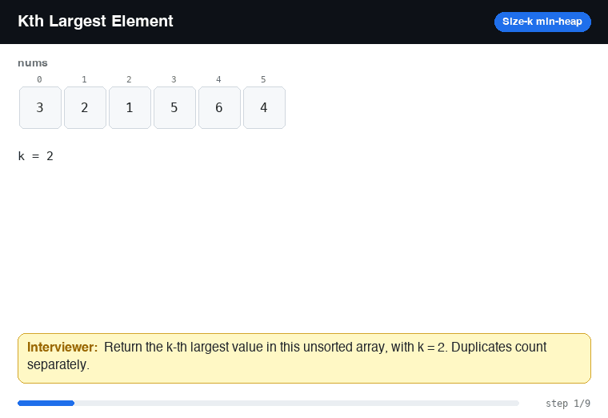

# Walkthrough: Kth Largest Element

**Module:** [10 · Heaps & Priority Queues](../README.md) · **Difficulty:** Medium · **Solution:** [`p02_kth_largest.go`](../p02_kth_largest.go)



## The problem in plain words

Find the k-th largest value in an unsorted array. Duplicates count separately, so in `[3,3,1]` the 2nd largest is 3.

```
nums = [3,2,1,5,6,4], k = 2  →  5
```

## Mock interview

**Interviewer:** Return the k-th largest element of an unsorted array. Duplicates count as separate elements.

**Candidate:** Is k always valid, between 1 and len(nums)? And may I change the array?

**Interviewer:** k is always valid. Don't change the input.

**Candidate:** For `[3,2,1,5,6,4]` with k = 2, sorted it's `[1,2,3,4,5,6]`, so the answer is 5. With k = 1 it's the maximum, and with k = n it's the minimum.

**Candidate:** The simplest answer (`FindKthLargestSort`) sorts a copy and returns `s[n-k]`. That's O(n log n), and it does more work than needed: I only care about the top k values.

**Interviewer:** How would you use a heap?

**Candidate:** I keep a min-heap holding the k largest values seen so far. For each number I push it, and if the heap now has more than k items, I pop the smallest. At the end the heap holds the k largest, and its top, the smallest of them, is the k-th largest.

**Interviewer:** Why a *min*-heap if you want large values?

**Candidate:** Because the value I need to throw out is the smallest of my current k. A min-heap gives me that one in O(log k). Anything I pop has at least k values larger than it, so it can never be the k-th largest.

**Candidate:** In code: `h := NewMin[int]()`, loop over `nums`, `h.Push(v)`, and `if h.Len() > k { h.Pop() }`. Return `h.Peek()`.

**Candidate:** Testing with k = 2: push 3, then 2, so the heap holds {2, 3}. Push 1 and pop it right away. Push 5 and pop 2. Push 6 and pop 3. Push 4 and pop it. The heap holds {5, 6}, and the top is 5.

**Interviewer:** Can you do better than O(n log k)?

**Candidate:** Quickselect (`FindKthLargestQuickselect`) partitions around a random pivot and only continues into the side that holds the answer. That's O(n) expected and O(n²) worst case. The heap is better for streams, or when k is much smaller than n.

**Interviewer:** Complexity of the heap version?

**Candidate:** n pushes and at most n pops on a heap of size k + 1: **O(n log k) time, O(k) space**.

## What the animation shows

| Step | Value | Action | Heap top |
|---|---|---|---|
| 1 | Interviewer states the problem | | |
| 2 | Brute force: sort and read `s[n-k]` | | |
| 3 | 3 | push, keep | 3 |
| 4 | 2 | push, keep | 2 |
| 5 | 1 | push, pop 1 | 2 |
| 6 | 5 | push, pop 2 | 3 |
| 7 | 6 | push, pop 3 | 5 |
| 8 | 4 | push, pop 4 | 5 |
| 9 | Answer 5, O(n log k) time, O(k) space | | |

## Detailed explanation

**Invariant:** after processing the first i values, the heap holds the min(i, k) largest of them. Pushing a new value and then popping the smallest keeps exactly the k largest. The popped value has at least k values in the heap that are at least as large, so it can't be the k-th largest overall.

When the loop ends, the heap holds the k largest values of the whole array. The smallest of those is the k-th largest, and it sits at the top of the min-heap.

Duplicates are handled naturally. Equal values are separate heap entries, so `[3,3,1]` with k = 2 keeps {3, 3} and returns 3.

**Quickselect** in the repo uses a three-way partition (less than / equal to / greater than the pivot). That keeps it fast when many values repeat, because the whole "equal" block is settled in one pass.

## Complexity

| Approach | Time | Space |
|---|---|---|
| Sort (`FindKthLargestSort`) | O(n log n) | O(n) |
| Size-k min-heap (`FindKthLargestHeap`) | O(n log k) | O(k) |
| Quickselect (`FindKthLargestQuickselect`) | O(n) expected, O(n²) worst | O(n) copy |

## Common mistakes

- Using a max-heap of all n values and popping k times. That works, but it's O(n + k log n) time and O(n) space, and it misses the point of the size-k heap.
- Popping before pushing, which can throw away the new value's chance to stay.
- Returning `s[k-1]` from an ascending sort, which is the k-th *smallest*.

## Try it yourself

```sh
go test ./course/10-heaps/ -run TestFindKthLargest -v
```
