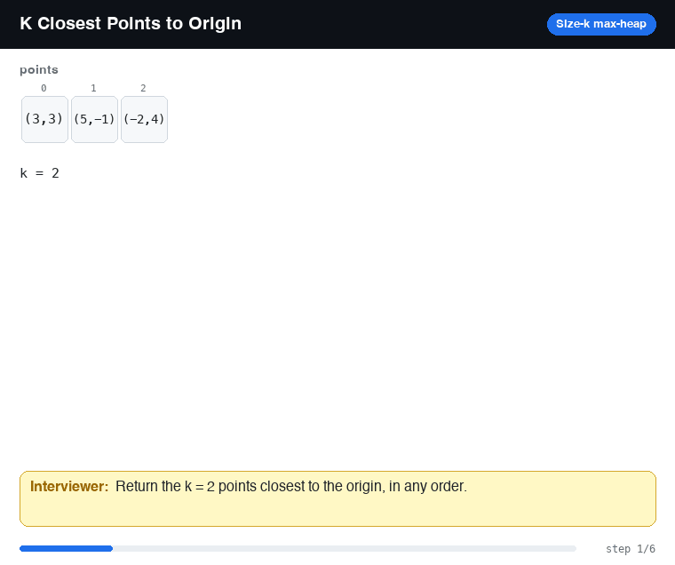

# Walkthrough: K Closest Points to Origin

**Module:** [10 · Heaps & Priority Queues](../README.md) · **Difficulty:** Medium · **Solution:** [`p03_k_closest_points.go`](../p03_k_closest_points.go)



## The problem in plain words

You get points on a plane and a number k. Return the k points closest to (0, 0), in any order.

```
points = [[3,3],[5,-1],[-2,4]], k = 2  →  [[3,3],[-2,4]]
squared distances: 18, 26, 20
```

The animation uses this second example from the doc comment. The first one (`[[1,3],[-2,2]], k=1`) has only two points, so it never shows the heap at full size.

## Mock interview

**Interviewer:** Given a list of points and k, return the k points nearest to the origin. Any order is fine.

**Candidate:** If two points tie at the cut-off distance, can I return either? And is k at most the number of points?

**Interviewer:** Either is fine, and yes, k ≤ len(points).

**Candidate:** For `[[3,3],[5,-1],[-2,4]]` with k = 2, the squared distances are 18, 26 and 20. The two closest are (3,3) and (-2,4). I'll compare squared distances, `x*x + y*y`. The order is the same as for real distances, and I avoid `sqrt` and floats.

**Candidate:** The simple way (`KClosestSort`) sorts all points by distance and takes the first k. That's O(n log n).

**Interviewer:** Can you avoid sorting everything?

**Candidate:** Yes, with a heap of size k. For the k *smallest* distances I use a *max*-heap. Its top is the farthest point I'm currently keeping, which is the one to throw out when something closer arrives. I push each point, and if the heap has more than k items, I pop the top.

**Interviewer:** Why a max-heap for the smallest values?

**Candidate:** The heap holds my current best k. The question at each step is "which of my k is worst?", and for distances the worst is the largest. A max-heap answers that in O(1) and removes it in O(log k).

**Candidate:** In code: `h := New(func(a, b []int) bool { return dist2(a) > dist2(b) })`. For each point, `h.Push(p)`, then `if h.Len() > k { h.Pop() }`. Finally, pop everything into the output slice.

**Candidate:** Testing with k = 2: push (3,3) at 18. Push (5,-1) at 26, which goes to the top. Push (-2,4) at 20. Now there are 3, so I pop the top, (5,-1). The heap holds (-2,4) and (3,3).

**Interviewer:** Complexity?

**Candidate:** One push and at most one pop per point on a heap of size k + 1: **O(n log k) time, O(k) space**.

## What the animation shows

The heap tree shows squared distances; the array shows the points.

| Step | Point | dist² | Action | Heap |
|---|---|---|---|---|
| 1 | Interviewer states the problem | | | |
| 2 | Brute force: sort by distance | | | |
| 3 | (3,3) | 18 | push | (3,3) |
| 4 | (5,-1) | 26 | push | (5,-1), (3,3) |
| 5 | (-2,4) | 20 | push, pop (5,-1) | (-2,4), (3,3) |
| 6 | Answer (-2,4), (3,3); O(n log k) time, O(k) space | | | |

## Detailed explanation

**Invariant:** after processing some points, the heap holds the k closest of them (or all of them, if there are fewer than k). When a new point arrives and the heap overflows, the point popped is the farthest of k + 1 candidates. At least k points are as close or closer, so it can't be in the answer.

Squared distances keep everything in integers. Since both sides are non-negative, `a² < b²` exactly when `a < b`, so the order is unchanged.

Ties at the cut-off: the heap keeps whichever of the tied points the sifting leaves behind. The problem allows any of them, and the tests check distances, not exact points.

The output order is the order of pops, farthest first. The problem accepts any order, so no sort is needed.

## Complexity

| Approach | Time | Space |
|---|---|---|
| Sort (`KClosestSort`) | O(n log n) | O(n) |
| Size-k max-heap (`KClosest`) | O(n log k) | O(k) |

## Common mistakes

- Using a min-heap of size k, which evicts the closest point instead of the farthest.
- Computing `math.Sqrt` and comparing floats. It's slower and can give rounding issues.
- With very large coordinates, `x*x + y*y` can overflow `int32`. Go's `int` is 64-bit on common platforms, which is enough for the usual limits.

## Try it yourself

```sh
go test ./course/10-heaps/ -run TestKClosest -v
```
