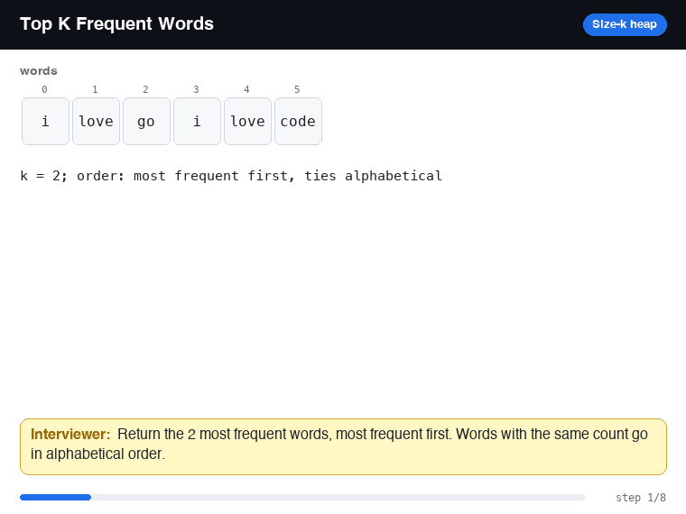

# Walkthrough: Top K Frequent Words

**Module:** [10 · Heaps & Priority Queues](../README.md) · **Difficulty:** Medium · **Solution:** [`p04_top_k_frequent_words.go`](../p04_top_k_frequent_words.go)



## The problem in plain words

Given a list of words and a number k, return the k most frequent words, most frequent first. Words with the same count are ordered alphabetically.

```
["i","love","go","i","love","code"], k = 2  →  ["i","love"]
```

## Mock interview

**Interviewer:** Return the k most frequent words, from most to least frequent. Break ties alphabetically.

**Candidate:** Is k at most the number of distinct words? And are the words already lowercase?

**Interviewer:** Yes to both.

**Candidate:** In the example, "i" and "love" appear twice, "go" and "code" once. Both top words have count 2, so they're ordered alphabetically: `["i", "love"]`.

**Candidate:** First I count with a map, in O(n). The simple next step (`TopKFrequentSort`) sorts all u distinct words by count descending, then word ascending, and takes the first k. That's O(u log u).

**Interviewer:** And with a heap?

**Candidate:** I keep a heap of size k whose top is the *worst* word I'm currently keeping: the lowest count, and for equal counts the alphabetically *later* word. For each word I push it, and if the heap has more than k items, I pop the worst. That's O(u log k).

**Interviewer:** Why reverse the tie-break inside the heap?

**Candidate:** The heap's top is the one I throw away. In the answer, "i" beats "love" on a tie, so on a tie "love" is worse, and it's the one that should be on top. The code defines `better(a, b)` for the final ranking and builds the heap with `less = better(b, a)`, so "less" means "worse".

**Candidate:** At the end the heap pops worst first, so I fill the output from the back. That gives best first without a separate reverse.

**Candidate:** Testing: counts are i:2, love:2, go:1, code:1. Push i. Push love; it ties with i and comes later alphabetically, so it's on top. Push go; now there are 3, so I evict go:1. Push code and evict code:1. Popping gives love, then i. Written from the back, that's `["i", "love"]`.

**Interviewer:** Go's map order is random. Does that matter?

**Candidate:** No. The heap only compares (count, word) pairs, and the comparison is a strict total order, so the final k words and their order are the same whatever order the map gives.

**Interviewer:** Complexity?

**Candidate:** **O(n + u log k) time** and **O(u) space** for the map, where u is the number of distinct words.

## What the animation shows

| Step | What happens | Heap (worst on top) |
|---|---|---|
| 1 | Interviewer states the problem | |
| 2 | Count with a map; brute force sorts all words | |
| 3 | Push i:2 | i:2 |
| 4 | Push love:2; it's worse than i on a tie | love:2, i:2 |
| 5 | Push go:1, evict go:1 | love:2, i:2 |
| 6 | Push code:1, evict code:1 | love:2, i:2 |
| 7 | Pop love, then i, writing from the back | |
| 8 | Answer `["i", "love"]`, O(n + u log k) time, O(u) space | |

The animation takes the map entries in first-seen order. Go's real order varies from run to run, but the result is the same.

## Detailed explanation

This is the size-k heap pattern with a custom order. The heap's top is always the candidate that would be dropped first. After every push-then-pop, the heap holds the k best words seen so far, by the same argument as Kth Largest: anything evicted has k words that rank at least as high.

The tie-break is the part people get wrong. The final ranking is "higher count first, then alphabetical". The heap needs the *opposite* of that ranking, because its top is the worst. Writing one `better` function and flipping its arguments for the heap keeps the two orders in sync.

Popping the heap gives worst first. Filling `out` from index `len(out)-1` down to 0 puts the best word at index 0.

Edge cases: k equal to the number of distinct words returns all of them, sorted. Equal counts are fully ordered by the word, so the output is deterministic.

## Complexity

| Approach | Time | Space |
|---|---|---|
| Count + sort (`TopKFrequentSort`) | O(n + u log u) | O(u) |
| Count + size-k heap (`TopKFrequent`) | O(n + u log k) | O(u) |

## Common mistakes

- Using the answer's order directly in the heap. Then the top is the *best* word, and you evict the wrong one.
- Getting the tie-break backwards in the heap, so "i" is evicted before "love".
- Forgetting to reverse the pops, which returns the words worst first.

## Try it yourself

```sh
go test ./course/10-heaps/ -run TestTopKFrequent -v
```
