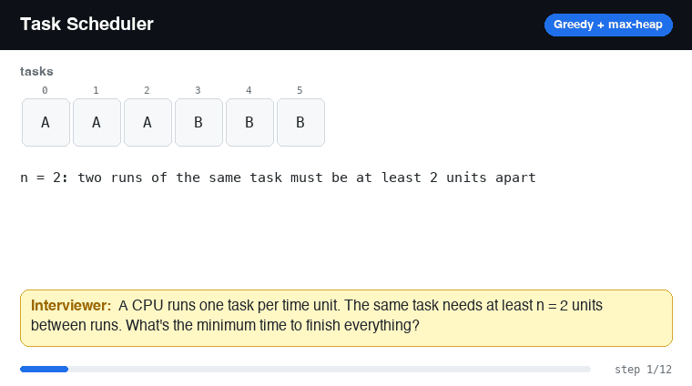

# Walkthrough: Task Scheduler

**Module:** [10 · Heaps & Priority Queues](../README.md) · **Difficulty:** Medium · **Solution:** [`p05_task_scheduler.go`](../p05_task_scheduler.go)



## The problem in plain words

A CPU runs one task per time unit. Tasks are labelled A to Z. Two runs of the same label must be at least n units apart. In between, the CPU can run other tasks or sit idle. What is the minimum total time?

```
tasks = AAABBB, n = 2  →  8      A B _ A B _ A B
```

## Mock interview

**Interviewer:** Given tasks labelled A to Z and a cooldown n, return the minimum number of time units to run them all. The same task must be at least n units apart.

**Candidate:** Can I run tasks in any order? And does idle time count?

**Interviewer:** Any order, and yes, idle units count.

**Candidate:** For `AAABBB` with n = 2, the best schedule is `A B idle A B idle A B`, which takes 8. With n = 0 there's no cooldown, so it's 6. An empty list takes 0.

**Candidate:** Trying every order is exponential, so I need a greedy rule.

**Interviewer:** What rule?

**Candidate:** At each tick, run the available task with the most copies left. That task is the one most likely to force idle time later, so it should start as early as possible. A max-heap of remaining counts gives me that task. When a task runs, it waits in a FIFO queue with the time it becomes ready again. Tasks finish cooling in the order they ran, so a plain queue is enough.

**Candidate:** In code (`LeastIntervalHeap`): count the tasks, push the non-zero counts into `NewMax[int]()`. Each tick: increase `time`. If the heap isn't empty, pop a count and decrease it. If anything is left, append `{left, time + n}` to the queue. Then, if the front of the queue is ready at `time`, push it back into the heap. Loop until both are empty.

**Candidate:** Testing: t=1 runs A, which cools until t=3. t=2 runs B, which cools until t=4. At t=3 nothing is ready, so the CPU idles, and A comes back at the end of the tick. t=4 runs A, and B comes back. t=5 runs B. t=6 is idle again. t=7 and t=8 run the last A and B. Total: 8.

**Interviewer:** Can you get the answer without simulating?

**Candidate:** Yes, that's `LeastInterval`. Let m be the highest count. The most frequent task needs m − 1 full gaps of length n + 1 after its first m − 1 runs, plus a last slot for every task tied at the top count. If there are enough other tasks to fill every gap, there's no idling, and the answer is just `len(tasks)`. So it's `max(len(tasks), (m-1)*(n+1) + numMax)`. Here that's max(6, 2·3 + 2) = 8.

**Interviewer:** Complexity?

**Candidate:** The formula is **O(len(tasks)) time and O(26) space**. The simulation is O(T log 26), where T is the answer, which is effectively linear.

## What the animation shows

| Step | Time | Runs | Note |
|---|---|---|---|
| 1 | Interviewer states the problem | | |
| 2 | Brute force: try every order | | |
| 3 | Counts A=3, B=3 go into the max-heap | | |
| 4 | t=1 | A | A cools until t=3 |
| 5 | t=2 | B | B cools until t=4 |
| 6 | t=3 | idle | A is ready again |
| 7 | t=4 | A | B is ready again |
| 8 | t=5 | B | |
| 9 | t=6 | idle | A is ready again |
| 10 | t=7 | A | last A; B is ready again |
| 11 | t=8 | B | last B; loop ends |
| 12 | Answer 8, and the formula max(6, 2·3 + 2) = 8 | | |

The Go heap holds plain counts. The animation also tracks the letter of each count, only to label the timeline.

## Detailed explanation

**Why the formula is a lower bound.** The most frequent task appears m times. Between consecutive runs there must be at least n other units, so its runs span at least `(m-1)*(n+1) + 1` units. Every other task tied at count m also needs a slot after the last frame, which adds `numMax - 1`. And of course the answer is at least `len(tasks)`, because each task takes a unit.

**Why it's reachable.** Lay out the m − 1 frames of length n + 1, each starting with the top task, and fill the gaps with the other tasks, round-robin. If the gaps run out, there's no idle time at all and you just need `len(tasks)` units.

**Why the greedy simulation agrees.** Running the task with the most remaining copies first is exactly what fills the frames in that order. The tests check that both functions agree on every case.

Edge cases: n = 0 gives `len(tasks)`. A single task type `AAA` with n = 2 gives `A _ _ A _ _ A` = 7. An empty input returns 0 (the formula code checks `maxCount == 0`).

## Complexity

| Approach | Time | Space |
|---|---|---|
| Heap simulation (`LeastIntervalHeap`) | O(T log 26), T = answer | O(26) |
| Closed-form formula (`LeastInterval`) | O(len(tasks)) | O(26) |

## Common mistakes

- Forgetting `max(len(tasks), ...)`. With many different tasks, the frame count is smaller than the number of tasks.
- Counting only one task at the top count, instead of `numMax`.
- In the simulation, checking the cooldown queue before running this tick's task, which can be off by one.

## Try it yourself

```sh
go test ./course/10-heaps/ -run TestLeastInterval -v
```
