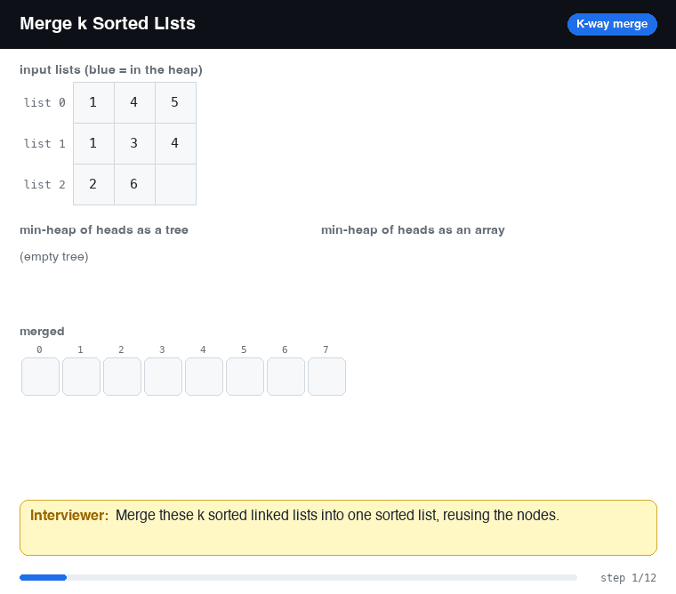

# Walkthrough: Merge k Sorted Lists

**Module:** [10 · Heaps & Priority Queues](../README.md) · **Difficulty:** Hard · **Solution:** [`p06_merge_k_sorted.go`](../p06_merge_k_sorted.go)



## The problem in plain words

You get k linked lists, each sorted from small to large. Merge them into one sorted linked list, reusing the existing nodes.

```
[1->4->5, 1->3->4, 2->6]  →  1->1->2->3->4->4->5->6
```

## Mock interview

**Interviewer:** Merge k sorted linked lists into one sorted list and return its head. Reuse the nodes.

**Candidate:** Can some lists be empty, or can the whole input be empty?

**Interviewer:** Both can happen.

**Candidate:** For `[1->4->5, 1->3->4, 2->6]` the result is `1->1->2->3->4->4->5->6`. Empty lists are skipped, and no lists at all returns nil.

**Candidate:** A simple approach merges list 0 with list 1, then the result with list 2, and so on. The merged list keeps growing and gets walked again each time, so with N total nodes it's O(N·k).

**Interviewer:** How do you do better?

**Candidate:** The smallest value left anywhere must be the head of one of the k lists, because each list is sorted. So I keep the k current heads in a min-heap. I pop the smallest, append it to the output, and push its next node if there is one. The heap never holds more than k nodes.

**Interviewer:** Why is it safe to only look at the heads?

**Candidate:** Every node behind a head is at least as large as that head. So the smallest remaining node is always among the heads, and the heap gives me the smallest head in O(log k).

**Candidate:** In code (`MergeKListsHeap`): a heap ordered by `a.Val < b.Val`. Push every non-nil head. Use a dummy node and a `tail` pointer. While the heap isn't empty, pop `n`, set `tail.Next = n`, move `tail`, and push `n.Next` if it isn't nil. At the end, set `tail.Next = nil` and return `dummy.Next`.

**Candidate:** Testing: the heap starts with 1, 1 and 2. Pop 1 from list 0 and push 4. Pop 1 from list 1 and push 3. Pop 2 and push 6. Pop 3 and push 4. Pop 4 from list 0 and push 5. Pop 4 from list 1, which has nothing left. Then 5, then 6. The output is `1,1,2,3,4,4,5,6`.

**Interviewer:** Is there an approach without a heap?

**Candidate:** `MergeKListsPairwise` merges lists in pairs, then pairs of results, and so on. There are log k rounds, each touching all N nodes, so it's also O(N log k), with O(1) extra space.

**Interviewer:** Complexity of the heap version?

**Candidate:** Each of the N nodes is pushed and popped once on a heap of at most k items: **O(N log k) time, O(k) extra space**.

## What the animation shows

| Step | What happens | Merged so far |
|---|---|---|
| 1 | Interviewer states the problem | |
| 2 | Brute force: merge one list at a time, O(N·k) | |
| 3 | Push the 3 heads: 1, 1, 2 | |
| 4 | Pop 1 (list 0), push 4 | 1 |
| 5 | Pop 1 (list 1), push 3 | 1 1 |
| 6 | Pop 2 (list 2), push 6 | 1 1 2 |
| 7 | Pop 3 (list 1), push 4 | 1 1 2 3 |
| 8 | Pop 4 (list 0), push 5 | 1 1 2 3 4 |
| 9 | Pop 4 (list 1), list 1 is empty | 1 1 2 3 4 4 |
| 10 | Pop 5 (list 0), list 0 is empty | 1 1 2 3 4 4 5 |
| 11 | Pop 6 (list 2), heap is empty | 1 1 2 3 4 4 5 6 |
| 12 | Answer, O(N log k) time, O(k) space | |

## Detailed explanation

**Invariant:** the heap holds exactly one node from each list that still has nodes left, and that node is the list's current head. Every node already in the output is at most every node still in the lists.

Each pop takes the smallest head. That's the smallest remaining node overall, because every other node is behind some head and at least as large. Appending it keeps the output sorted. Pushing its successor restores the invariant for that list.

The dummy node avoids a special case for the first append. `tail.Next = nil` at the end is a safety step: the last node popped is already the end of its own list, so its `Next` is nil anyway.

Ties between equal values (the two 1s) can come out in either order. Both orders give a correctly sorted list.

Edge cases: empty input, or only nil lists, means nothing is pushed, so the function returns `dummy.Next`, which is nil.

## Complexity

| Approach | Time | Space |
|---|---|---|
| Merge one at a time (naive) | O(N·k) | O(1) |
| Min-heap of heads (`MergeKListsHeap`) | O(N log k) | O(k) |
| Pairwise rounds (`MergeKListsPairwise`) | O(N log k) | O(1) |

## Common mistakes

- Pushing nil heads into the heap, which panics on `a.Val`.
- Pushing all N nodes at the start. It still works, but it costs O(N log N) time and O(N) space.
- Forgetting to advance `tail`, which overwrites the same link over and over.

## Try it yourself

```sh
go test ./course/10-heaps/ -run TestMergeKLists -v
```
