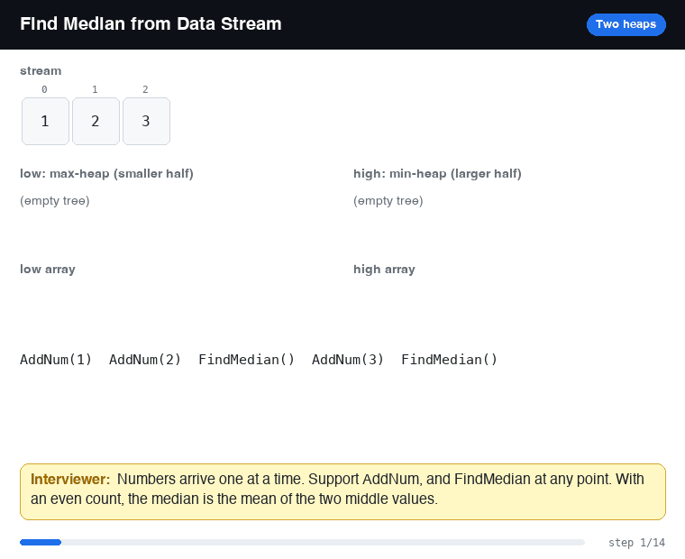

# Walkthrough: Find Median from Data Stream

**Module:** [10 · Heaps & Priority Queues](../README.md) · **Difficulty:** Hard · **Solution:** [`p07_median_finder.go`](../p07_median_finder.go)



## The problem in plain words

Numbers arrive one at a time. At any point you may be asked for the median of everything so far. With an even count, the median is the average of the two middle values.

```
AddNum(1) AddNum(2)  FindMedian() → 1.5
AddNum(3)            FindMedian() → 2.0
```

## Mock interview

**Interviewer:** Build a structure with `AddNum(v)` and `FindMedian()`. `FindMedian` returns the median of all numbers added so far.

**Candidate:** Will `FindMedian` ever be called before any number is added? And should it return a float?

**Interviewer:** It's only called after at least one `AddNum`, and it returns a `float64`.

**Candidate:** After 1 and 2, the median is (1 + 2) / 2 = 1.5. After 3 as well, it's the middle value, 2. Duplicates and negative numbers should work too.

**Candidate:** The baseline (`SortedMedianFinder`) keeps a sorted slice. `FindMedian` is O(1), but each insert has to shift elements to make room, so `AddNum` is O(n).

**Interviewer:** How would you make inserts faster?

**Candidate:** I only need the middle, not full order. So I split the numbers into two halves. A max-heap `low` holds the smaller half, and a min-heap `high` holds the larger half. I keep two rules: everything in `low` is at most everything in `high`, and `low` has the same size as `high` or one more. Then the median is `low`'s top when the count is odd, or the average of both tops when it's even.

**Interviewer:** How does `AddNum` keep both rules?

**Candidate:** Three steps. Push v into `low`. Move `low`'s largest into `high`. That keeps the ordering rule, whatever v was. Then, if `high` has more items than `low`, move `high`'s smallest back into `low`. That fixes the sizes.

**Interviewer:** Why always go through `low` first?

**Candidate:** It saves a comparison. Whatever v is, after the first two steps the largest value of the small side has moved across, so `low`'s top is still at most `high`'s top. I don't have to decide which heap v belongs in.

**Candidate:** Testing: AddNum(1): 1 goes into `low`, moves to `high`, then moves back because `high` is bigger. AddNum(2): 2 goes into `low`, moves to `high`. Sizes are 1 and 1, so no rebalance. The median is (1 + 2) / 2 = 1.5. AddNum(3): 3 goes into `low` and moves to `high`, which now holds 2 and 3. That's too many, so 2 moves back to `low`. Now `low` has one more, and the median is its top, 2.

**Interviewer:** Complexity?

**Candidate:** `AddNum` does at most three heap operations: **O(log n)**. `FindMedian` only peeks: **O(1)**. Space is **O(n)**.

## What the animation shows

| Step | Operation | low | high |
|---|---|---|---|
| 1 | Interviewer states the problem | | |
| 2 | Brute force: sorted slice, O(n) insert | | |
| 3 | AddNum(1): push 1 into low | [1] | [] |
| 4 | Move 1 to high | [] | [1] |
| 5 | high is bigger, move 1 back | [1] | [] |
| 6 | AddNum(2): push 2 into low | [2, 1] | [] |
| 7 | Move 2 to high | [1] | [2] |
| 8 | Sizes equal, no rebalance | [1] | [2] |
| 9 | FindMedian = (1 + 2) / 2 = 1.5 | [1] | [2] |
| 10 | AddNum(3): push 3 into low | [3, 1] | [2] |
| 11 | Move 3 to high | [1] | [2, 3] |
| 12 | high is bigger, move 2 back | [2, 1] | [3] |
| 13 | FindMedian = low's top = 2 | [2, 1] | [3] |
| 14 | Complexity: AddNum O(log n), FindMedian O(1) | | |

## Detailed explanation

**Invariant:** after every `AddNum`,

1. every value in `low` is ≤ every value in `high`, and
2. `len(low) == len(high)` or `len(low) == len(high) + 1`.

With these, `low` holds the smaller ⌈n/2⌉ values and `high` the larger ⌊n/2⌋. For odd n the median is the largest value of the smaller half, `low.Peek()`. For even n it's the average of the two middle values, `low.Peek()` and `high.Peek()`.

**Why step 2 keeps rule 1.** After pushing v into `low`, popping `low`'s maximum removes the largest value on the small side. It is at least everything left in `low`. And it's at most everything in `high`, or it was v, which is now in `high` anyway. Either way, rule 1 holds after it moves.

**Why step 3 keeps both rules.** Moving `high`'s minimum to `low` can't break rule 1: it's at most every other value in `high`, and at least every value in `low`. It brings the sizes back in line.

The averages are computed in `float64`, so `(1 + 2) / 2` is 1.5, not 1.

## Complexity

| Approach | AddNum | FindMedian | Space |
|---|---|---|---|
| Sorted slice (`SortedMedianFinder`) | O(n) | O(1) | O(n) |
| Two heaps (`MedianFinder`) | O(log n) | O(1) | O(n) |

## Common mistakes

- Pushing v directly into one heap based on a comparison, then forgetting to rebalance. The halves drift apart.
- Letting `high` be the larger heap, but still reading the median from `low`.
- Doing integer division for the even case, which drops the .5.

## Try it yourself

```sh
go test ./course/10-heaps/ -run TestMedianFinder -v
```
