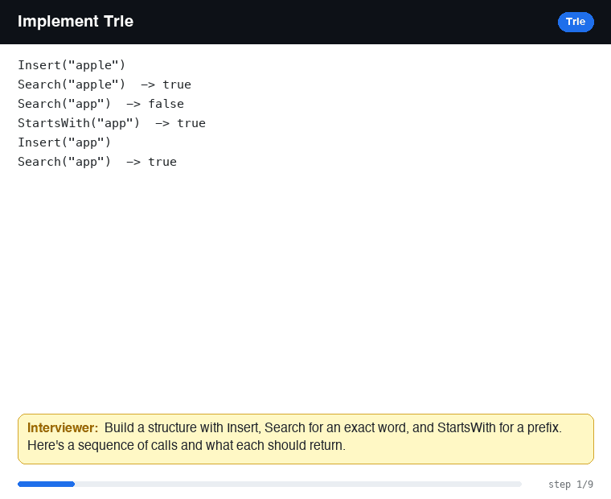

# Walkthrough: Implement Trie

**Module:** [11 · Tries](../README.md) · **Difficulty:** Medium · **Solution:** [`p01_implement_trie.go`](../p01_implement_trie.go) and [`trie.go`](../trie.go)



## The problem in plain words

Build a word container with three operations: add a word, check whether an exact word was added, and check whether any added word starts with a given prefix.

```
Insert("apple")
Search("apple")     -> true
Search("app")       -> false   (only a prefix so far)
StartsWith("app")   -> true
Insert("app")
Search("app")       -> true
```

## Mock interview

**Interviewer:** Implement a trie with `Insert`, `Search` and `StartsWith`. `Search` asks for an exact word, `StartsWith` asks for a prefix.

**Candidate:** A few questions first. Are the words lowercase `a` to `z`? Can the same word be inserted twice? And does `StartsWith("")` count as true?

**Interviewer:** Lowercase only for the main version. Duplicates can happen. The empty prefix is a prefix of everything, so yes.

**Candidate:** Let me run the example by hand. After `Insert("apple")`, `Search("apple")` is true. `Search("app")` is false, because "app" was never inserted, even though it is the start of "apple". `StartsWith("app")` is true. After `Insert("app")`, `Search("app")` becomes true.

**Candidate:** The simplest solution keeps a `[]string`. `Search` compares the word with every stored word, and `StartsWith` calls `strings.HasPrefix` on each. That is O(N·L) per call for N words, so it gets slower as the dictionary grows.

**Interviewer:** Can you make the cost independent of N?

**Candidate:** Yes, with a trie. Each node stands for a prefix, and each edge adds one letter. Words that share a beginning share the same nodes. To insert, I walk the letters from the root and create any missing child. At the last node I set `IsEnd`, which means "a word ends exactly here". `Search` and `StartsWith` both use the same walk. If the walk falls off the tree, the answer is false for both. If it lands on a node, `StartsWith` is true, and `Search` is true only if that node has `IsEnd`.

**Interviewer:** Why do you need `IsEnd` at all? The node for "app" exists after inserting "apple".

**Candidate:** That is exactly why. The node exists because "apple" passes through it. Without a flag I can't tell "app is a word" from "app is only the start of a word". Forgetting this check is the most common trie bug.

**Candidate:** In Go, a node is `Children [26]*Node` plus `IsEnd`. The index of a letter is `w[i] - 'a'`. A shared `walk(s)` returns the final node or `nil`. The course's `Trie` in `trie.go` also keeps a `Pass` counter on each node, the number of words that go through it. That powers `CountPrefix` and `Delete`. `Insert` checks `Search` first so a duplicate doesn't increase the counters twice. For Unicode keys, `MapTrie` uses `map[rune]*mapNode` instead of the array.

**Candidate:** Testing on the example: inserting "apple" builds the chain a, p, p, l, e and marks e. `Search("apple")` ends on e with `IsEnd` true. `Search("app")` ends on the second p, `IsEnd` false. `StartsWith("app")` ends on a real node, so true. `Insert("app")` creates no nodes and only marks the second p. Now `Search("app")` is true.

**Interviewer:** Complexity?

**Candidate:** Each operation visits at most L nodes for a key of length L, so **O(L) time**, no matter how many words are stored. Space is one node per distinct prefix, **O(total characters inserted)**.

**Interviewer:** What would change for Unicode words?

**Candidate:** Indexing bytes with `w[i] - 'a'` breaks. I would range over the string to get runes and store children in a map, like `MapTrie`. A map costs a hash per step but only stores the edges that exist.

## What the animation shows

| Step | Call | What happens | Result |
|---|---|---|---|
| 1 | — | The interviewer lists the calls | — |
| 2 | — | Brute force: scan a list, O(N·L) per call | — |
| 3 | `Insert("apple")` | Creates a, p, p, l, e; marks e as a word end | — |
| 4 | `Search("apple")` | Walk ends on e, `IsEnd` true | true |
| 5 | `Search("app")` | Walk ends on the second p, `IsEnd` false | false |
| 6 | `StartsWith("app")` | Walk doesn't fall off | true |
| 7 | `Insert("app")` | No new nodes; marks the second p; `Pass` is 2 along a-p-p | — |
| 8 | `Search("app")` | Walk ends on the second p, `IsEnd` true | true |
| 9 | — | Every operation is O(L) | — |

## Detailed explanation

A trie stores a set of strings so that **every prefix of every stored word is exactly one node**. The path from the root to a node spells that prefix. This gives two facts:

- A prefix `p` belongs to some stored word if and only if walking `p` from the root never falls off the tree. That is `StartsWith`.
- A word `w` is stored if and only if the walk lands on a node that was marked when `w` was inserted. That is `Search`.

Because the walk only depends on the letters of the key, the work per call is O(L). The number of stored words never enters the cost, which is the whole point compared with a list.

Edge cases:

- **The empty string.** `walk("")` returns the root, so `StartsWith("")` is true even on an empty trie, matching `strings.HasPrefix(s, "")`. `Search("")` is true only if the empty word was inserted.
- **Duplicate inserts.** `Trie.Insert` returns early if `Search` already finds the word, so `Pass` counts distinct words.
- **Deleting.** `Delete` lowers `Pass` along the path and cuts the branch at the first child whose count reaches 0, so no dead nodes remain to fool `StartsWith`.

## Complexity

| Approach | Time per call | Space |
|---|---|---|
| Brute force (slice of words) | O(N·L) | O(total characters) |
| Array trie (`Trie.Insert`, `Trie.Search`, `Trie.StartsWith`) | O(L) | O(total characters × 26 pointers) |
| Map trie (`MapTrie.Insert`, `MapTrie.Search`, `MapTrie.StartsWith`) | O(L) expected | O(total characters) |

## Common mistakes

- Returning true from `Search` just because the node exists. You must check `IsEnd`.
- Using `w[i] - 'a'` on non-ASCII input. It indexes bytes, not letters.
- Counting a duplicate insert twice when you keep counters.
- Deleting by clearing `IsEnd` only, which leaves dead branches that make `StartsWith` return true for removed words.

## Try it yourself

```sh
go test ./course/11-tries/ -run TestTrieBasics -v
```
