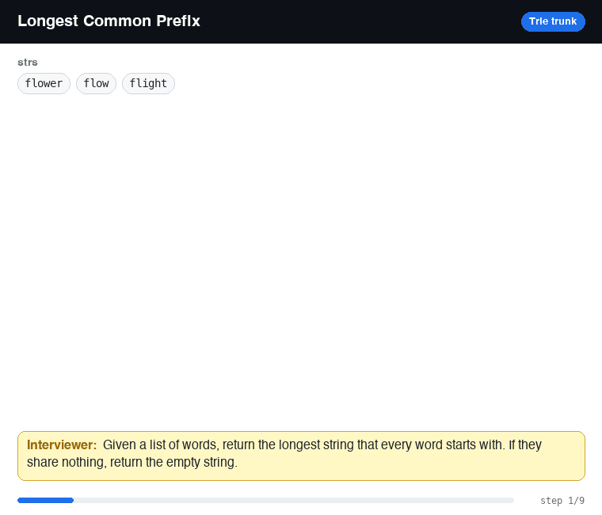

# Walkthrough: Longest Common Prefix

**Module:** [11 · Tries](../README.md) · **Difficulty:** Easy · **Solution:** [`p02_longest_common_prefix.go`](../p02_longest_common_prefix.go)



## The problem in plain words

You get a list of words. Return the longest string that every word starts with. If they share nothing, or the list is empty, return `""`.

```
["flower", "flow", "flight"]  ->  "fl"
["dog", "racecar", "car"]     ->  ""
```

## Mock interview

**Interviewer:** Given a list of strings, return their longest common prefix.

**Candidate:** Can the list be empty, and can it contain an empty string? And are the words lowercase?

**Interviewer:** Either can happen. Return `""` in both cases. Assume lowercase `a` to `z`.

**Candidate:** For `["flower", "flow", "flight"]` the answer is "fl", because the third letters are o, o and i. For `["dog", "racecar", "car"]` the first letters already differ, so the answer is empty. If one word is a prefix of another, like `["ab", "abc"]`, the answer is the shorter word.

**Candidate:** A naive approach tries each prefix of the first word, longest or shortest first, and checks `strings.HasPrefix` on every word. That re-reads the same characters once per prefix length, so it is O(L·S) for S total characters.

**Interviewer:** Can you avoid the repeated work?

**Candidate:** Two ways. The plain one is a vertical scan: compare character `i` of the first word with character `i` of every other word, and stop at the first mismatch or at the end of the shortest word. Each character is read once, O(S) time, O(1) space.

Since this is the trie module, the trie view is also worth knowing. Insert all words. The common prefix is the "trunk" from the root: keep walking while the current node has exactly one child and no word ends there. A second child means the words disagree on the next letter. A word ending means one word is used up, so the prefix can't grow.

**Interviewer:** Why do you stop when a word ends at a node, even if it has one child?

**Candidate:** Because that word is the prefix itself. With `["ab", "abc"]`, after "ab" there is one child, c, but "ab" has no c. The answer must be "ab", and the `IsEnd` check gives that.

**Candidate:** In code, `LongestCommonPrefixTrie` builds a `Trie`, then loops `for !cur.IsEnd`. It scans the 26 children. If it finds a second non-nil child it returns the prefix so far. If it finds none, it breaks. Otherwise it appends the letter and moves down.

**Candidate:** Testing on the example: after inserting all three words, the root has one child, f, so the prefix becomes "f". Node f has one child, l, so it becomes "fl". Node "fl" has two children, i and o, so I stop and return "fl".

**Interviewer:** Complexity, and which one would you write?

**Candidate:** Both are **O(S) time**. The scan uses **O(1) space** and the trie uses **O(S)**. For a single query I would write the scan. The trie pays off if the same word set is queried many times, for example "the common prefix of all words starting with p".

## What the animation shows

| Step | What happens | Prefix so far |
|---|---|---|
| 1 | The interviewer states the problem | — |
| 2 | Brute force: check every prefix of the first word, O(L·S) | — |
| 3 | Insert "flower": one chain | — |
| 4 | Insert "flow": reuses f-l-o-w | — |
| 5 | Insert "flight": shares f-l, then branches at i | — |
| 6 | Root has one child f, no word ends at the root | "f" |
| 7 | Node f has one child l | "fl" |
| 8 | Node "fl" has two children, i and o: stop | "fl" |
| 9 | Answer "fl"; scan vs trie complexity | "fl" |

## Detailed explanation

In a trie, two words share a node exactly as long as they share a prefix. So the longest common prefix of all words is the deepest node that **every** word passes through. Starting from the root, every word passes through a node as long as:

1. the node has exactly one child, so nobody branches off, and
2. no word ends at the node, so nobody stops.

The first node that breaks either rule is the end of the common prefix. That gives the loop in `LongestCommonPrefixTrie`.

The vertical scan, `LongestCommonPrefixScan`, does the same thing without building anything. Column `i` is "the next trunk node". A mismatch is a second child, and `i == len(s)` is a word ending.

Edge cases:

- Empty list: both functions return `""` immediately.
- An empty string in the list: the root gets `IsEnd`, so the trie loop never starts. The scan hits `i == len(s)` at `i = 0`.
- One word: the answer is the word itself. The trunk follows its single chain until its `IsEnd`.

## Complexity

| Approach | Time | Space |
|---|---|---|
| Brute force (every prefix × every word) | O(L·S) | O(1) |
| Vertical scan (`LongestCommonPrefixScan`) | O(S) | O(1) |
| Trie trunk (`LongestCommonPrefixTrie`) | O(S) | O(S) |

## Common mistakes

- Indexing past the end of a shorter word. Check `i == len(s)` before `s[i]`.
- Forgetting the `IsEnd` stop in the trie version, which returns "abc" for `["ab", "abc"]`.
- Returning `first[:i+1]` instead of `first[:i]` on a mismatch.

## Try it yourself

```sh
go test ./course/11-tries/ -run TestLongestCommonPrefix -v
```
