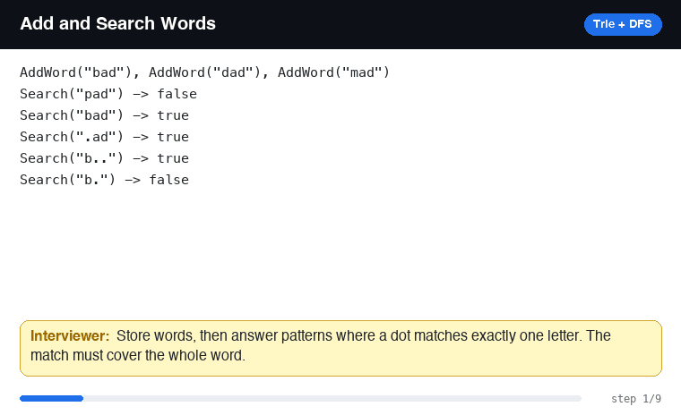

# Walkthrough: Add and Search Words

**Module:** [11 · Tries](../README.md) · **Difficulty:** Medium · **Solution:** [`p03_add_search_words.go`](../p03_add_search_words.go)



## The problem in plain words

Build a dictionary where you can add words and then ask whether a pattern matches a stored word. A pattern uses lowercase letters and `.`, where `.` stands for exactly one letter. The pattern must match the whole word, not only its start.

```
AddWord("bad"); AddWord("dad"); AddWord("mad")
Search("pad") -> false
Search("bad") -> true
Search(".ad") -> true
Search("b..") -> true
Search("b.")  -> false
```

## Mock interview

**Interviewer:** Design a structure with `AddWord(word)` and `Search(pattern)`. A dot in the pattern matches any single letter.

**Candidate:** Does a dot match exactly one letter, never zero? And must the match cover the full word?

**Interviewer:** Exactly one letter, and yes, the whole word.

**Candidate:** Then with "bad", "dad" and "mad" stored, ".ad" is true because "bad" fits. "b.." is true for the same reason. "b." is false: "ba" is only the start of "bad", and no two-letter word is stored. "pad" is false because no word starts with p.

**Candidate:** The brute force keeps a `[]string`. For each search it skips words of the wrong length and compares letter by letter, treating a dot as a match. That is O(N·L) per search. The tests use it as the reference, `wordListDictionary`.

**Interviewer:** How would you speed up searches?

**Candidate:** Store the words in a trie and search with a DFS. A normal letter follows exactly one edge. A dot has to try every existing child. When the pattern is used up, I return the node's `IsEnd`, because the match must end exactly on a word. A branch stops as soon as it falls off the trie, and I return true as soon as any branch succeeds.

**Interviewer:** Isn't that exponential with many dots?

**Candidate:** In the worst case it can branch up to 26 ways per dot, so O(26^d · L) with d dots. But it can never visit more nodes than the trie has, and branches die quickly when the next letter doesn't exist. Patterns without dots are a plain O(L) walk.

**Candidate:** In Go, `AddWord` is the usual insert into `[26]*Node` children. `Search` defines a recursive closure `match(n, i)`. If `i == len(pattern)` it returns `n.IsEnd`. For a letter it looks up one child and recurses. For a dot it loops over all children and returns true on the first success.

**Candidate:** Testing: "pad" fails at the root, there is no p child. "bad" walks b, a, d and lands on a word end. For ".ad" the dot tries children in order, b first, and b-a-d already ends on a word, so it stops there. "b.." walks b, then the dots follow a and d, and d is a word end. "b." walks b and a, then the pattern is used up on node "ba", which is not a word end, so false.

**Interviewer:** Complexity?

**Candidate:** `AddWord` is **O(L)**. `Search` is **O(L)** without dots, and **O(26^d · L)** in the worst case with d dots, capped by the trie size. Space is **O(total characters)**.

## What the animation shows

| Step | Call | Path through the trie | Result |
|---|---|---|---|
| 1 | — | The interviewer lists the calls | — |
| 2 | — | Brute force: compare against every word, O(N·L) | — |
| 3 | `AddWord` × 3 | Three branches: b-a-d, d-a-d, m-a-d | — |
| 4 | `Search("pad")` | Root has no p child | false |
| 5 | `Search("bad")` | b → a → d, word end | true |
| 6 | `Search(".ad")` | Dot tries b first; b → a → d is a word end | true |
| 7 | `Search("b..")` | b, then the dots follow a and d | true |
| 8 | `Search("b.")` | b → a, pattern used up, not a word end | false |
| 9 | — | Complexity | — |

## Detailed explanation

The search answers one question at each call of `match(n, i)`: "is there a stored word whose remaining letters, below node `n`, match `pattern[i:]`?"

- If `i == len(pattern)`, nothing is left to match, so the answer is whether a word ends at `n`.
- If `pattern[i]` is a letter, only one child can work. If it's missing, the answer is false.
- If `pattern[i]` is a dot, any child might work, so the answer is the OR over all children. Returning on the first true is a safe shortcut.

Each recursive call moves one level deeper in the trie and one position further in the pattern, so the recursion depth is at most L. Different branches explore different trie nodes at the same depth, so the total work is bounded by the number of nodes the pattern can reach.

Edge cases:

- A pattern longer than every word: the walk falls off and returns false.
- A pattern of all dots: it explores every node at depth up to L. Still correct, just the slowest case.
- A stored word that is a prefix of another, like "ba" and "bad": `IsEnd` on the "ba" node makes `Search("b.")` true.

## Complexity

| Approach | AddWord | Search | Space |
|---|---|---|---|
| Word list (`wordListDictionary`) | O(1) | O(N·L) | O(total characters) |
| Trie + DFS (`WordDictionary.AddWord`, `WordDictionary.Search`) | O(L) | O(L), worst O(26^d · L) | O(total characters) |

## Common mistakes

- Returning true when the pattern runs out on any node. You must check `IsEnd`.
- For a dot, returning the result of the first child instead of trying the next child when it fails.
- Treating `.` as "zero or more letters", which is a different problem.

## Try it yourself

```sh
go test ./course/11-tries/ -run TestWordDictionary -v
```
