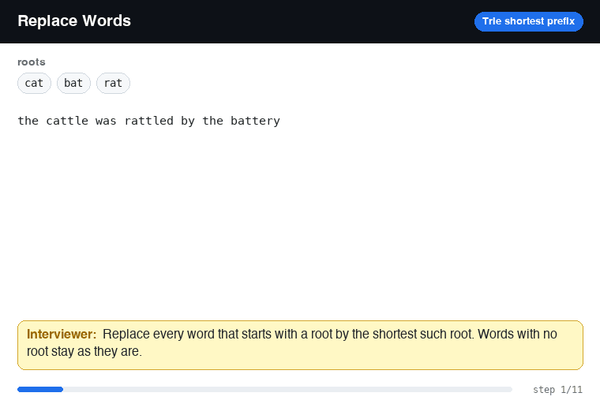

# Walkthrough: Replace Words

**Module:** [11 · Tries](../README.md) · **Difficulty:** Medium · **Solution:** [`p04_replace_words.go`](../p04_replace_words.go)



## The problem in plain words

You have a list of short roots and a sentence. Every word that starts with a root gets replaced by the shortest root it starts with. Other words stay the same.

```
roots    = ["cat", "bat", "rat"]
sentence = "the cattle was rattled by the battery"
result   = "the cat was rat by the bat"
```

## Mock interview

**Interviewer:** Given roots and a sentence, replace each word with its shortest root.

**Candidate:** Is everything lowercase, separated by single spaces? And if two roots match, like "a" and "aa", I pick the shorter one?

**Interviewer:** Lowercase, space-separated. Yes, always the shortest root.

**Candidate:** On the example, "cattle" starts with "cat", "rattled" with "rat" and "battery" with "bat". "the", "was" and "by" match nothing, so they stay. With roots `["a", "aa"]`, "aadsfasf" becomes "a", not "aa".

**Candidate:** The brute force checks every root against every word with `strings.HasPrefix` and keeps the shortest match. That is O(words · roots · L). It's `ReplaceWordsBrute` in the repo.

**Interviewer:** Can you avoid checking every root for every word?

**Candidate:** Yes. I put all roots in a trie, then walk each word from the root letter by letter. The first node I reach with `IsEnd` set is the shortest root, because nodes nearer the root are shorter prefixes. I can stop there. If the walk falls off the trie first, no root is a prefix of the word, and I keep the word.

**Interviewer:** Why is the first `IsEnd` the shortest one? Couldn't a longer root be better?

**Candidate:** The problem asks for the shortest. Any root that is a prefix of the word lies on this one path, and the walk meets them in order of length. So the first one found is the shortest by construction.

**Candidate:** In code, `ReplaceWords` inserts the roots into a `Trie`, splits the sentence with `strings.Fields`, maps each word through `shortestRoot`, and joins with spaces. `shortestRoot` follows `Children[w[i]-'a']`. It returns `w` when a child is `nil`, and returns `w[:i+1]` when the node has `IsEnd`.

**Candidate:** Testing on the example: "the" has no t at the root, keep it. "cattle" walks c, a, t and hits a word end, so it becomes "cat". "was" has no w, keep it. "rattled" becomes "rat". "by" has a b but no y under it, keep it. The second "the" stays. "battery" becomes "bat".

**Interviewer:** Complexity?

**Candidate:** Building the trie is O(R) for R total root characters. Each word walk reads at most the word's letters and often stops early. So **O(R + S) time** for sentence length S, and **O(R) space** for the trie.

## What the animation shows

| Step | Word | Walk | Output word |
|---|---|---|---|
| 1 | — | The interviewer states the problem | — |
| 2 | — | Brute force: every word × every root | — |
| 3 | — | Trie of cat, bat, rat | — |
| 4 | the | No t child at the root | the |
| 5 | cattle | c → a → t, word end | cat |
| 6 | was | No w child | was |
| 7 | rattled | r → a → t, word end | rat |
| 8 | by | b exists, no y below it | by |
| 9 | the | Same as step 4 | the |
| 10 | battery | b → a → t, word end | bat |
| 11 | — | Answer and complexity | — |

## Detailed explanation

Every root that is a prefix of word `w` corresponds to a node on the path spelled by `w` from the root of the trie, and that node is marked `IsEnd`. Walking `w` visits those nodes from shortest to longest. So:

- The first `IsEnd` node is the shortest root. Return it immediately.
- If the walk falls off the trie before any `IsEnd`, no root is a prefix of `w`. Return `w`.
- If the walk reaches the end of `w` without an `IsEnd`, `w` is only a prefix of some root, which doesn't count. Return `w`.

That's the whole of `shortestRoot`. Each word costs at most its own length, and usually less.

Edge cases:

- A root equal to a full word, like root "cat" and word "cat": the walk hits `IsEnd` on the last letter and returns "cat", unchanged.
- Duplicate roots: `Trie.Insert` ignores the second copy.
- Extra spaces: `strings.Fields` splits on runs of whitespace, and the output uses single spaces.

## Complexity

| Approach | Time | Space |
|---|---|---|
| Brute force (`ReplaceWordsBrute`) | O(words · roots · L) | O(1) extra |
| Trie (`ReplaceWords`) | O(R + S) | O(R) |

## Common mistakes

- Walking the whole word and taking the last `IsEnd`. That gives the longest root.
- Treating a word that is only a prefix of a root as a match.
- Not stopping when `Children[...]` is `nil`, which dereferences a nil pointer.

## Try it yourself

```sh
go test ./course/11-tries/ -run TestReplaceWords -v
```
