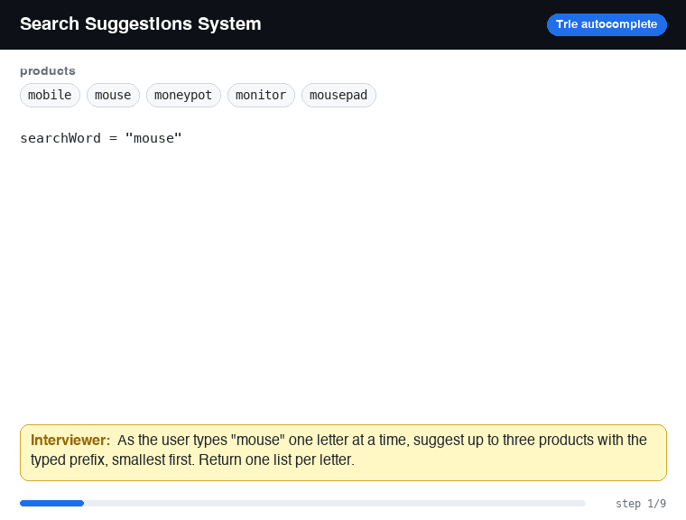

# Walkthrough: Search Suggestions System

**Module:** [11 · Tries](../README.md) · **Difficulty:** Medium · **Solution:** [`p05_search_suggestions.go`](../p05_search_suggestions.go)



## The problem in plain words

You have a list of product names. A user types a search word one letter at a time. After each letter, suggest up to three products that start with what has been typed so far, picking the alphabetically smallest ones.

```
products = ["mobile", "mouse", "moneypot", "monitor", "mousepad"], searchWord = "mouse"
m     -> [mobile moneypot monitor]
mo    -> [mobile moneypot monitor]
mou   -> [mouse mousepad]
mous  -> [mouse mousepad]
mouse -> [mouse mousepad]
```

## Mock interview

**Interviewer:** Return a list of up to three suggestions for every prefix of the search word.

**Candidate:** Are product names distinct and lowercase? And if nothing matches a prefix, is an empty list correct for that letter?

**Interviewer:** Distinct, lowercase, and yes, empty for that letter.

**Candidate:** For "m" all five products match. Sorted, they are mobile, moneypot, monitor, mouse, mousepad, so the first three are mobile, moneypot, monitor. From "mou" on only mouse and mousepad match. Once a prefix matches nothing, every longer prefix matches nothing too.

**Candidate:** The brute force filters all products for each prefix and sorts the matches. That redoes the same filtering for every letter typed: about O(L · n log n) string comparisons.

**Interviewer:** How would a trie help?

**Candidate:** Insert all products into a trie. After each typed letter, I take one step down from the previous node. Then I run a DFS from that node, visiting children from a to z. A pre-order DFS in that order produces words in sorted order, and a word that ends higher up, like "mouse", comes before the longer words below it. So I collect words until I have three and stop.

**Interviewer:** Why does a DFS give sorted order?

**Candidate:** Sorted order compares the first letter, then the next, and a shorter word comes before any longer word that starts with it. The DFS does the same: it records a word when it reaches its end node, before going deeper, and it tries smaller letters first. So it outputs words in exactly the sorted order.

**Candidate:** In Go, `SuggestedProducts` builds a `Trie`, keeps a `cur` node, and for each letter moves `cur` to `cur.Children[c]`. If `cur` becomes `nil`, the rest of the answers stay `nil`. Otherwise it calls `t.WithPrefix(prefix, 3)`, the trie's DFS with a limit. There's also `SuggestedProductsSorted`, which sorts once and uses `sort.SearchStrings` to find the first product at or after each prefix, then takes up to three that still have the prefix.

**Candidate:** Testing: after "m", the DFS meets mobile, moneypot, monitor and stops. "mo" gives the same. After "mou" the node has only the s branch, and the DFS finds mouse, then mousepad. "mous" and "mouse" give the same two.

**Interviewer:** Complexity?

**Candidate:** Building the trie is **O(P)** for P total characters. Each letter costs one step plus a DFS that stops after three words. The sorted version is **O(P log n)** to sort plus **O(L log n)** binary searches. Space is **O(P)** for the trie.

## What the animation shows

| Step | Typed | What happens | Suggestions |
|---|---|---|---|
| 1 | — | The interviewer states the problem | — |
| 2 | — | Brute force: filter and sort for each prefix | — |
| 3 | — | Trie of all five products | — |
| 4 | m | DFS from node m stops after three words | mobile, moneypot, monitor |
| 5 | mo | One step down, same DFS | mobile, moneypot, monitor |
| 6 | mou | Only the u branch remains | mouse, mousepad |
| 7 | mous | Same | mouse, mousepad |
| 8 | mouse | Same | mouse, mousepad |
| 9 | — | All five lists and the complexity | — |

## Detailed explanation

Two facts make the trie version work.

1. **Prefix node.** All products that start with prefix `p` are exactly the words in the subtree below the node for `p`. Typing one more letter only moves one level down, so I keep the node from the previous letter instead of walking from the root again.
2. **Sorted DFS.** A pre-order DFS that records a word on reaching its end node and visits children in a to z order lists the subtree's words in lexicographic order. So "the three smallest" is "the first three the DFS finds". `WithPrefix` checks `len(out) == limit` at the top of each call to stop early.

When the walk falls off the trie, the subtree is empty and stays empty for every longer prefix, so the code just `continue`s and leaves the remaining entries `nil`.

The sort plus binary search version uses the same idea in a flat array. In a sorted list, all strings with prefix `p` form one contiguous block, which starts at the first string `>= p`.

## Complexity

| Approach | Time | Space |
|---|---|---|
| Brute force (filter and sort per prefix) | O(L · n log n) comparisons | O(n) |
| Trie (`SuggestedProducts`) | O(P + L·k), k = work to collect 3 words | O(P) |
| Sort + binary search (`SuggestedProductsSorted`) | O(P log n + L log n) | O(n) for the sorted copy |

## Common mistakes

- Collecting all words under the node and then sorting. That throws away the trie's free ordering.
- Recording a word after visiting its children, which puts "mousepad" before "mouse".
- Walking from the root for every prefix instead of keeping the current node.
- Sorting the caller's slice in place in the binary search version. The repo copies it first.

## Try it yourself

```sh
go test ./course/11-tries/ -run TestSuggestedProducts -v
```
