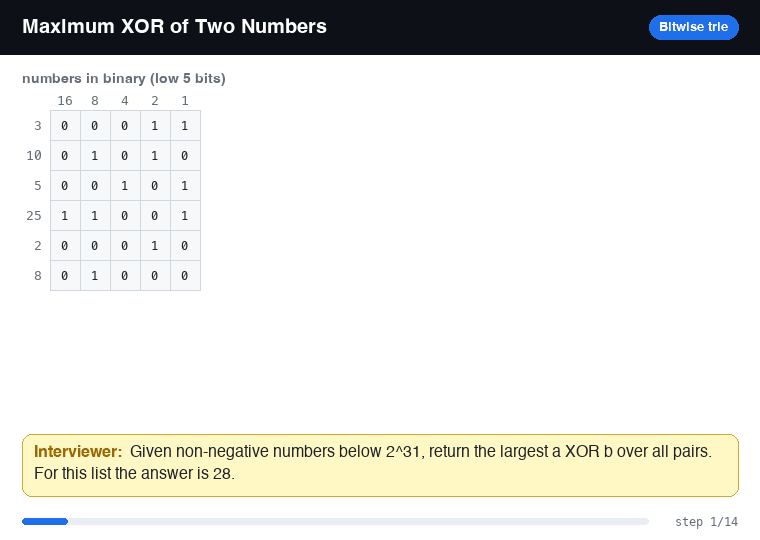

# Walkthrough: Maximum XOR of Two Numbers

**Module:** [11 · Tries](../README.md) · **Difficulty:** Medium · **Solution:** [`p06_maximum_xor.go`](../p06_maximum_xor.go)



## The problem in plain words

You get a list of non-negative numbers below 2^31. Pick two of them (they may be the same element) so that `a XOR b` is as large as possible, and return that value.

```
[3, 10, 5, 25, 2, 8]  ->  28    because 5 XOR 25 = 00101 ^ 11001 = 11100 = 28
[0]                   ->  0
```

## Mock interview

**Interviewer:** Return the maximum `a XOR b` over all pairs in the array.

**Candidate:** Are all numbers non-negative and below 2^31? Can a pair use the same element twice? What about an empty array?

**Interviewer:** Yes, non-negative and below 2^31. The same element is allowed, so a single number gives 0. Return 0 for an empty array.

**Candidate:** In the example, 5 is 00101 and 25 is 11001. They differ in the top three bits, so the XOR is 11100, which is 28. No pair does better.

**Candidate:** The brute force tries every pair: O(n²). That's `FindMaximumXORBrute`.

**Interviewer:** How can you beat O(n²)?

**Candidate:** XOR is largest when the numbers differ in the highest bits. Bit k is worth 2^k, which is more than all lower bits together, 2^k − 1. So for a fixed x, the best partner is found greedily from the top bit down: at each bit, prefer a partner whose bit is the opposite of x's, as long as one exists.

To answer "does a partner with this prefix of bits exist?" quickly, I store every number in a **bitwise trie**. Each number is a path of 31 bits, most significant first, and each node has a 0 child and a 1 child. To query x, I walk down and take the opposite child when it exists, adding `1 << b` to the result. Otherwise I take the same child, and that bit adds nothing.

**Interviewer:** Why is the greedy choice safe? Taking the opposite bit now might lead to a worse path later.

**Candidate:** It can't. Suppose I take the opposite bit at position b and get a 1 there. Any path that takes the same bit has a 0 at position b. Even if all its lower bits were 1, it would be at most 2^b − 1 there, which is less than the 2^b I've already locked in. The higher bits are the same on both paths, so the greedy path always wins.

**Candidate:** In Go, `FindMaximumXOR` loops over the numbers. For each x it calls `insertBits(root, x)`, then `bestXOR(root, x)`, and keeps the maximum. Inserting before querying means x can pair with itself and with everything earlier. Every pair is still checked once, from the later element's side. `maxBit` is 30, so all paths have the same length.

**Candidate:** Testing: 3 is alone, so XOR 0. 10 pairs best with 3 for 9. 5 pairs best with 10 for 15. Then 25 = 11001. Bit 4: 25 has 1, a 0 child exists, take it, +16. Bit 3: 25 has 1, a 0 child exists, +8. Bit 2: 25 has 0, a 1 child exists, +4. Now only 5 remains on this path. Bits 1 and 0 can't flip. The result is 28. Then 2 gets 27 with 25 and 8 gets 17 with 25. The best stays 28.

**Interviewer:** Complexity?

**Candidate:** Each insert and each query walks 31 levels, so **O(n · 31) time**, linear in n. The trie has at most 31 new nodes per number, so **O(n · 31) space**.

## What the animation shows

The numbers here are all below 32, so the top 26 bits are 0 for every number. The animation draws only the low 5 levels of the trie. The code still walks all 31.

| Step | Number | What happens | Best so far |
|---|---|---|---|
| 1 | — | The numbers in binary | — |
| 2 | — | Brute force: every pair, O(n²) | — |
| 3 | 3 | Insert, query: pairs with itself, XOR 0 | 0 |
| 4 | 10 | Insert, query: best partner 3, XOR 9 | 9 |
| 5 | 5 | Insert, query: best partner 10, XOR 15 | 15 |
| 6 | 25 | Insert 25 = 11001, start the greedy walk | 15 |
| 7 | 25 | Bit 4: want 0, take it, +16 | 15 |
| 8 | 25 | Bit 3: want 0, take it, +8 | 15 |
| 9 | 25 | Bit 2: want 1, take it, +4 | 15 |
| 10 | 25 | Bit 1: want 1, missing, follow 0 | 15 |
| 11 | 25 | Bit 0: want 0, missing, follow 1 | 15 |
| 12 | 25 | Path ends at 5: 25 XOR 5 = 28 | 28 |
| 13 | 2, 8 | Same again: 27 and 17 | 28 |
| 14 | — | Answer 28 and the complexity | 28 |

## Detailed explanation

`bestXOR(root, x)` returns `max(x XOR y)` over the stored values y. At bit b it keeps this invariant: *the current node is the set of stored numbers whose top bits match the path taken, and the bits chosen so far give the largest possible top part of `x XOR y`.*

- If the opposite child exists, some stored y has bit b different from x. Taking it sets bit b of the XOR. As shown in the interview, no other choice can make up for losing that bit.
- If it doesn't exist, every remaining candidate has the same bit as x, so bit b of the XOR is 0 whatever you do.

After 31 levels the path spells one concrete stored number, and the accumulated `xor` is exactly `x XOR y` for it.

Inserting before querying handles two edge cases: a single number gives `x XOR x = 0`, and the root never has empty children during a query. An empty input returns 0 before building anything.

## Complexity

| Approach | Time | Space |
|---|---|---|
| Brute force (`FindMaximumXORBrute`) | O(n²) | O(1) |
| Bitwise trie (`FindMaximumXOR`) | O(n · 31) | O(n · 31) |

## Common mistakes

- Walking bits from the least significant end. Greedy only works from the top bit down.
- Using different path lengths for different numbers. Fix the width (31 bits) so every number has a full path.
- Querying before the first insert, which walks into an empty trie and dereferences `nil`.
- Forgetting the parentheses in `(x >> b) & 1`.

## Try it yourself

```sh
go test ./course/11-tries/ -run TestFindMaximumXOR -v
```
