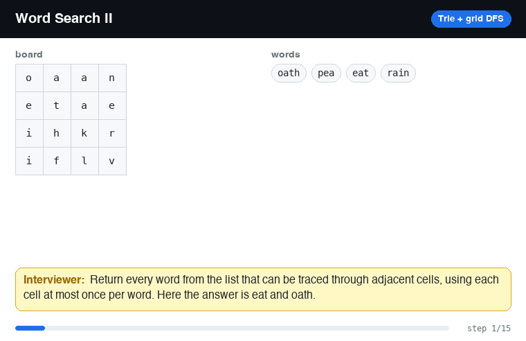

# Walkthrough: Word Search II

**Module:** [11 · Tries](../README.md) · **Difficulty:** Hard · **Solution:** [`p07_word_search_ii.go`](../p07_word_search_ii.go)



## The problem in plain words

You get a grid of letters and a list of words. Return every word you can spell by moving up, down, left or right between cells, using each cell at most once per word.

```
o a a n
e t a e      words ["oath", "pea", "eat", "rain"]  ->  ["eat", "oath"]
i h k r
i f l v
```

## Mock interview

**Interviewer:** Find all words from the list that appear in the board.

**Candidate:** Can a word use the same cell twice? Can the word list contain duplicates? And what order should the result be in?

**Interviewer:** No reusing cells within one word. Duplicates may appear, but report each word once. Return the result sorted.

**Candidate:** In the example, "oath" goes (0,0) o, (0,1) a, (1,1) t, (2,1) h. "eat" goes (1,3) e, (1,2) a, (1,1) t. "pea" has no p on the board, and "rain" has no path. So the answer is `["eat", "oath"]`.

**Candidate:** The brute force runs the single-word Word Search for every word: a backtracking DFS from every cell. That costs O(m·n·4·3^(L−1)) per word, times the number of words. Words with a shared prefix redo the same exploration. That's `FindWordsBrute`.

**Interviewer:** How do you share the work between words?

**Candidate:** I put all words in a trie and run **one** DFS from each cell, stepping down the trie as I step across the grid. If the letters on the current path aren't a prefix of any word, the child is `nil` and I stop right there. So one search covers every word at once.

Three details make it fast and correct:

1. Store the whole word at its end node. When I reach a node with a word, I record it with no string building.
2. Clear that stored word after recording it, so a second path to the same word isn't reported again.
3. On the way back, if a node has no word and no children left, remove it from its parent. Later searches then skip finished branches immediately.

**Interviewer:** Why is pruning safe? You might need that node again.

**Candidate:** A node with no stored word and no children can't lead to any word that hasn't been found yet. Every word below it has been found and cleared. Removing it changes nothing about the answer. It only saves time.

**Candidate:** In Go, `wordNode` has `children [26]*wordNode` and `word string`. `dfs(r, c, parent)` looks up `parent.children[board[r][c]-'a']` and returns if it's `nil`. It records `node.word` if set, marks the cell `'#'`, recurses into the four neighbours, restores the letter, and prunes the node if `node.word == ""` and `isLeaf(node)`. Passing the parent lets the child prune itself. The result is sorted at the end.

**Candidate:** Testing on the example. From (0,0) 'o' I go to (0,1) 'a', (1,1) 't', (2,1) 'h', and the node stores "oath", so I record it. Unwinding prunes h, t, a and o, because the o branch has nothing left. From (1,0) 'e' I'm on the e node, but no neighbour is 'a', so I back up. From (1,3) 'e' I go to (1,2) 'a' and (1,1) 't', and record "eat". The e branch is pruned. From (2,3) 'r' no neighbour is 'a', so nothing. The result sorted is `["eat", "oath"]`.

**Interviewer:** Complexity?

**Candidate:** Worst case **O(m·n·4·3^(L−1))** for maximum word length L: four directions on the first step, three after that because you can't step back. Pruning usually cuts this a lot. Space is **O(total characters of the words)** for the trie plus **O(L)** recursion depth.

## What the animation shows

| Step | Where | What happens | Found |
|---|---|---|---|
| 1 | — | The interviewer shows the board and words | — |
| 2 | — | Brute force: one grid search per word | — |
| 3 | — | Trie of oath, pea, eat, rain | — |
| 4 | (0,0) o | Root has an o child, start a DFS | — |
| 5 | (0,1) a | "oa" is still a prefix | — |
| 6 | (1,1) t | "oat" is still a prefix | — |
| 7 | (2,1) h | Node "oath" holds a word: record and clear it | oath |
| 8 | — | Unwinding prunes the whole o branch | oath |
| 9 | (1,0) e | No neighbour continues "e": back up | oath |
| 10 | (1,3) e | Start a DFS on the e branch | oath |
| 11 | (1,2) a | "ea" is still a prefix | oath |
| 12 | (1,1) t | Node "eat" holds a word: record and clear it | oath, eat |
| 13 | — | Unwinding prunes the e branch | oath, eat |
| 14 | (2,3) r | No neighbour continues "r": back up | oath, eat |
| 15 | — | Sorted answer and the complexity | eat, oath |

## Detailed explanation

The DFS keeps this invariant: *when `dfs(r, c, parent)` runs, the cells on the current path spell the prefix of `parent`, and none of them is reused.* Looking up `parent.children[board[r][c]]` extends the prefix by one cell. If the child is `nil`, no word continues this way, so the whole subtree of grid paths is skipped. That one check replaces the separate searches of the brute force.

Marking the cell with `'#'` before recursing and restoring it afterwards is standard backtracking. It enforces "each cell at most once per word" without a separate visited grid, and the restore makes the cell usable for other paths. The bounds check also skips neighbours marked `'#'`.

Clearing `node.word` after recording handles both duplicates in the input and multiple grid paths for the same word. Since `FindWords` stores the word at the node, duplicate words in the list map to one node anyway.

Pruning happens after the four recursive calls, so a node is only removed once nothing below it is needed. In the example, finding "oath" empties the whole o branch, so it disappears from the trie.

Note that the function marks cells in the caller's `board` while it runs, but every cell is restored before it returns.

## Complexity

| Approach | Time | Space |
|---|---|---|
| Brute force (`FindWordsBrute`) | O(words · m·n · 4·3^(L−1)) | O(L) recursion |
| Trie + DFS (`FindWords`) | O(m·n · 4·3^(L−1)), less with pruning | O(total word characters) + O(L) |

## Common mistakes

- Forgetting to restore `board[r][c]` after the recursive calls, which hides letters from later paths.
- Not clearing the stored word, so the same word is reported once for every path that spells it.
- Stopping the DFS after finding a word. A longer word can continue below that node, for example "eat" and "eats".
- Building the current string on every step instead of storing the word at its end node.

## Try it yourself

```sh
go test ./course/11-tries/ -run TestFindWords -v
```
