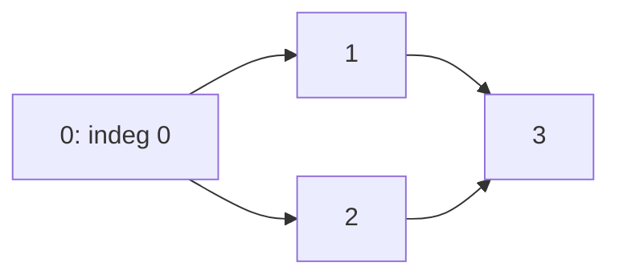

# 12 · Graphs: BFS, DFS, topological sort, union-find

## What you'll learn

- Turning an interview prompt into a graph: explicit edge lists, grids, words, letters.
- **BFS** for fewest-steps questions, including **multi-source BFS**.
- **DFS** for reachability, flood fill and cycle detection (three colours).
- **Topological sort** two ways: Kahn's in-degree queue and reversed DFS post-order.
- **Union-find** with path compression + union by rank, for components and cycle-closing edges.

## Recognize the pattern

| The prompt says… | Reach for |
|---|---|
| "minimum number of steps / moves / transformations", unweighted | BFS |
| "spreads from all X at once", "distance to nearest X" | multi-source BFS |
| "count islands / regions / groups", "can A reach B" | DFS/BFS flood fill or union-find |
| "prerequisites", "dependencies", "build order", "is there a cycle" (directed) | topological sort |
| "edges arrive one by one", "which edge creates a cycle" (undirected) | union-find |
| "can water reach the border" | reverse search from the targets |

## The idea

A graph is nodes plus edges. Grids are graphs too: cell `(r, c)` has edges to its four neighbours.

**BFS** explores in rings of equal distance using a FIFO queue; **DFS** dives down one path using recursion (or a stack) and backs up.

```
        0                BFS from 0:  0 | 1 2 | 3 4      (by distance)
       / \               DFS from 0:  0 1 3 4 2          (deep first)
      1   2
     / \
    3   4
```

**Topological sort (Kahn).** Repeatedly take a node with no incoming edges, emit it, and delete its outgoing edges. If nodes remain that never reach in-degree 0, they are on a cycle.



Queue `[0]` → emit 0, `1` and `2` drop to 0 → emit 1, 2 → `3` drops to 0 → emit 3. Order: `0 1 2 3`.

**Union-find** keeps a forest; each tree is a group whose root is the representative.

```
union(0,1) union(2,3) union(1,3)      find(3) with path compression
    0       2            0                 0
    |       |          /   \             / | \
    1       3         1     2           1  2  3   <- 3 now points straight at the root
                            |
                            3
```

## Go template

```go
// BFS — mark visited when you ENQUEUE, so nothing is queued twice.
dist := make([]int, n)
for i := range dist {
	dist[i] = -1
}
dist[src] = 0
queue := []int{src}
for len(queue) > 0 {
	u := queue[0]
	queue = queue[1:]
	for _, v := range adj[u] {
		if dist[v] == -1 {
			dist[v] = dist[u] + 1
			queue = append(queue, v)
		}
	}
}

// Union-find
func (uf *UnionFind) Find(x int) int {
	if uf.parent[x] != x {
		uf.parent[x] = uf.Find(uf.parent[x]) // path compression
	}
	return uf.parent[x]
}
```

Full versions (iterative DFS, both topological sorts, union by rank) are in [graphs.go](graphs.go).

## Complexity

| Algorithm | Time | Space |
|---|---|---|
| BFS / DFS (adjacency list) | `O(V + E)` | `O(V)` |
| Grid BFS / DFS | `O(m·n)` | `O(m·n)` |
| Topological sort (either) | `O(V + E)` | `O(V)` |
| Union-find, per op | `O(α(n))` amortised ≈ constant | `O(n)` |

## Common pitfalls

- **Marking visited too late.** In BFS, mark when enqueuing. Marking on dequeue lets the same node be queued many times (still correct for plain BFS, but wasteful — and wrong for "rot it now" style counters).
- **`queue = queue[1:]` keeps the backing array alive.** Fine in interviews; for long-lived queues use a ring buffer or reset the slice per level.
- **Directed vs undirected.** `AdjList(n, edges, directed)` — forgetting the reverse edge silently breaks undirected problems. Course-schedule edges point `prereq -> course`.
- **Cycle detection in directed graphs needs three colours.** A plain `visited` flag can't tell a back edge (cycle) from a cross edge to an already-finished node.
- **Recursion depth.** A 1000×1000 all-land grid means a million-deep DFS. Go's stacks grow, so it works, but an iterative BFS is the safer production answer — say so.
- **Grid bounds.** Check `r >= 0 && r < m && c >= 0 && c < n` before indexing; `[4][2]int` direction tables keep it tidy.
- **Mutating the caller's grid.** "Sinking" islands in place is a common trick; copy first, or use a separate `seen` grid, unless the interviewer allows mutation.
- **Union-find without union by rank or compression** degrades to `O(n)` per op on a chain.
- **Map iteration order is random in Go.** If you build adjacency from a map, output order is not deterministic — tests must validate properties (e.g. "is a topological order"), not exact sequences.

## Problems

| # | Problem | Difficulty | Key idea |
|---|---|---|---|
| 01 | [Number of Islands](p01_number_of_islands.go) | Medium | Flood fill each new land cell; or union-find and count groups |
| 02 | [Clone Graph](p02_clone_graph.go) | Medium | Map original → copy doubles as visited; register before recursing |
| 03 | [Rotting Oranges](p03_rotting_oranges.go) | Medium | Multi-source BFS, one level per minute |
| 04 | [Course Schedule I & II](p04_course_schedule.go) | Medium | Topological sort; cycle ⇔ impossible |
| 05 | [Connected Components](p05_connected_components.go) | Medium | Union-find: each successful union removes a group |
| 06 | [Redundant Connection](p06_redundant_connection.go) | Medium | First edge whose endpoints are already connected |
| 07 | [Pacific Atlantic Water Flow](p07_pacific_atlantic.go) | Medium | Climb uphill from both coasts, intersect |
| 08 | [Word Ladder](p08_word_ladder.go) | Hard | BFS on implicit word graph; bidirectional BFS |
| 09 | [Alien Dictionary](p09_alien_dictionary.go) | Hard | Adjacent-word facts → graph → Kahn |

## Practice tip

Hide the solution, keep the signature, and re-solve. Then:

```bash
go test ./course/12-graphs/ -run TestLadderLength -v
```

Most problems ship two implementations plus a randomized cross-check; when you re-solve, make your version pass the `...Random` test too.

## Next

[13 · Shortest paths & MST](../13-shortest-paths-mst/README.md) — when edges have weights, BFS is no longer enough.
