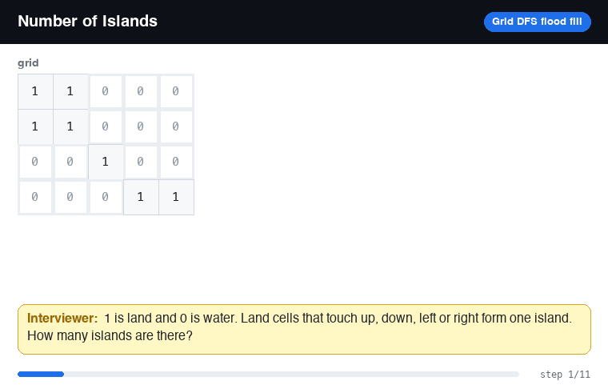

# Walkthrough: Number of Islands

**Module:** [12 · Graphs](../README.md) · **Difficulty:** Medium · **Solution:** [`p01_number_of_islands.go`](../p01_number_of_islands.go)



## The problem in plain words

A grid holds `'1'` for land and `'0'` for water. Land cells that touch up, down, left or right belong to the same island. Count the islands.

```
1 1 0 0 0
1 1 0 0 0     ->  3
0 0 1 0 0
0 0 0 1 1
```

## Mock interview

**Interviewer:** Given a grid of `'1'` and `'0'`, count the islands. Cells only connect horizontally and vertically.

**Candidate:** Do diagonal cells count as touching? Can I modify the grid? And can the grid be empty?

**Interviewer:** No diagonals. Please don't modify the input. An empty grid has 0 islands.

**Candidate:** In the example, the 2×2 block at the top left is one island. The single cell at (2,2) is a second, because it only touches the block diagonally. The pair at (3,3) and (3,4) is the third. So the answer is 3.

**Candidate:** A naive approach explores the full island around every land cell and then dedupes the islands it found. The same island gets explored once for each of its cells, so that's O((m·n)²) in the worst case.

**Interviewer:** How do you avoid exploring an island more than once?

**Candidate:** This is counting connected components in a grid graph. I scan the cells row by row. When I meet land I haven't seen, that's a new island, so I add one and flood-fill it with a DFS that marks every connected land cell as seen. Later, the scan meets those cells again but skips them because they're marked. So each island is counted exactly once, at its first cell in scan order.

**Interviewer:** Why mark a cell when you enter it rather than after exploring its neighbours?

**Candidate:** If I marked it later, two neighbours could each step back into it and the DFS could loop. Marking on entry means the recursive call returns immediately for any cell that's already seen.

**Candidate:** In Go, `NumIslands` makes a `seen [][]bool` so the input isn't changed. The recursive `sink(r, c)` returns if the cell is out of bounds, water, or seen. Otherwise it marks it and calls itself for the four directions in `dirs4`: down, up, right, left. The double loop calls `sink` and increments `islands` for each unseen land cell. There's also `NumIslandsUnionFind`, which merges each land cell with its right and lower land neighbours and returns the group count minus the water cells.

**Candidate:** Testing: (0,0) is unseen land, so islands is 1. The DFS marks (0,0), goes down to (1,0), right to (1,1), up to (0,1). Every other neighbour is water or seen, so it returns. The scan then reaches (0,1), already seen, skip. At (2,2) it finds new land: islands is 2, and the fill marks only that cell. At (3,3), islands is 3, and the fill marks (3,3) and (3,4). The answer is 3.

**Interviewer:** Complexity? And anything you'd worry about on a huge grid?

**Candidate:** Every cell is marked at most once and checks four neighbours, so **O(m·n) time** and **O(m·n) space** for `seen` and the recursion. On a 1000×1000 all-land grid the recursion goes a million calls deep. Go's stacks grow, so it works, but in production I'd use an iterative BFS or the union-find version.

## What the animation shows

| Step | Cell | What happens | Islands |
|---|---|---|---|
| 1 | — | The interviewer shows the grid | — |
| 2 | — | Brute force: explore around every land cell, O((m·n)²) | — |
| 3 | (0,0) | New land: count it, mark it, start the DFS | 1 |
| 4 | (1,0) | DFS steps down and marks it | 1 |
| 5 | (1,1) | DFS steps right and marks it | 1 |
| 6 | (0,1) | DFS steps up and marks it | 1 |
| 7 | — | The DFS returns: island 1 fully marked | 1 |
| 8 | (0,1) | Scan reaches a seen land cell: skip | 1 |
| 9 | (2,2) | New land, a one-cell island | 2 |
| 10 | (3,3) | New land, fill marks (3,3) and (3,4) | 3 |
| 11 | — | Answer 3 and the complexity | 3 |

## Detailed explanation

The scan keeps this invariant: *after processing cell (r, c), every land cell connected to any cell at or before (r, c) in scan order is marked seen.* When the scan meets unseen land, that cell can't be connected to any earlier land cell, or the earlier flood fill would have marked it. So it really is a new island. The flood fill then marks the whole island, which restores the invariant.

The DFS reaches exactly the land cells connected to the start cell, because it only moves between adjacent land cells and tries all four directions from each one.

The union-find version gives the same count another way. It starts with m·n singleton groups, and every union of two adjacent land cells lowers the count by one. Merging only with the right and lower neighbours still covers every adjacent pair once. At the end, each water cell is still its own group, so subtracting the water count leaves the number of islands.

Edge cases:

- Empty grid: both functions return 0 before indexing `grid[0]`.
- All water: no `sink` call ever starts, so the answer is 0.
- Diagonal land, like (1,1) and (2,2): not connected, so it's two islands.

## Complexity

| Approach | Time | Space |
|---|---|---|
| Brute force (explore around every land cell) | O((m·n)²) | O(m·n) |
| DFS flood fill (`NumIslands`) | O(m·n) | O(m·n) |
| Union-find (`NumIslandsUnionFind`) | O(m·n·α(m·n)) | O(m·n) |

## Common mistakes

- Checking `grid[r][c]` before the bounds check, which panics at the edge.
- Marking cells as seen after recursing, which can loop forever.
- Counting diagonal neighbours as connected.
- "Sinking" islands by writing `'0'` into the caller's grid when the interviewer asked you not to modify it.

## Try it yourself

```sh
go test ./course/12-graphs/ -run TestNumIslands -v
```
