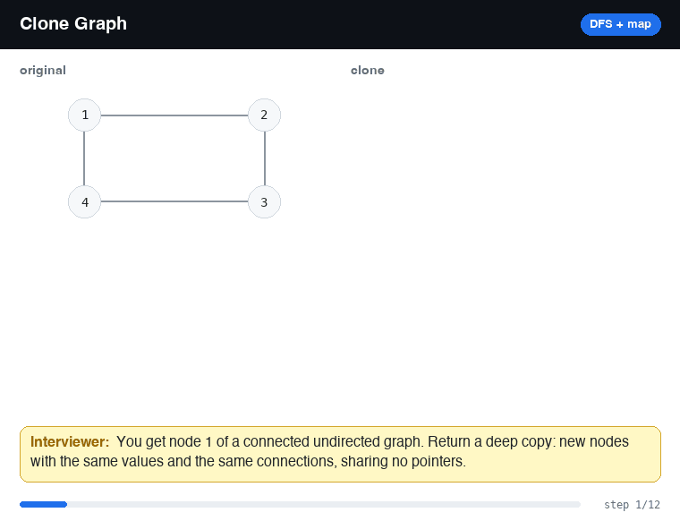

# Walkthrough: Clone Graph

**Module:** [12 · Graphs](../README.md) · **Difficulty:** Medium · **Solution:** [`p02_clone_graph.go`](../p02_clone_graph.go)



## The problem in plain words

You get one node of a connected undirected graph. Each node has a value and a list of neighbours. Build a complete copy: new nodes with the same values and the same connections, sharing no pointers with the original.

```
1 -- 2
|    |      clone(node 1) -> a new 4-cycle 1'-2'-3'-4' made of fresh nodes
4 -- 3
```

## Mock interview

**Interviewer:** Given a reference to node 1, return a deep copy of the graph.

**Candidate:** Is the graph connected, so everything is reachable from the node I get? Can the input be `nil`? Are values unique?

**Interviewer:** Connected, yes. `nil` should return `nil`. Don't rely on values being unique.

**Candidate:** Then I'll key everything by node pointer, not by value. In the example, node 1's neighbours are 2 and 4, node 2's are 1 and 3, and so on. The copy needs four new nodes with those same neighbour lists, pointing only at new nodes.

**Candidate:** The naive idea is "copy this node, then copy each neighbour recursively". On a graph with a cycle that never ends: 1 copies 2, 2 copies 1, 1 copies 2 again. And even without cycles, a node reachable two ways would be copied twice.

**Interviewer:** How do you fix that?

**Candidate:** I keep a map from original node to its copy. Before copying a node, I check the map. If a copy exists, I return it. The map is the visited set and the lookup table at the same time.

The important detail is the order. I create the copy and put it in the map **before** I recurse into the neighbours. Then, when a cycle leads back to a node that's still being built, the map already has its copy, and the recursion stops.

**Interviewer:** What would go wrong if you added to the map after the neighbours?

**Candidate:** Node 1 would start, recurse into 2, and 2 would look for 1 in the map. It wouldn't be there yet, so 2 would start a second copy of 1, and that one would recurse into 2 again. It's the same infinite loop.

**Candidate:** In Go, `CloneGraph` has a `copies map[*GraphNode]*GraphNode` and a recursive closure `clone(n)`. If `copies[n]` exists, return it. Otherwise make `c := &GraphNode{Val: n.Val}`, store `copies[n] = c`, then `append(c.Neighbors, clone(nb))` for each neighbour. `CloneGraphBFS` does the same with a queue: it creates a copy when a node is first discovered and fills in its neighbour list when the node is dequeued.

**Candidate:** Testing: `clone(1)` creates 1' and recurses into 2. `clone(2)` creates 2', then its first neighbour 1 is in the map, so 1' is returned and appended to 2'. Its next neighbour 3 is new: create 3'. 3's neighbour 2 is a map hit. 4 is new: create 4'. 4's neighbours 1 and 3 are both map hits. The recursion unwinds, filling in the remaining lists, and 1's last neighbour 4 is a map hit too. Every original node is copied once.

**Interviewer:** Complexity?

**Candidate:** Each node is created once and each neighbour entry is copied once, so **O(V + E) time**. The map holds V entries, and the recursion can be V deep, so **O(V) space**.

## What the animation shows

The clone panel draws an arrow for each entry in a copy's neighbour list as it gets filled in. An undirected edge shows up as two arrows once both ends have their lists.

| Step | Call | What happens |
|---|---|---|
| 1 | — | The interviewer shows the 4-cycle |
| 2 | — | Naive recursion loops forever on the cycle |
| 3 | `clone(1)` | Create 1', store it in the map |
| 4 | `clone(2)` | Create 2', store it |
| 5 | `clone(1)` from 2 | Map hit: return 1' |
| 6 | `clone(3)` | Create 3', store it |
| 7 | `clone(2)` from 3 | Map hit: return 2' |
| 8 | `clone(4)` | Create 4', store it |
| 9 | `clone(1)` from 4 | Map hit: return 1' |
| 10 | `clone(3)` from 4 | Map hit: return 3' |
| 11 | `clone(4)` from 1 | Map hit: return 4' |
| 12 | — | The clone is a new 4-cycle; complexity |

## Detailed explanation

The map gives two guarantees.

1. **Each original node gets exactly one copy.** A copy is created only when the map has no entry, and it's added to the map in the same step. Every later request returns that same copy.
2. **The recursion ends.** A node is expanded, meaning its neighbours are visited, only on the call that creates its copy. So each node is expanded once, and each neighbour entry is followed once.

Together they mean every edge of the original appears once in each endpoint's copied neighbour list, pointing at the right copy, and no pointer refers back to the original graph.

The BFS version follows the same two rules: create and register on discovery, and wire the neighbour list when dequeued. It avoids deep recursion on long paths.

Edge cases:

- `nil` input returns `nil`.
- A single node with no neighbours returns one new node with an empty list.
- A self-loop (a node listed as its own neighbour) works because the node is already in the map when its own neighbour list is processed.

## Complexity

| Approach | Time | Space |
|---|---|---|
| Naive recursion without a map | doesn't terminate on cycles | — |
| DFS + map (`CloneGraph`) | O(V + E) | O(V) |
| BFS + map (`CloneGraphBFS`) | O(V + E) | O(V) |

## Common mistakes

- Storing the copy in the map after recursing into the neighbours, which loops on cycles.
- Keying the map by value instead of by pointer, which breaks when values repeat.
- Appending an original neighbour instead of its copy, so the clone points back into the original graph.

## Try it yourself

```sh
go test ./course/12-graphs/ -run TestCloneGraph -v
```
