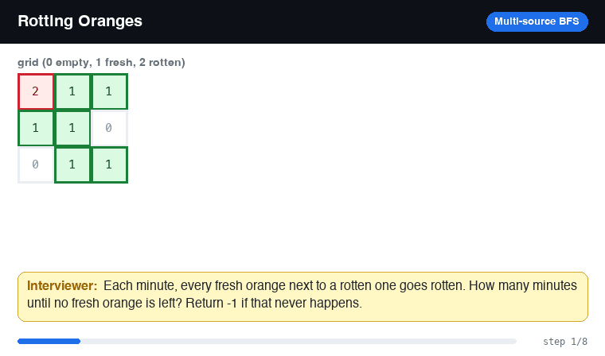

# Walkthrough: Rotting Oranges

**Module:** [12 · Graphs](../README.md) · **Difficulty:** Medium · **Solution:** [`p03_rotting_oranges.go`](../p03_rotting_oranges.go)



## The problem in plain words

A grid holds 0 (empty), 1 (fresh orange) or 2 (rotten orange). Every minute, each fresh orange next to a rotten one (up, down, left, right) turns rotten. Return how many minutes it takes until no fresh orange is left, or -1 if some fresh orange can never be reached.

```
2 1 1
1 1 0   ->  4
0 1 1

2 1 1
0 1 1   ->  -1   (the bottom-left orange is walled off)
1 0 1
```

## Mock interview

**Interviewer:** Return the minutes until every orange is rotten, or -1 if that never happens.

**Candidate:** What if there are no fresh oranges at the start? And can there be several rotten oranges at the start?

**Interviewer:** No fresh oranges means 0 minutes. And yes, any number of rotten oranges.

**Candidate:** In the first example, the rot spreads from the top-left corner. Minute 1 reaches (0,1) and (1,0). Minute 2 reaches (0,2) and (1,1). Minute 3 reaches (2,1). Minute 4 reaches (2,2). So the answer is 4. In the second example, the orange at (2,0) has empty cells on both of its sides, so it never rots: -1.

**Candidate:** The brute force simulates it literally. Each minute, scan the whole grid, find fresh oranges next to rotten ones, then rot them all at once. That rescans everything each minute, and there can be O(m·n) minutes, so it's O((m·n)²). That's `OrangesRottingSimulate`.

**Interviewer:** Can you avoid rescanning?

**Candidate:** The rot spreads like ripples, one ring per minute. That's BFS, where a BFS level is one minute. The key is that several oranges are rotten at the start, so I put **all** of them in the queue at minute 0. This is a multi-source BFS. All the fronts then grow at the same speed, which is exactly what happens in the real process.

**Interviewer:** Why not run a BFS from each rotten orange and take the minimum time per cell?

**Candidate:** That works too, but it's one BFS per source, so it's much slower. One multi-source BFS gives every cell its distance to the nearest rotten orange in a single pass.

**Candidate:** In Go, `OrangesRotting` copies the grid, queues every rotten cell and counts the fresh ones. Then, while the queue is non-empty and fresh is above 0, it builds the next level: for every cell in the queue and each of the four directions, a fresh neighbour is set to 2 right away, `fresh` goes down, and it's appended to `next`. Then `queue = next` and `minutes++`. At the end it returns -1 if `fresh > 0`, otherwise `minutes`.

**Candidate:** Testing on the first example: the queue starts as [(0,0)] with 6 fresh. Minute 1 rots (1,0) and (0,1), 4 fresh left. Minute 2 rots (1,1) and (0,2), 2 left. Minute 3 rots (2,1), 1 left. Minute 4 rots (2,2), 0 left, and the loop stops. The answer is 4.

**Interviewer:** Why does the loop also check `fresh > 0`?

**Candidate:** Without it, the last level would still be processed even though nothing is left to rot, and `minutes` would be one too high. Checking `fresh > 0` stops right after the last orange rots. It also makes a grid with no fresh oranges return 0 straight away.

**Interviewer:** Complexity?

**Candidate:** Each cell joins the queue at most once and checks four neighbours, so **O(m·n) time** and **O(m·n) space** for the queue and the grid copy.

## What the animation shows

Red cells are rotten, green cells are fresh, orange cells rotted during the current minute.

| Step | Minute | Rotted this minute | Fresh left |
|---|---|---|---|
| 1 | — | The interviewer shows the grid | 6 |
| 2 | — | Brute force: rescan every minute, O((m·n)²) | 6 |
| 3 | 0 | Queue = every rotten orange: (0,0) | 6 |
| 4 | 1 | (1,0), (0,1) | 4 |
| 5 | 2 | (1,1), (0,2) | 2 |
| 6 | 3 | (2,1) | 1 |
| 7 | 4 | (2,2) | 0 |
| 8 | — | Answer 4 and the complexity | 0 |

## Detailed explanation

The BFS keeps this invariant: *at the start of round k, the queue holds exactly the oranges that became rotten at minute k − 1 (minute 0 for the starting rotten ones), and every orange that rots by minute k − 1 is already marked 2.* Processing one round rots exactly the fresh oranges next to the current queue, which is what happens in minute k.

Marking a neighbour rotten as soon as it's found, not when it's dequeued, is important here. Two rotten oranges can share a fresh neighbour. If it weren't marked straight away, it would be added to `next` twice and `fresh` would be decremented twice.

If the queue empties while `fresh > 0`, some fresh orange has no path of oranges to any rotten one. No more rounds can reach it, so the answer is -1.

Edge cases:

- No fresh oranges: the loop never runs, return 0.
- Fresh oranges but no rotten ones: the queue starts empty, return -1.
- Empty grid: return 0.

## Complexity

| Approach | Time | Space |
|---|---|---|
| Simulation (`OrangesRottingSimulate`) | O((m·n)²) | O(m·n) |
| Multi-source BFS (`OrangesRotting`) | O(m·n) | O(m·n) |

## Common mistakes

- Running a separate BFS from each rotten orange. The fronts race each other and the code gets slow and complicated.
- Marking an orange rotten only when it's dequeued, which queues it twice and breaks the `fresh` counter.
- Counting one extra minute after the last orange rots.
- Changing the caller's grid. The repo works on a copy.

## Try it yourself

```sh
go test ./course/12-graphs/ -run TestOrangesRotting -v
```
