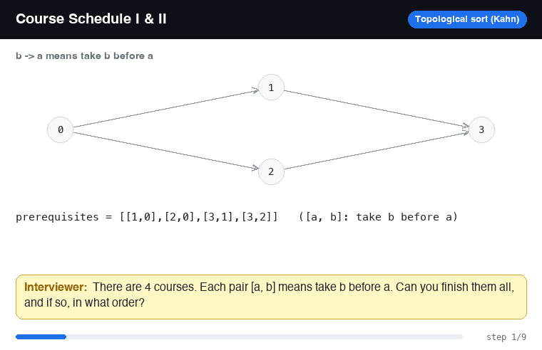

# Walkthrough: Course Schedule I & II

**Module:** [12 · Graphs](../README.md) · **Difficulty:** Medium · **Solution:** [`p04_course_schedule.go`](../p04_course_schedule.go) and [`graphs.go`](../graphs.go)



## The problem in plain words

There are `numCourses` courses, numbered from 0. Each pair `[a, b]` means "take b before a". Part I asks whether you can finish every course. Part II asks for one valid order, or an empty result if there is none.

```
2 courses, [[1,0]]                    -> I: true,  II: [0 1]
2 courses, [[1,0],[0,1]]              -> I: false, II: []    (they require each other)
4 courses, [[1,0],[2,0],[3,1],[3,2]]  -> II: [0 1 2 3] or [0 2 1 3]
```

The animation uses the 4-course example, then shows the 2-course cycle.

## Mock interview

**Interviewer:** Given the number of courses and the prerequisite pairs, can you finish them all? And if so, give me an order.

**Candidate:** If several orders are valid, can I return any of them? Can there be duplicate pairs?

**Interviewer:** Any valid order is fine. Assume no duplicates.

**Candidate:** For 4 courses with `[[1,0],[2,0],[3,1],[3,2]]`, course 0 has no prerequisites, 1 and 2 need 0, and 3 needs both 1 and 2. So 0 first, then 1 and 2 in either order, then 3. For `[[1,0],[0,1]]` each course waits for the other, so it's impossible.

**Candidate:** The brute force tries every ordering of the courses and checks each pair: O(n!·E). Too slow beyond a handful of courses.

**Interviewer:** What structure is hiding here?

**Candidate:** A directed graph. I draw an edge b → a for each pair `[a, b]`. A valid schedule is an order where every edge goes forward, which is a **topological order**. One exists exactly when the graph has no cycle.

I'll use Kahn's algorithm. I count each course's in-degree, the number of prerequisites it still waits for. Every course with in-degree 0 can be taken now, so it goes in a queue. I repeatedly take a course from the queue, add it to the order, and lower the in-degree of each course that depends on it. Any course that reaches 0 joins the queue.

**Interviewer:** How does that tell you about cycles?

**Candidate:** A course on a cycle always waits for another course on the same cycle, so its in-degree never reaches 0 and it's never emitted. So if the order has all n courses, there's no cycle and the order is valid. If it has fewer, the answer to part I is false and part II is empty. One run answers both parts.

**Candidate:** In Go, `prereqGraph` builds the adjacency list with `adj[p[1]] = append(adj[p[1]], p[0])`. `TopoSortKahn` in `graphs.go` counts in-degrees, queues the zeros, and returns `order, len(order) == n`. `CanFinish` returns the `ok`, and `FindOrder` returns the order or `[]int{}` when `ok` is false. `CanFinishDFS` uses the other method: a three-colour DFS that reports a cycle when it reaches a grey node.

**Candidate:** Testing: in-degrees are 0, 1, 1, 2, so the queue is [0]. Take 0: courses 1 and 2 drop to 0 and join. Take 1: course 3 drops to 1. Take 2: course 3 drops to 0 and joins. Take 3. The order is [0 1 2 3], all four courses, so it's possible. For the 2-course cycle, both in-degrees are 1, the queue starts empty, and the order is empty: false, and `FindOrder` returns `[]`.

**Interviewer:** Complexity?

**Candidate:** Building the graph is O(E). Each course is queued once and each edge is decremented once, so **O(V + E) time** and **O(V + E) space** for the adjacency list.

## What the animation shows

The small purple tag on each course is its current in-degree.

| Step | What happens | Queue after | Order |
|---|---|---|---|
| 1 | The interviewer shows the 4-course graph | — | — |
| 2 | Brute force: try every ordering | — | — |
| 3 | In-degrees 0, 1, 1, 2; only course 0 is ready | [0] | [] |
| 4 | Take 0: courses 1 and 2 drop to 0 | [1 2] | [0] |
| 5 | Take 1: course 3 drops to 1 | [2] | [0 1] |
| 6 | Take 2: course 3 drops to 0 | [3] | [0 1 2] |
| 7 | Take 3: nothing left to unlock | [] | [0 1 2 3] |
| 8 | Second example `[[1,0],[0,1]]`: no in-degree 0, order is empty | [] | [] |
| 9 | All 4 courses emitted: `CanFinish` true, `FindOrder` [0 1 2 3] | — | [0 1 2 3] |

## Detailed explanation

Kahn's algorithm keeps this invariant: *a course is added to the order only after all of its prerequisites are already in the order.* A course enters the queue only when its in-degree reaches 0, which means every course with an edge into it has been emitted. So every emitted order is valid.

Why does it emit everything when there's no cycle? In any non-empty set of remaining courses without a cycle, at least one course has no remaining prerequisites: follow prerequisite edges backwards and, with no cycle, you must stop at such a course. So the queue can only run dry when every remaining course is on or behind a cycle.

The three-colour DFS reaches the same answer from the other side. White means unvisited, grey means on the current path, black means finished. Reaching a grey node means an edge goes back into the current path, which is a cycle. The reversed post-order is a topological order.

Edge cases:

- No prerequisites: every course has in-degree 0, so any order works and Kahn emits 0, 1, 2, ...
- A self-loop `[a, a]`: course a has in-degree 1 from itself and is never freed, so the answer is false.
- `numCourses = 0`: the order is empty and `ok` is true.

## Complexity

| Approach | Time | Space |
|---|---|---|
| Brute force (every ordering) | O(n! · E) | O(n) |
| Kahn (`CanFinish`, `FindOrder` via `TopoSortKahn`) | O(V + E) | O(V + E) |
| Three-colour DFS (`CanFinishDFS` via `TopoSortDFS`) | O(V + E) | O(V + E) |

## Common mistakes

- Drawing the edge the wrong way. `[a, b]` means b before a, so the edge is b → a.
- Detecting cycles in a directed graph with a single `visited` flag. It can't tell a back edge from a cross edge; use in-degrees or three colours.
- Returning `nil` from `FindOrder` for an impossible schedule when the caller expects an empty, non-nil slice.

## Try it yourself

```sh
go test ./course/12-graphs/ -run TestCourseSchedule -v
```
