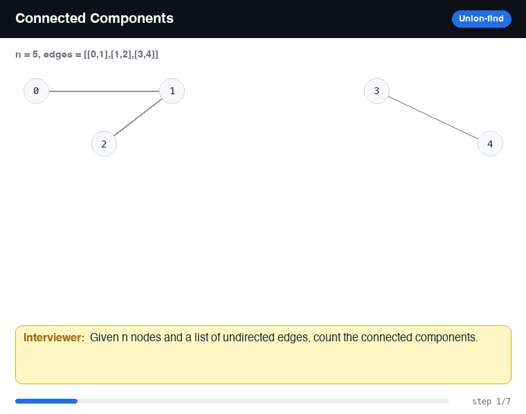

# Walkthrough: Connected Components

**Module:** [12 · Graphs](../README.md) · **Difficulty:** Medium · **Solution:** [`p05_connected_components.go`](../p05_connected_components.go) and [`graphs.go`](../graphs.go)



## The problem in plain words

You have `n` nodes numbered 0 to n−1 and a list of undirected edges. Count the connected components: the groups of nodes that can reach each other.

```
n = 5, edges = [[0,1],[1,2],[3,4]]        ->  2   ({0,1,2} and {3,4})
n = 5, edges = [[0,1],[1,2],[2,3],[3,4]]  ->  1
```

## Mock interview

**Interviewer:** Count the connected components of an undirected graph given as n and an edge list.

**Candidate:** Can there be isolated nodes with no edges? Duplicate edges? Self-loops?

**Interviewer:** Isolated nodes, yes, each is its own component. Assume the edge list is otherwise clean, but don't break on a duplicate.

**Candidate:** In the first example, 0-1 and 1-2 join {0, 1, 2}, and 3-4 joins {3, 4}. That's 2 components. If 2-3 is added, everything joins into 1.

**Candidate:** A naive way is to run a BFS from every node, collect the set it reaches, and count distinct sets. That's O(V·(V + E)).

**Interviewer:** Can you do it in one pass?

**Candidate:** Two good answers. A DFS from each unvisited node, counting how many DFS runs start, is O(V + E). That's `CountComponentsDFS`.

The other is union-find, which is what I'll show. Start with n groups, one per node, so the count is n. For each edge, find the root of each endpoint. If the roots differ, merge the groups and lower the count by one. If they're the same, the edge adds nothing. At the end, the count is the answer. It's useful when edges arrive one at a time and you need the count after each.

**Interviewer:** Why does each successful union lower the count by exactly one?

**Candidate:** Union only merges when the two roots differ, so it turns two separate groups into one. That's one group fewer. An edge inside a group doesn't merge anything and doesn't change the count. So the count always equals the number of groups.

**Candidate:** In Go, `CountComponents` creates `NewUnionFind(n)`, calls `uf.Union(e[0], e[1])` for each edge, and returns `uf.Count()`. `UnionFind` in `graphs.go` has `parent`, `rank` and `count`. `Find` uses path compression: it points every node on the way straight at the root. `Union` uses union by rank: the root of the shorter tree goes under the root of the taller one. On a tie, the second root goes under the first, and the first root's rank grows.

**Candidate:** Testing: count starts at 5. Edge 0-1: roots 0 and 1, equal ranks, so 1 goes under 0, rank of 0 becomes 1, count 4. Edge 1-2: find(1) is 0, find(2) is 2. Rank 1 beats rank 0, so 2 goes under 0, count 3. Edge 3-4: 4 goes under 3, count 2. Roots 0 and 3 remain, so the answer is 2.

**Interviewer:** Complexity?

**Candidate:** With path compression and union by rank, each operation costs amortised O(α(n)), the inverse Ackermann function, which is at most 4 or so in practice. So **O(n + E·α(n)) time**, about linear, and **O(n) space** for `parent` and `rank`.

## What the animation shows

The left panel shows the edges added so far. The right panel shows the union-find forest: each arrow points from a node to its parent, and green nodes are roots. A tag like `r1` is a root's rank.

| Step | Edge | find results | What happens | Count |
|---|---|---|---|---|
| 1 | — | — | The interviewer shows the graph | — |
| 2 | — | — | Brute force: BFS from every node | — |
| 3 | — | — | Every node is its own root | 5 |
| 4 | 0-1 | 0, 1 | Equal ranks: 1 under 0, rank of 0 becomes 1 | 4 |
| 5 | 1-2 | 0, 2 | 2 under 0 (lower rank) | 3 |
| 6 | 3-4 | 3, 4 | Equal ranks: 4 under 3 | 2 |
| 7 | — | — | Roots 0 and 3 remain: answer 2 | 2 |

## Detailed explanation

Union-find stores each group as a tree, and the root of the tree names the group. Two nodes are in the same group if and only if `Find` returns the same root for both. The invariant is: *`count` equals the number of trees, and two nodes share a tree exactly when the edges processed so far connect them.*

- Initially there are n one-node trees and no edges, so the invariant holds.
- Processing edge (a, b) either finds both in the same tree, where nothing changes, or links one root under the other, which merges two trees into one and lowers `count` by one.

The two speed-ups keep the trees flat. Union by rank keeps the height at O(log n) by never putting a taller tree under a shorter one. Path compression flattens the path every time `Find` walks it. Together they give the near-constant amortised cost.

Edge cases:

- No edges: the answer is n.
- A duplicate edge or an edge inside an existing group: `Union` returns false and the count doesn't change.
- `n = 0`: the count is 0.

## Complexity

| Approach | Time | Space |
|---|---|---|
| Brute force (BFS from every node) | O(V · (V + E)) | O(V + E) |
| DFS (`CountComponentsDFS`) | O(V + E) | O(V + E) |
| Union-find (`CountComponents`) | O(V + E·α(V)) | O(V) |

## Common mistakes

- Comparing `parent[a] == parent[b]` instead of `Find(a) == Find(b)`. Parents aren't roots.
- Decrementing the count on every edge, including edges inside a group.
- Leaving out both union by rank and path compression, which lets the trees become long chains with O(n) finds.

## Try it yourself

```sh
go test ./course/12-graphs/ -run TestCountComponents -v
```
