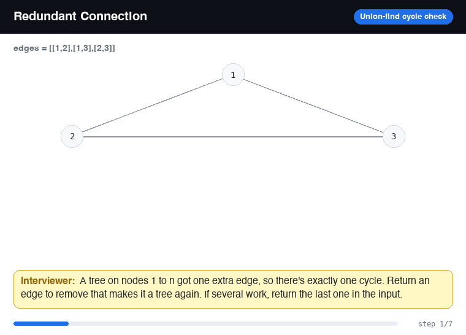

# Walkthrough: Redundant Connection

**Module:** [12 · Graphs](../README.md) · **Difficulty:** Medium · **Solution:** [`p06_redundant_connection.go`](../p06_redundant_connection.go) and [`graphs.go`](../graphs.go)



## The problem in plain words

A tree on nodes 1 to n had one extra edge added, so the graph now has exactly one cycle. The edges come in order. Return an edge you can remove to get a tree back. If several edges work, return the one that appears last in the input.

```
[[1,2],[1,3],[2,3]]              ->  [2 3]
[[1,2],[2,3],[3,4],[1,4],[1,5]]  ->  [1 4]
```

## Mock interview

**Interviewer:** Find the redundant edge. If there's more than one choice, return the last one in the list.

**Candidate:** So there are n nodes and exactly n edges, the graph is connected, and there's exactly one cycle?

**Interviewer:** Yes.

**Candidate:** In the first example, the edges 1-2, 1-3 and 2-3 form a triangle. Removing any of them leaves a tree, so I return the last one, [2, 3]. In the second example, the cycle is 1-2-3-4-1. Edge 1-5 isn't on it. The last cycle edge in the input is [1, 4].

**Candidate:** The brute force tries removing each edge from last to first and checks with a BFS whether the rest is still connected. A connected graph with n − 1 edges on n nodes is a tree. That's n BFS runs of O(n) each, so O(n²). It's `FindRedundantConnectionBrute`.

**Interviewer:** Can you find it in one pass?

**Candidate:** Yes, with union-find. I add the edges one by one. If an edge's two endpoints are already connected, that edge closes a cycle, so I return it. Otherwise I union the two groups and continue.

**Interviewer:** Why is the first edge that closes the cycle also the last cycle edge in the input?

**Candidate:** Before that edge, the processed edges form a forest, with no cycle. The edge closes a cycle, so all the other edges of that cycle were processed earlier. There's only one cycle in the graph, so every other cycle edge appears before this one in the input. That makes it the last one, which is exactly what the problem asks for.

**Candidate:** In Go, `FindRedundantConnection` makes `NewUnionFind(len(edges) + 1)` because nodes are 1-based and n equals the number of edges. For each edge it calls `uf.Union(e[0], e[1])`. `Union` returns false when the roots are already equal, and that's when I return `e`.

**Candidate:** Testing: edge [1,2], roots 1 and 2 differ, union. Edge [1,3], roots 1 and 3 differ, union. Edge [2,3]: find(2) is 1 and find(3) is 1. Same root, so [2,3] closes the cycle. Return [2,3].

**Interviewer:** Complexity?

**Candidate:** n unions with path compression and union by rank: **O(n·α(n)) time**, effectively linear, and **O(n) space**.

## What the animation shows

| Step | Edge | find results | What happens |
|---|---|---|---|
| 1 | — | — | The interviewer shows the triangle |
| 2 | — | — | Brute force: remove each edge and BFS, O(n²) |
| 3 | — | — | Every node is its own group |
| 4 | [1,2] | 1, 2 | Different roots: union |
| 5 | [1,3] | 1, 3 | Different roots: union |
| 6 | [2,3] | 1, 1 | Same root: this edge closes the cycle |
| 7 | — | — | Answer [2,3] and the complexity |

## Detailed explanation

The invariant while scanning is: *the edges processed so far form a forest, and union-find's groups are exactly that forest's trees.* As long as each new edge joins two different trees, adding it keeps a forest. The first edge whose endpoints are in the same tree would create a cycle, because a path between them already exists inside that tree.

Since the input has exactly one cycle, the cycle's edges are that path plus the closing edge. All path edges came earlier in the input, so the closing edge is the last cycle edge. Removing it leaves n − 1 edges that connect all n nodes: a tree.

`Union` doing the check and the merge in one call is convenient: its `bool` result is exactly "were these two in different groups?".

Edge cases:

- The cycle edge appears last in the whole input: still found on the last iteration.
- Nodes are 1-based, so index 0 of `parent` is unused. Sizing the union-find to `len(edges) + 1` avoids an off-by-one.

## Complexity

| Approach | Time | Space |
|---|---|---|
| Brute force (`FindRedundantConnectionBrute`) | O(n²) | O(n) |
| Union-find (`FindRedundantConnection`) | O(n·α(n)) | O(n) |

## Common mistakes

- Sizing the union-find as `len(edges)` with 1-based nodes, which indexes out of range for node n.
- Returning the first edge of the cycle instead of the edge that closes it.
- Using this approach on the directed version of the problem (Redundant Connection II), where a node with two parents needs separate handling.

## Try it yourself

```sh
go test ./course/12-graphs/ -run TestFindRedundantConnection -v
```
